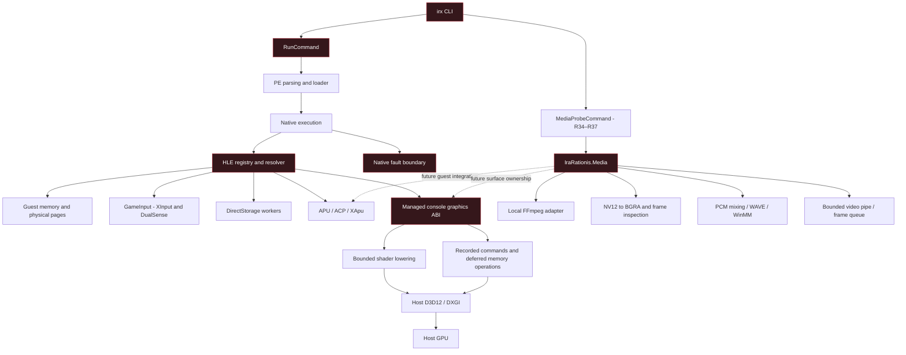
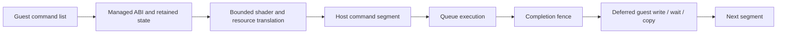
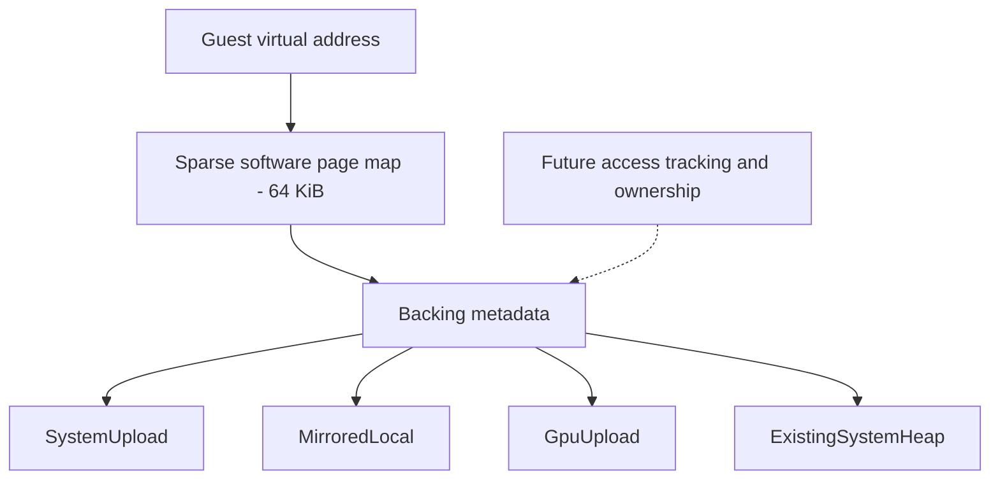
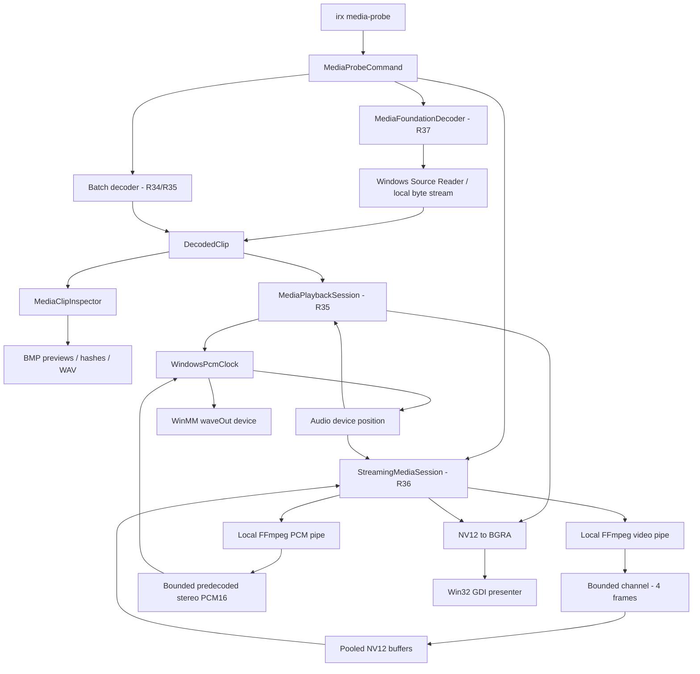
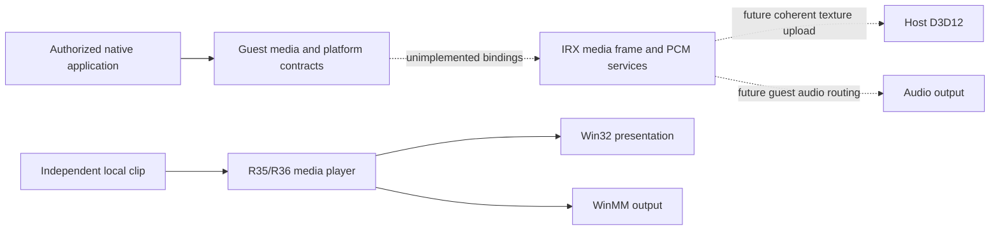
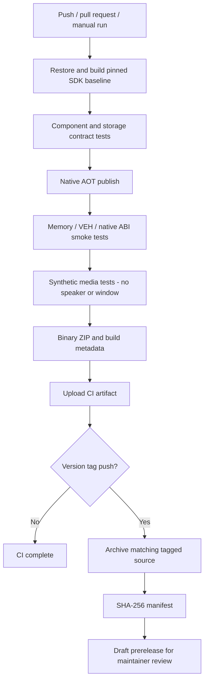

<div align="center">
  
  <h1>IRA RATIONIS</h1>
  <h3>PROJECT VINDEX · v0.1.0</h3>
  <p><i>The Wrath of Reason</i><br />
  <b>Nullius in verba · Non impone opinionem</b></p>
  <p><b>Defiance through competence.</b></p>
  <p>
    
    
    
  </p>
  <p>
    
    
    
    
    <a href="https://github.com/DBWilliamEngineering/IraRationis/actions/workflows/build.yml"></a>
  </p>
  <p><b>First Light R37 · In-process media decoding and Windows distribution</b><br />
  Windows x64 · C# / selected native C++ · <code>irx.exe</code><br />
  GPL-covered runtime · separately designated proprietary material<br />
  Updated November 25, 2026</p>
  <p><a href="#first-light-current-progress">Progress</a> · <a href="#architecture">Architecture</a> · <a href="#build-and-validate">Build &amp; validate</a> · <a href="#continuous-integration-and-releases">Releases</a> · <a href="#development-history">History</a> · <a href="#intellectual-property-licensing-and-attribution">Licensing</a></p>
</div>

---

Independent systems engineering research into native x86-64 console compatibility on Windows. Ira Rationis (IRX) develops a managed-first runtime spanning native ABI translation, GPU command execution, virtual memory, input, storage and media processing. It is an experimental compatibility runtime, not a complete console emulator, security sandbox or official SDK.

## Project Identity and Architectural Direction

Ira Rationis (IRX) is an independently evolving, managed-first compatibility runtime designed to research and implement native Xbox Series X|S executable compatibility on Windows x64.

IRX is not intended to be a direct language port, a title-specific launcher, or a simple wrapper around an existing compatibility implementation.

The project pursues its own architectural direction, leveraging modern C#, .NET Native AOT, compile-time source generation, unmanaged interoperability, and selective C++ implementation where platform requirements justify its use.

While the project incorporates attributed upstream work, its architectural direction, subsystem design, development methodology, and ongoing implementation extend beyond that foundation.

### Engineering Philosophy

- Correctness before compatibility claims.
- Native execution wherever architectural and platform compatibility permits.
- Managed-first systems engineering without unnecessary native boundaries.
- Explicit memory ownership and resource lifecycle management.
- Compile-time generation over runtime reflection where appropriate.
- Contract-driven subsystem validation.
- Performance improvements supported by instrumentation and measurable evidence.
- Long-term architectural maintainability over title-specific workarounds.

The objective is not merely to execute a particular title. It is to develop a robust, extensible compatibility architecture capable of supporting increasingly complex native workloads.

For further information, see [Architectural Divergence](docs/ARCHITECTURAL-DIVERGENCE.md) | [Architecture and Research](docs/ARCHITECTURE.md) | [Architecture Atlas](docs/ARCHITECTURE-ATLAS.md).

## Release designations

| Version | Codename | State |
| --- | --- | --- |
| 0.1 | Vindex | Current development |
| 0.2 | Abaddon | Reserved |
| 0.3 | Apollyon | Reserved |
| 0.4 | Prometheus | Reserved |
| 1.0 | Invictus | Reserved |

The centered identity header is the release-level source of truth. Update the release designation, milestone and verified capabilities at each major release. Reserved names are not delivery commitments.

## First Light: current progress

> **Native execution, recognizable UI rendering and guest-consumed controller input have been observed.** Startup logo, intro video, guest audio output, account workflow completion and the main menu remain unresolved. R34–R35 established an independently working Windows media path. R36 bounded streamed video is maintainer-verified; R37 adds a separate in-process Windows decoder. Neither connects the guest's playback or account services.

The evidence below is maintainer-reported from local R30–R36 execution logs unless indicated otherwise. These observations are not proof of compatibility across other titles, hardware or builds. No game-derived binaries or captures are included in this repository update.

| Milestone | State | Evidence / boundary |
| --- | --- | --- |
| Native executable entry | Observed | Loaded image and dependencies enter native code. |
| Static imports | Observed | 924 resolved slots, zero missing in the R31 audit of five images. This does not establish ABI or behavioral parity. |
| Original UI pixels | Observed | Recognizable interface text and geometry rendered through translated draw paths. |
| Host presentation | Observed | Native D3D12/DXGI presentation; sampled final composition fingerprints match their intermediate inputs. |
| Controller input | Observed | Wired DualSense press/release events retrieved through the guest GameInput ABI. |
| Storage | Observed | R32 strict length checks, successful sampled reads and decompression/status markers; no reported request failures in the submitted run. |
| Independent media decoding | Observed | R34 Windows CLI: 60 decoded frames, 60 unique fingerprints, 192,000 interleaved PCM16 samples at 48 kHz stereo. |
| Media CLI integration | Observed | R34 published CLI executed the media command and completed the synchronous audio API call. |
| Independent live A/V | Observed | R35 original Vindex clip: 60 frames presented, 0 skipped, 25 distinct image fingerprints, cancellation false, audio clock 2.000 s; visible logo screenshot supplied. Audible output not separately confirmed. |
| Bounded video streaming | Observed | R36: 60 decoded and presented frames, 0 skipped, 4-frame queue, 2.000 s audio clock; not a long-duration benchmark. |
| In-process media decoding | Implemented, unverified | R37 Windows Media Foundation backend: local bounded MP4, NV12 and 48 kHz stereo PCM16; Windows build and acceptance pending. |
| Startup logo / video | Outstanding | Black startup surfaces observed; decoded guest frame delivery not established. |
| Guest audio | Outstanding | APU/SHAPE/ACP initialization observed; XMA, full DSP and actual output missing or unverified. |
| Frontend / main menu | Outstanding | Input reaches the guest but account workflow does not progress in the supplied run. |
| Gameplay | Not demonstrated | No claim of playable game compatibility. |

Progress is reported by evidence rather than a speculative percentage. There is no claimed overall title completion score or external tracker rating.

### Performance evidence

| Revision | Observed behavior |
| --- | --- |
| R24–R27 | Sub-1 presentation/s during early UI experiments; CPU exception overhead and serialized submission identified. |
| R28 | Mean about 16.4 presentations/s after experimental CLZERO batching. |
| R29 | Mean about 19.7 presentations/s; sampled peak 21.44/s. One sparse upload case copied 37,354 bytes into an allocation of 1,161,472 bytes (about 96.8% fewer copied bytes). |
| R30 | Approximately 17–20 presentations/s in the supplied controller run. |
| R31 | Bounded full-surface readbacks reduced throughput during capture; disable them for normal performance measurements. |

These are development-run presentation rates, not measured gameplay FPS, and not controlled cross-revision benchmarks. The target remains sustained correct 30 FPS and eventually 60+ FPS on suitable hardware. Correctness takes precedence over presentation rate.

## Architecture, Research & Engineering Evidence

Ira Rationis maintains detailed technical documentation
covering its independently evolving architecture,
implementation strategy, performance research,
and upstream relationships.

| Documentation | Description |
|---|---|
| [Architecture Atlas](docs/IRX-ARCHITECTURE-ATLAS.md) | Detailed architecture, 41 technical diagrams, performance evidence and subsystem relationships |
| [Architectural Divergence](docs/ARCHITECTURAL-DIVERGENCE.md) | Architectural identity and upstream relationships |
| [Architecture and Research](docs/ARCHITECTURE.md) | Technical research and implementation notes |
| [Implementation Provenance](docs/PROVENANCE.md) | Component-level attribution and source lineage |
| [Development History](https://github.com/DBWilliamEngineering/IraRationis/commits/main/) | Engineering evolution and implementation history |

IRX distinguishes source implementation, contract
validation, subsystem execution, integrated compatibility,
and measured performance.

Architectural progress is documented through reproducible
evidence rather than speculative completion percentages.

## Architecture



Solid edges indicate implemented architectural paths, not complete interface coverage. Dotted edges indicate planned integration. The CLI media probe is deliberately independent of native guest execution; normal `irx run` does not call it. See [architecture notes](docs/architecture.md) for the original research diagrams and historical design rationale.

### Solution organization

| Project | Responsibility |
| --- | --- |
| `IraRationis.Cli` | Command routing, executable selection, launch and diagnostic probes |
| `IraRationis.Core` | Shared configuration and runtime models |
| `IraRationis.PE` / `IraRationis.Loader` | PE inspection, preparation, import binding, TLS and execution |
| `IraRationis.HLE` | Managed ABI exports for platform, memory, storage, audio and input |
| `IraRationis.Graphics` / `IraRationis.Shaders` | Graphics ABI, shader inspection and bounded lowering, host graphics execution |
| `IraRationis.Memory` | Memory strategy and virtual unified memory research |
| `IraRationis.Game` / `IraRationis.Pipeline` | Game-format and pipeline research utilities |
| `IraRationis.Media` | Independent local media decoding, conversion, inspection and PCM output |
| `IraRationis.Generators` | Compile-time ABI code generation |
| `IraRationis.Native` | Native exception boundary and independent C++ probes |
| `IraRationis.Runtime.Tests` | Runtime ABI regression tests |
| `tests/storage-contract` | Synthetic storage payload contract checks |
| `tests/media-baseline` | Synthetic media fixture and primitive regression tests |

### Managed-first graphics boundary

The production `D3D12XboxCreateDevice` export resolves directly to the C# console graphics implementation. Host calls cross typed unmanaged COM boundaries. The original C++ graphics bridge is historical, not the production device implementation. The native DLL is retained for CPU fault context handling and independent diagnostic workloads; adding native code is justified by platform or correctness requirements rather than preference.



R10–R23 established executable host shader families, indexed input, texture sampling, bounded compute and native presentation. R24–R29 reduced overhead through fence reuse, timing instrumentation, narrowed vertex reads and sparse uploads, while retaining the conservative command-memory ordering. This is not a general RDNA2 compiler or a complete asynchronous GPU scheduler. Resource allocation, host visibility and correct content are separate milestones; successful PSO creation or fence completion does not establish semantic parity.

### Virtual unified memory (VUM)



VUM investigates explicit software address translation and comparative CPU/GPU backing strategies. The memory probe uses buffer writes and GPU checksums to compare mapped system upload, staged GPU-local, CPU-visible VRAM and eligible existing system heaps. VUM is an isolated research architecture, not a complete production residency manager or an interception mechanism for arbitrary native CPU writes. No zero-copy gameplay claim is made.

### Input and storage

The controller backend preserves XInput and keyboard fallback and adds wired DualSense HID report processing, normalization, dead zones and reconnect attempts. R30 demonstrated guest readings of actual button presses and releases. Bluetooth, haptics and full reading callback semantics remain incomplete.

DirectStorage uses per-queue ordered workers with raw reads and Zlib decompression. R32 added opt-in strict payload length checks and sampled request/status accounting. BCPack and weighted shared scheduling are not yet implemented. Success reports do not independently verify every byte's semantic interpretation by the guest.

### Media architecture: R34–R37



The existing `--play` path uses a bounded batch decoder, exports inspection artifacts and displays video in a native window synchronized to `waveOut` device position. R35 was observed presenting every frame of the original two-second Vindex fixture. The R36 `--stream` path decodes video progressively into a bounded four-frame channel, applies producer backpressure, rents frame memory from `ArrayPool<byte>`, and schedules the most recent due frame from the same audio clock. It does not write temporary raw video files. Audio is still predecoded (48 kHz stereo PCM16, up to 30 seconds) and submitted as one buffer. Fixed output: 640×360 NV12 at 30 FPS; clips with a different aspect ratio are currently rescaled to this extent. The queue capacity is not a measurement of total process memory: the producer, consumer and FFmpeg can retain additional bounded buffers or codec state. The R35/R36 FFmpeg paths require a trusted external decoder. R37 optionally uses the Windows Media Foundation Source Reader in-process, with direct COM ABI dispatch and deterministic interface release. It opens a local MP4 byte stream, selects native NV12 and PCM16 outputs, verifies format and timeline bounds, and reuses the R35 playback contract. It currently supports 30 FPS, at most 150 frames, up to 1080p with a 128 MiB decoded-video limit and up to five seconds of 48 kHz stereo audio. The decoder is synchronous and batch-buffered, with no cancellation timeout; Windows codecs must be installed. Color interpretation retains the existing BT.709 limited-range conversion assumption. The path checks are not a filesystem sandbox. Windows compilation and codec negotiation are not yet verified. No D3D12 video presenter, WASAPI streaming, variable timestamps, guest Bink or XMA integration is claimed.

### Startup integration boundary



The independent player is not invoked during normal guest execution. It does not replace an application's logo, simulate account success or establish guest video/audio playback. Integration depends on correct, documented decoder, graphics, audio and legitimate platform service contracts.

## Build and validate

Requirements: Windows x64, the .NET SDK specified in `global.json`, Visual Studio C++ build tools required by the existing native bridge build, and a compatible Direct3D 12 driver for graphics probes. FFmpeg is required for the existing FFmpeg-based media tests and streaming path, not ordinary runtime commands or R37 Media Foundation playback. Windows Media Foundation and compatible codecs are required for `--mf`.

```powershell
dotnet restore IraRationis.slnx
dotnet build IraRationis.slnx -c Release
dotnet publish IraRationis.Cli -c Release -r win-x64 -o artifacts/native-r37
.\artifacts\native-r37\irx.exe --help
```

R34, R35 and R36 were successfully exercised by the maintainer on Windows. R37 compilation and Windows playback remain unverified. Local playback is not a substitute for a green CI run.

### Standalone media validation (no guest executable required)

```powershell
$ffmpeg = (Get-Command ffmpeg.exe -ErrorAction Stop).Source
$clip = (Resolve-Path .\tests\media-baseline\fixture.mp4).Path

# R35 batch playback baseline
& .\artifacts\native-r37\irx.exe media-probe $ffmpeg $clip --play

# R36 progressive video path (no raw video files)
$intro = (Resolve-Path .\tests\media-baseline\vindex-intro.mp4).Path
& .\artifacts\native-r37\irx.exe media-probe $ffmpeg $intro --stream

# R37 in-process Windows decoder (no FFmpeg needed)
& .\artifacts\native-r37\irx.exe media-probe --mf $intro --play

# Independent primitive and fixture regression checks
dotnet run --project tests/media-baseline/MediaBaseline.csproj -c Release -- $ffmpeg $clip

# Storage contract regression checks
dotnet run --project tests/storage-contract/StorageContract.csproj -c Release
```

Expected fixture observations: 60 decoded video frames, 60 distinct frame hashes, 192,000 interleaved PCM samples (96,000 stereo sample frames), 48 kHz and a nonzero audio peak. The CLI prints `IRX-R34` and the output directory under `artifacts/media-probe/`; the test application uses `artifacts/media-baseline/`. Each run creates a unique directory containing up to three BMP previews and `media-output.wav`. Omit the playback flag to decode and export without speaker output. The R36 `--stream` mode reports `IRX-R36`, decoded/presented/skipped frame counts and audio position; the Vindex fixture is expected to decode 60 frames, with approximately 2.0 seconds of audio (AAC padding may slightly increase PCM length); it does not export inspection artifacts. Static or silent clips are valid for the general CLI; the synthetic fixture test explicitly requires motion and sound.

Other independent commands:

```powershell
.\artifacts\native-r37\irx.exe graphics-probe
.\artifacts\native-r37\irx.exe veh-probe
.\artifacts\native-r37\irx.exe present-probe --seconds 5 --fps 60
.\artifacts\native-r37\irx.exe memory-probe --self-test
```

For supported runtime options, use `irx --help`. Native title execution is experimental and unsandboxed. Use only trusted executables and dependencies for which you have authorization; do not bypass licensing, authentication or entitlement requirements.

## Continuous integration and releases

The [Windows x64 Native AOT workflow](.github/workflows/build.yml) validates the solution on pushes, pull requests and manual runs. Pushes of `v*` tags also prepare a draft prerelease, only if the entire validation job passes. Ordinary CI has read-only repository permissions; release creation has a separate, tag-only job with `contents: write`.



**Most recent inspected historical run:** [45712840752](https://github.com/DBWilliamEngineering/IraRationis/actions/runs/45712840752) passed compilation, Native AOT publish and initial component probes. Its native entry test returned the expected sentinel `42` and printed its success message, but the Actions step failed. R36 explicitly returns `0` from all three PowerShell native test scripts after successful assertions and cleanup. Unexpected exit codes still throw. This corrects the likely exit-status propagation issue; a new CI run is required to confirm the fix and expose any subsequent failures. No test is marked `continue-on-error`.

The subsequent [run 45715465397](https://github.com/DBWilliamEngineering/IraRationis/actions/runs/45715465397) failed at restore with MSB4126: MSVC setup exported `Platform=x64`, but the solution expects `Any CPU`. R37 normalizes that MSBuild environment and explicitly selects Release/Any CPU for solution restore/build, retaining `win-x64` Native AOT publication. A new run must confirm the correction.

CI adds the independent R32 storage regression and R34 media decoding/primitive tests, including a noninteractive published-CLI probe. It does not open a video window, require physical controllers or assert that sound was audible. R35/R36/R37 live playback remains a local Windows acceptance check. The Media Foundation headless test is available via manual workflow dispatch with `test_native_media` enabled because hosted runners may not include the required codecs.

### Download and run without compiling

Successful CI runs upload `irx-win-x64-unpacked` (the published executable, native bridge and support files) alongside the release ZIP artifact. Published GitHub releases provide `irx-win-x64.zip`. Extract all files together; `irx-native.dll` must remain beside `irx.exe`. The runtime is self-contained and does not need the .NET SDK. The package includes a quick-start guide and the original Vindex media fixture. No FFmpeg binary or commercial game files are bundled.

### Creating a release

After the intended commit passes CI, select a new version tag. For example, for this experimental milestone:

```powershell
git tag -a v0.1.0-r37 -m "Vindex / First Light R37"
git push origin v0.1.0-r37
```

The workflow prepares `irx-win-x64.zip`, `irx-source.zip` (the exact tagged source) and `SHA256SUMS.txt`. Review the draft under GitHub Releases before publishing. The release job does not publish automatically, modify an existing release, create game assets, or bundle FFmpeg. Binary archives include the project license and notices; review third-party dependency obligations and the corresponding source archive before distribution. See [release procedure](docs/RELEASING.md) for the complete checklist. If repository content is intended to remain restricted, confirm repository visibility before pushing or releasing it.

## Development history

| Revision | Scope |
| --- | --- |
| R3–R5 | Typed command-list close, presentation ingress and addressable fence synchronization |
| R6–R8 | APU heap and SHAPE context memory, ACP control interface, managed XApu Opus decoding |
| R9–R13 | First-draw evidence, bounded shader lowering, host pipeline and vertex-fetch execution |
| R14–R17 | Rectangle and textured draw execution, physical aliases, compute/LUT and descriptor handling |
| R18–R19 | Diagnostic preview, native swap chain and window sizing |
| R20–R23 | Indexed draws, PSO cache, color and array transform families |
| R24–R27 | Fence pooling, stage timings, pooled snapshots, narrowed vertex reads, CPU thread/resource telemetry |
| R28–R29 | Experimental CLZERO batching and sparse indexed host uploads |
| R30 | Native wired DualSense support and guest input telemetry |
| R31 | Input-correlated intermediate and presented pixel fingerprinting |
| R32 | Strict storage payload validation and request/status telemetry |
| R33 | Independent media library and synthetic fixture |
| R34 | Solution registration, CLI integration, shared inspection implementation and documentation |
| R35 | Native live A/V, audio-clock frame scheduling and original Vindex fixture |
| R36 | Progressive video decode, bounded frame channel, pooled buffers, PCM pipe, release identity, native test exit handling and gated draft release workflow |
| R37 | In-process Windows Media Foundation decoder, CLI backend selection, solution platform normalization, unpacked distribution and quick-start package |

## Remaining engineering milestones

1. Validate R37 in-process decoding and playback, preserving the verified R35/R36 baselines.
2. Establish documented video surface ownership, layout and synchronization using authorized synthetic GPU workloads.
3. Extend shader and pipeline translation with explicit capability and error semantics rather than dummy-success returns.
4. Establish a streaming audio backend, correct decoder/PCM ownership, scheduling and observable native output.
5. Validate legitimate platform-service and async lifecycle contracts with independent test applications.
6. Demonstrate correct integrated startup, then measure stable throughput and memory behavior.

The previously observed pipeline rejections (`E_NOTIMPL` for slots `0x1C8` and `0x218`), transparent startup draws, guest resource alias coherence, incomplete audio processing and unverified account lifecycle are outstanding questions, not proven root causes of a single failure. Independent media success does not demonstrate guest video or audio integration.

## Intellectual property, licensing and attribution

Ira Rationis maintains its own technical direction, release identity, architecture and implementation strategy, with a focus on managed-first systems engineering and measurable correctness. Copyright in original contributions remains with their respective rights holders.

The GPL-covered runtime incorporates adapted work from [Zettrox/ztrx](https://github.com/Zettrox/ztrx), based on VIctory and victory-fork (original reference tree `90b529f878a470fec9bf07b7be316bc769a12232`). [DexNom/VIctory](https://github.com/DexNom/VIctory/tree/main) and [victory-fork](https://github.com/fxceless/victory-fork) are additional technical references. [avatarmanz/VIctory-7900XTX](https://github.com/avatarmanz/VIctory-7900XTX) reports deferred command translation, parallel submission preparation, resource-coherence improvements and independent texture uploads on AMD hardware. Those are research directions, not code integrated into R37 or proof of IRX performance. Applicable upstream notices and GPL obligations are preserved; reference use does not imply upstream feature parity or endorsement.

- **Runtime software:** [GPL-3.0-or-later](LICENSE).
- **Separately identifiable independent materials:** [proprietary material notice](LICENSE-PROPRIETARY.md), where validly and explicitly designated. No proprietary designation overrides GPL rights or third-party obligations.
- **External dependencies:** retain their applicable licenses. FFmpeg is supplied separately by the user and is not bundled.

No commercial game assets, executable images, credentials, shader dumps, caches or title-derived captures belong in version control. Preserve historical technical notes in Git history. IRX is not affiliated with or endorsed by Microsoft, Rockstar Games or the referenced projects.
