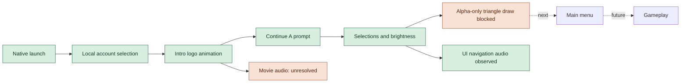
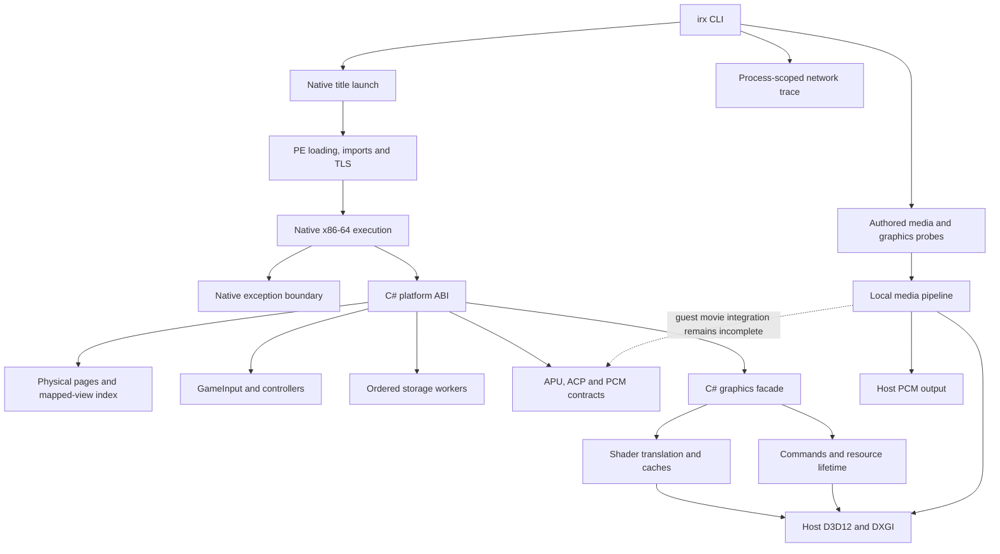

<div align="center">
  
  <h1>IRA RATIONIS</h1>
  <h3>PROJECT VINDEX · v0.1.0</h3>
  <p><i>The Wrath of Reason</i><br />
  <b>Nullius in verba · Non impone opinionem</b></p>
  <p><b>Defiance through competence.</b></p>
  <p>
    
    
    
    
  </p>
  <p>
    
    
    
    
    <a href="https://github.com/DBWilliamEngineering/IraRationis/actions/workflows/build.yml"></a>
  </p>
  <p>Native console compatibility research<br />
  Windows x64 · C# · Native AOT · Direct3D 12<br />
  Updated November 27, 2026 · Past brightness settings<br />
  Next development target: Main menu transition</p>
  <p><a href="#current-status">Status</a> · <a href="#architecture">Architecture</a> · <a href="#build-and-validate">Build &amp; validate</a> · <a href="#documentation">Documentation</a> · <a href="#distribution-and-releases">Releases</a> · <a href="#licensing-and-attribution">Licensing</a></p>
</div>

---

Ira Rationis (IRX) is an experimental native x86-64 Xbox Series X|S compatibility runtime for Windows. It develops its own architecture for loading, platform services, graphics, memory, input, storage, and media. It incorporates attributed upstream foundations; it does not claim that every component was independently authored from inception.

IRX has progressed through local account selection, the animated title introduction, the Continue (A) prompt, and the initial configuration screens through brightness. The next milestone is an interactive main menu with continuous intro audio. The longer-term objective is smooth 3840×2160 gameplay at 60 FPS, with correct rendering and continuous audio.

## Current status

### Vindex milestone: past brightness settings

On November 27, 2026 (US Central time), the maintainer proceeded past the subtitle and brightness screens during native guest execution. The movie audio had improved in this run but still had gaps and choppiness. Main-menu execution and gameplay remain unverified.

The local Native AOT run on an NVIDIA GeForce RTX 4090 reported GPU completion for the dual-mask rectangle and passed byte readback of the authored tiled BC3 upload fixture. The next blocked draw is a non-indexed triangle list whose vertex shader fetches from a root SRV and whose pixel shader targets an A8_UNORM render target with no depth buffer bound.

| Latest runtime evidence | Observed |
| --- | ---: |
| Elapsed time at last startup observation | 74.001 seconds |
| Bound images / missing imports | 5 / 0 |
| Successful presentations / attempts | 1,426 / 1,426 |
| Draw calls observed | 21,440 |
| Compute dispatches observed | 1,357 |
| Last sampled presentation rate | 16.78/s |
| Main menu | Not yet reached |

Intro windows with comparable draw and fence counts averaged about 20.8 presentations per second, up from 10.9 in the preceding capture. Scene and timing differences prevent attributing this change to one optimization. The counters measure observed calls and presents. Visual progression and audio quality are maintainer observations. Commercial title captures stay local.

### Startup progression



### Component status

| Area | Evidence and current boundary |
| --- | --- |
| Native execution | Native entry, five bound images, and zero missing imports in the latest run. |
| Graphics | Title intro and settings through brightness observed. Planar color, sRGB strips, indexed UI variants and dual-mask rectangles report GPU completion. The tiled BC3 upload passes readback. General shader coverage, resource coherence and command semantics remain incomplete. |
| Compute | Existing 3D color transform and two-/three-segment curve LUT dispatches complete on the GPU. Authored 17- and 29-texel numerical readback fixtures pass for both device ABI paths at the existing tolerance. General RDNA2 translation and console-equivalent title output remain unverified. |
| Input and local account | Guest-consumed wired DualSense input, local profile selection and settings navigation observed; the real host async runtime successfully returns an offline local-user handle. General callback delivery, online identity, privilege and token services remain incomplete or explicitly unsupported. |
| Storage | Local strict storage contracts and native DirectStorage fixture passed, including raw/Zlib reads, virtual-drive access, physical-page writes and ordered error reporting. BCPack and shared weighted scheduling remain outstanding. |
| Title audio and media | Guest XApu/Opus contracts pass. The Bink trace measures PCM delivery and samples guest voice readiness. The latest intro still has audible gaps. Mixer consumption and endpoint timing remain under investigation. |
| Memory and performance | Guarded publication, ordered uploads, cached layout and descriptor data, and CLZERO batching address measured subsystem costs. Late settings still use dozens of completion waits per present. See [validation evidence](docs/DIAGNOSTICS.md#resident-page-validation-results). |
| Runtime services | Host initialization, local-user completion, gamertag reads and persistent storage access observed. Unsupported online/provider requests remain explicit failures. See [service contracts](docs/runtime-services.md). |
| Diagnostics and validation | The November 27 local Release build (zero warnings/errors), Native AOT publication, component contracts, graphics probes, and native fixtures passed. GitHub Actions validation is separate. |
| Post-intro transition | Brightness settings passed. The next alpha-only draw is the current compatibility boundary. |
| Gameplay and sustained FPS | Not demonstrated. No overall completion percentage or competitive performance claim is made. |

### Next development work

| Development front | Objective |
| --- | --- |
| **Main menu** | Support the captured depthless alpha-only triangle and subsequent required draws. Validate resource bindings, fixed-function state and GPU output, then establish stable menu rendering and input. |
| **Movie audio** | Trace actual Bink PCM producer/consumer timing, buffer occupancy, underruns and endpoint delivery. Correct the identified defect without regressing working narration and UI audio. |
| **Performance** | Profile comparable scenes, isolate CPU emulation, resource staging, submission and guest worker costs, and reduce the critical path toward sustained requested presentation cadence without weakening synchronization. |

Use the [consolidated validation](docs/RELEASING.md#local-build-and-component-checks) to confirm the next compatibility change and preserve the first new blocked draw or dispatch.

Historical measurements and their limits remain in the [Architecture Atlas](docs/ARCHITECTURE-ATLAS.md). Compare the same scene, settings, capture interval, and matching symbols; inclusive stack percentages are not FPS measurements.

## Engineering direction

- Implement runtime behavior in C# wherever possible. C++ is reserved for genuine platform requirements, such as the vectored exception boundary, and existing native probes.
- Make ownership, ordering, lifetime, and failures explicit. Use bounded workers for independent preparation and preserve guest-visible submission order.
- Use component folders and namespaces, one top-level type per file, and no authored nested types. Keep models with their owning component; create shared abstractions when actual consumers justify them.
- Prefer descriptive names, deliberate spacing, and self-documenting control flow. Comments explain constraints, contracts, and performance costs. Use `//TODO: Damon -> ...` for actionable follow-ups.
- Apply SOLID, DRY, YAGNI, and design patterns where they simplify real responsibilities. Reduce cyclomatic/Halstead complexity while improving maintainability; moving files alone does not establish a metric improvement.
- Base optimizations on traces and observed results. Document meaningful time/space complexity and preserve correctness.

Reference projects help explain contracts and identify questions. Replacing inherited implementation requires an independent design and retained contract tests; renaming or relocating adapted code does not change its provenance.

## Architecture



Solid edges show implemented paths, not complete API coverage. The authored media sample uses an explicit opt-in contract; it is not a replacement for a title's movie or account services.

| Project | Responsibility |
| --- | --- |
| `IraRationis.Cli` | Commands, launch, startup/network diagnostics, and authored media integration |
| `IraRationis.Core` | Configuration, asset policy, binary utilities, bounded preparation, and retirement |
| `IraRationis.PE` / `IraRationis.Loader` | PE parsing/models, images, imports, TLS, and instruction compatibility |
| `IraRationis.HLE` | Input, storage, audio, graphics, kernel, memory, and runtime ABI services |
| `IraRationis.Graphics` / `IraRationis.Shaders` | Graphics ABI, commands, descriptors, resources, presentation, and shader translation |
| `IraRationis.Memory` | Isolated virtual unified memory and backing-strategy research |
| `IraRationis.Media` | Audio, video, decoding, playback, and presentation |
| `IraRationis.Game` / `IraRationis.Pipeline` | Build identification, archives, and conversion infrastructure |
| `IraRationis.Generators` | Compile-time ABI fallback generation |
| `IraRationis.Native` | Native exception boundary and independent native probes |
| `IraRationis.Runtime.Tests` / `tests` | Component contracts and authored CPU, GPU, media, and native fixtures |

`ConsoleGraphicsDevice` remains one partial public facade, organized into folders such as `ConsoleGraphicsDevice/Drawing/VertexFetchSourceProbe.cs`. Its generated ABI slots retain that type identity. Extracted types use component namespaces and individual files.

### CPU/GPU memory and concurrency

The guest must see coherent memory even when host RAM and VRAM hold different representations. Indexed physical views improve bookkeeping; they do not provide general CPU/GPU alias coherence. The isolated virtual page-table research also does not intercept arbitrary native CPU writes.

Host materialization currently has a fixed 512 MiB total budget and 256 MiB per-resource limit. The versioned buffer observes explicit writes, not arbitrary guest-pointer writes, physical aliases, or GPU-authored contents. Residency expansion, dirty-range transfers, and eviction must respect these ownership and completion boundaries.

Ordered/deferred preparation queues already provide bounded workers and ordered consumption. More cores should reduce measured independent work without introducing unbounded queues or reordering guest-visible operations. Higher VRAM allocation or worker count alone is not evidence of better performance.

## Build and validate

Use Windows x64, the SDK pinned in [global.json](global.json), Visual Studio C++ build tools for the existing native boundary, and a compatible D3D12 driver for GPU probes. FFmpeg is supplied separately for its media paths; Media Foundation requires installed Windows codecs.

From the repository root, stop at the first failed command:

```powershell
dotnet restore IraRationis.slnx
dotnet build IraRationis.slnx -c Release --no-restore
dotnet run --project IraRationis.Runtime.Tests -c Release --no-build
dotnet run --project tests/startup-evidence/StartupEvidence.Contracts.csproj -c Release --no-build
dotnet run --project tests/versioned-upload/VersionedUpload.Contracts.csproj -c Release --no-build
dotnet run --project tests/descriptor-bindings/DescriptorBindings.Contracts.csproj -c Release --no-build
dotnet run --project tests/storage-contract/StorageContract.csproj -c Release --no-build
dotnet run --project tests/runtime-media/RuntimeMedia.csproj -c Release --no-build
dotnet publish IraRationis.Cli -c Release -r win-x64 -o artifacts/native
.\artifacts\native\irx.exe --help
```

To build, validate, and capture a fresh title run, use PowerShell 7 from the repository root.

```powershell
$run = 'artifacts/validation/title-' + (Get-Date -Format 'yyyyMMdd-HHmmss')
.\scripts\Invoke-R77.ps1 -OutputDirectory $run -Validate -TraceMovieAudio
```

Use `-UnblockReviewedFixtures` if PowerShell blocks a fixture you have reviewed. The launcher samples routine graphics success messages and leaves movie worker scheduling off by default. For a comparison run, set a fresh `-OutputDirectory`, pass `-PublishedHostDirectory` with the first run's `host` directory, and vary one option. See [title capture and comparison](docs/DIAGNOSTICS.md#title-capture-and-comparison).

Console contract projects execute through `dotnet run`; building the solution does not run them. Preserve the exact published EXE/DLL/PDB set when profiling, and use a distinct directory for each build being compared.

Launch your authorized title through the picker or supply its executable:

```powershell
.\artifacts\native\irx.exe run
.\artifacts\native\irx.exe run 'D:\AuthorizedTitle\game.exe'
```

### Independent media and graphics

```powershell
$intro = (Resolve-Path .\tests\media-baseline\vindex-intro.mp4).Path
.\artifacts\native\irx.exe media-probe --mf $intro --play
.\artifacts\native\irx.exe media-probe --mf $intro --gpu

$ffmpeg = (Get-Command ffmpeg.exe -ErrorAction Stop).Source
& .\artifacts\native\irx.exe media-probe $ffmpeg $intro --stream-gpu

.\artifacts\native\irx.exe graphics-probe
.\artifacts\native\irx.exe veh-probe

.\artifacts\native\irx.exe instruction-probe
.\artifacts\native\irx.exe present-probe --seconds 5 --fps 60
.\artifacts\native\irx.exe memory-probe --self-test
```

These commands can open a window or play audio. `--stream` and `--stream-gpu` use FFmpeg; `--mf` supports batch inspection, `--play`, and `--gpu`. See [media validation](tests/media-baseline/README.md), [GPU contracts](tests/gpu-media/README.md), and [authored runtime integration](docs/RUNTIME-INTEGRATION.md) for fixture expectations and boundaries.

## Documentation

| Document | Purpose |
| --- | --- |
| [Architecture Atlas](docs/ARCHITECTURE-ATLAS.md) | Subsystem relationships, contracts, diagrams, and historical evidence |
| [Architecture and Research](docs/architecture.md) | Runtime and memory-research boundaries |
| [Local Runtime Services](docs/runtime-services.md) | Local user/async ownership, persistent storage, routing, and validation boundaries |
| [Architectural Divergence](docs/ARCHITECTURAL-DIVERGENCE.md) | Independent direction and engineering principles |
| [Runtime Integration](docs/RUNTIME-INTEGRATION.md) | Authored fixtures, utility execution, and integration limits |
| [Diagnostics](docs/DIAGNOSTICS.md) | Startup/input investigation, DNS/socket capture, JSONL export, and CPU profiling |
| [Implementation Provenance](docs/PROVENANCE.md) | Source ancestry, reference use, and remaining attribution work |
| [Quick Start](docs/QUICKSTART.txt) | Using a published Windows distribution |
| [Release Procedure](docs/RELEASING.md) | Validation, packaging, tags, and draft releases |

Documentation is organized by topic. Revision-specific handoffs belong in [Git history](https://github.com/DBWilliamEngineering/IraRationis/commits/main/) rather than competing documents. Historical log markers and commit references remain useful evidence.

## Distribution and releases

The [Windows x64 workflow](.github/workflows/build.yml) defines builds, explicit contract execution, Native AOT publication, native smoke fixtures, and headless media checks. Optional Media Foundation validation requires manual dispatch and available codecs. A local build does not establish CI status; inspect the run for the exact commit.

Successful runs publish a Windows ZIP and unpacked distribution. Keep `irx.exe`, `irx-native.dll`, and the other dependencies together. The package includes the authored Vindex fixture, documentation, and network-export script; it does not bundle FFmpeg or commercial title files. Distribution archives omit PDBs, so retain local publish output for profiling.

Successful main-branch commits with an `R<number>:` subject can receive an automatic revision tag. Separately, `v*` tag pushes gate a draft prerelease. An automatic revision tag is not a published release or proof of game compatibility. See [Release Procedure](docs/RELEASING.md).

| Version | Codename | State |
| --- | --- | --- |
| 0.1 | Vindex | Current development |
| 0.2 | Abaddon | Reserved |
| 0.3 | Apollyon | Reserved |
| 0.4 | Prometheus | Reserved |
| 1.0 | Invictus | Reserved |

Reserved names are not delivery commitments. Tags do not automatically change the assembly version.

## Licensing and attribution

The runtime incorporates adapted work from [Zettrox/ztrx](https://github.com/Zettrox/ztrx), based on VIctory and victory-fork; the recorded original reference tree is `90b529f878a470fec9bf07b7be316bc769a12232`. Source notices and the [provenance inventory](docs/PROVENANCE.md) distinguish inherited implementation, independently developed extensions, and references.

- Runtime software: [GPL-3.0-or-later](LICENSE).
- Separately designated independent materials: [proprietary material notice](LICENSE-PROPRIETARY.md), subject to its scope and applicable third-party rights.
- External dependencies retain their applicable licenses. FFmpeg is supplied separately.

No commercial title assets, executables, credentials, shader dumps, caches, or title-derived captures belong in version control. Native title execution is experimental and unsandboxed; use authorized, trusted executables and dependencies. IRX is not affiliated with or endorsed by Microsoft, Rockstar Games, or the referenced projects.
