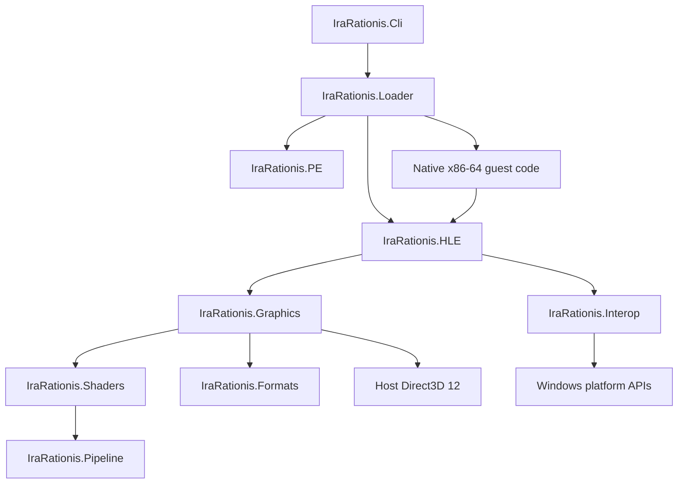

# Ira Rationis

*The Wrath of Reason*

**Nullius in verba · Non impone opinionem**

**Defiance through competence.**

**An experimental native Xbox Series X|S compatibility layer for Windows, written in C# and designed for .NET Native AOT.**

Ira Rationis explores the native execution of compatible Xbox Series X|S software on Windows x64 by translating console-specific operating system and graphics interfaces into their Windows equivalents. Rather than emulating an entire console CPU, the project aims to execute compatible x86-64 instructions directly on the host processor, implementing the platform services and GPU translation required by the guest software.

The project is a C# port and architectural adaptation of [Zettrox/ztrx](https://github.com/Zettrox/ztrx), which builds on VIctory and victory-fork. Ira Rationis prioritizes correctness, observable runtime behavior, maintainability, and native performance.

> **Development status:** Early development. The initial port provides read-only executable and shader inspection. Native execution, graphics output, startup video, and gameplay have not yet been achieved or verified in Ira Rationis. Upstream compatibility does not imply compatibility in this port.

## Project identity

| Attribute | Designation |
| --- | --- |
| Project | Ira Rationis |
| Translation | The Wrath of Reason |
| Abbreviation | IR |
| Initial codename | Vindex |
| Repository | `IraRationis` |
| Root namespace | `IraRationis` |
| Executable | `irx.exe` |
| Primary language | C# |
| Compilation target | .NET Native AOT |
| Future implementation | C++ |
| Classification | Independent engineering research |
| Repository visibility | Private (intended) |
| Philosophy | Defiance through competence |
| Primary motto | *Nullius in verba* |
| Heraldic motto | *Non impone opinionem* |

*Nullius in verba* rejects unquestioned authority; *Non impone opinionem* means approximately “Do not impose an opinion.” The project's engineering philosophy is to test assumptions, document evidence, and let observable results determine conclusions.

## Release codenames

| Version | Codename | Meaning | Proposed milestone |
| --- | --- | --- | --- |
| `0.1.0` | **Vindex** | Defender or avenger | Architectural foundation |
| `0.2.0` | **Abaddon** | Destruction or the abyss | Native interoperability |
| `0.3.0` | **Apollyon** | The destroyer | Compatibility and execution research |
| `0.4.0` | **Prometheus** | Knowledge and defiance | Diagnostics and performance |
| `0.5.0` | **Praetor** | Roman magistrate | Architectural consolidation |
| `1.0.0` | **Invictus** | Unconquered | First stable release |
| `2.0.0` | **Aeternum** | Eternally | Next-generation architecture |

These are planned milestones, not claims of completed functionality. Git tags use conventional version numbers, such as `v0.1.0`; release titles use the format **Ira Rationis v0.1.0 | Vindex**.

## Objectives

- Establish a native x86-64 compatibility runtime for Windows 10/11.
- Implement the Xbox application binary interface and required platform services.
- Translate console-specific graphics operations and shaders into host-compatible Direct3D 12 workloads.
- Support deterministic resource ownership and predictable memory management at native boundaries.
- Provide diagnostics for executable imports, memory consumption, threading, shader translation, GPU workloads, and crash analysis.
- Maintain Native AOT compatibility across the production codebase.
- Progress through reproducible milestones: binary inspection, synthetic native execution, graphics initialization, startup presentation, and broader compatibility.

## Architecture

The following is the proposed solution structure. The initial implementation may remain in a single project until its components are separated.

```text
IraRationis/
├── src/
│   ├── IraRationis.Cli/          # Command-line entry point and composition root
│   ├── IraRationis.Core/         # Configuration, diagnostics and shared abstractions
│   ├── IraRationis.PE/           # PE32+ and COFF analysis
│   ├── IraRationis.Loader/       # Image loading, imports, TLS and native execution
│   ├── IraRationis.Interop/      # Windows ABI and native bindings
│   ├── IraRationis.HLE/          # Console platform services
│   ├── IraRationis.Graphics/     # D3D12.X to Direct3D 12 translation
│   ├── IraRationis.Shaders/      # Shader parsing, IR and recompilation
│   ├── IraRationis.Formats/      # Texture, audio and binary formats
│   ├── IraRationis.Pipeline/     # Conversion and content-addressed caching
│   └── IraRationis.Game/         # Title-specific formats and compatibility logic
├── tests/                  # Unit, integration and native fixture tests
├── docs/                   # Architecture and compatibility documentation
├── Directory.Build.props   # Shared compiler and analyzer configuration
├── IraRationis.slnx
├── LICENSE
├── LICENSE-PROPRIETARY.md
└── README.md
```



## Development status

| Component | Status |
| --- | --- |
| PE32+ headers and sections | Initial implementation |
| Imports, delay imports and exports | Initial implementation |
| TLS and CodeView metadata inspection | Initial implementation |
| DXBC and DXIL container parsing | Initial implementation |
| COFF import-library analysis | Planned |
| Native image loading and ABI integration | Planned |
| Xbox platform API compatibility | Planned |
| Direct3D 12 graphics translation | Planned |
| Native shader translation and recompilation | Planned |
| Texture and audio format conversion | Planned |
| Startup video, menus and gameplay | Not supported yet |

Initial implementation refers to the previously prepared C# source port; its .NET build and Native AOT publish have not yet been validated. No actual title execution has been tested. The accompanying C++ reference port is independent and is not a required Ira Rationis dependency.

## Build requirements

- Windows 10 or Windows 11, x64.
- .NET 10 SDK or a compatible later SDK capable of targeting .NET 10.
- Visual Studio 2022 or later, or equivalent supported Visual Studio Build Tools, with the **Desktop development with C++** workload and Windows SDK.
- A Direct3D 12-capable GPU for future graphics development; the inspection tools do not require one. Upstream ztrx targets NVIDIA hardware supporting shader model 6.6 and mesh shaders; Ira Rationis's GPU compatibility is not established.

## Native AOT

Native AOT is a design requirement, not an optional optimization. The production CLI is intended to publish as a self-contained native Windows x64 executable, without a separately installed .NET runtime or managed JIT compilation at execution time.

Recommended `src/IraRationis.Cli/IraRationis.Cli.csproj`:

```xml
<Project Sdk="Microsoft.NET.Sdk">
  <PropertyGroup>
    <OutputType>Exe</OutputType>
    <TargetFramework>net10.0</TargetFramework>
    <RuntimeIdentifier>win-x64</RuntimeIdentifier>
    <PlatformTarget>x64</PlatformTarget>
    <AssemblyName>irx</AssemblyName>
    <RootNamespace>IraRationis</RootNamespace>
    <ImplicitUsings>enable</ImplicitUsings>
    <Nullable>enable</Nullable>
    <AllowUnsafeBlocks>true</AllowUnsafeBlocks>
    <PublishAot>true</PublishAot>
    <SelfContained>true</SelfContained>
    <DebugType>portable</DebugType>
  </PropertyGroup>
</Project>
```

Set `IsAotCompatible` to `true` in production class libraries to enable compatibility analysis. Treat trimming and AOT warnings as defects to investigate, and validate changes by publishing and running the native executable, not merely by building managed assemblies.

### Build and publish

The following paths assume the proposed solution structure has been created and the initial source files migrated into it.

```powershell
dotnet restore IraRationis.slnx
dotnet build IraRationis.slnx -c Release
dotnet publish src/IraRationis.Cli/IraRationis.Cli.csproj -c Release -r win-x64
```

The native executable should be emitted to:

```text
src/IraRationis.Cli/bin/Release/net10.0/win-x64/publish/irx.exe
```

A normal `dotnet build` or `dotnet run` is not proof of Native AOT execution. Run the published executable to validate AOT behavior. Preserve native PDB symbols for debugger and crash-dump analysis.

### Initial command-line interface

The initial port implements read-only inspection commands:

```powershell
.\irx.exe inspect "C:\path\to\title.exe"
.\irx.exe shader "C:\path\to\shader.dxbc"
```

These examples assume the terminal is in the published output directory. The original `Ztrx` namespaces, project name and CLI usage string must be updated when migrating the initial source into Ira Rationis.

## Engineering principles

- Prefer clear, idiomatic C# and the .NET standard library before introducing external dependencies.
- Use Allman braces, explicit blocks for control flow, and `var` where the inferred type is clear.
- Use `Span<T>`, `ReadOnlySpan<T>`, `Memory<T>`, and `BinaryPrimitives` for appropriate binary processing workloads.
- Isolate unsafe code, native allocation, pointer arithmetic and ABI contracts behind focused interfaces.
- Prefer source-generated P/Invoke (`LibraryImport`), blittable structs and unmanaged function pointers for native interoperability.
- Use explicit resource ownership (`IDisposable`, `SafeHandle`, or scoped native ownership where appropriate).
- Avoid runtime-generated managed code, dynamic managed assembly loading and reflection-dependent dependencies that cannot be made trimming-safe.
- Use explicit COM interfaces/vtables or an AOT-compatible generated COM implementation for Direct3D 12. Do not depend on built-in runtime COM interop.
- Do not allow managed exceptions to escape unmanaged callbacks. Translate errors at the ABI boundary.
- Use structured diagnostics, native debugger symbols, synthetic fixtures, differential testing against upstream, and repeatable benchmarks.

Native AOT eliminates the managed JIT but retains the .NET runtime services, including garbage collection. It does not guarantee deterministic allocation, zero overhead, or correctness of guest execution. Native executable loading, thread transitions, TLS, unwind metadata, COM lifetime and graphics ABI compatibility require separate validation.

See Microsoft's [Native AOT deployment overview](https://learn.microsoft.com/en-us/dotnet/core/deploying/native-aot/) and [native interop guidance](https://learn.microsoft.com/en-us/dotnet/core/deploying/native-aot/interop).

## Roadmap

1. Establish the C# solution, CI and native publish smoke tests.
2. Validate PE and shader parsing against upstream and synthetic fixtures; add COFF analysis.
3. Implement and validate native execution, import resolution, TLS, thread behavior and exception boundaries using harmless synthetic programs.
4. Implement the minimum platform services needed for initialization.
5. Establish host graphics output and validate command submission, resources and synchronization.
6. Implement media, shader translation and format support necessary for startup presentation.
7. Extend compatibility and improve CPU, memory and GPU performance using measured profiling data.

## Research access and contributions

The project is intended for private development and invited technical review. Public contributions are not solicited at this stage. Access to the private repository is controlled by its owner; this access policy does not limit the rights of recipients under the GPL.

Contributions should preserve Native AOT compatibility and include reproducible tests where possible. Prefer small, reviewable changes with documented assumptions, especially for binary layouts, native ABI behavior and GPU translation. Do not include proprietary game binaries, assets, SDK files, keys or other material you are not authorized to redistribute. Use synthetic or otherwise redistributable fixtures in the repository.

## Attribution and license

Ira Rationis is based on [Zettrox/ztrx](https://github.com/Zettrox/ztrx), itself based on VIctory (Marvisak) and victory-fork (fxceless). The initial port was derived from the upstream `main` tree `90b529f878a470fec9bf07b7be316bc769a12232`. Upstream copyright, attribution and licensing notices must be preserved in adapted files.

The adapted runtime and other GPL-covered software remain subject to the **GNU General Public License, version 3 or later (GPL-3.0-or-later)**, consistent with the upstream license. See [LICENSE](LICENSE). Conveying covered source or binaries requires compliance with the applicable GPL terms, including corresponding-source obligations where applicable. Private development does not by itself require public publication.

[LICENSE-PROPRIETARY.md](LICENSE-PROPRIETARY.md) reserves rights only in separately identifiable, independently owned material explicitly designated as proprietary and not subject to the GPL, such as standalone branding assets where applicable. It does not restrict use, copying, modification, redistribution or commercial activity permitted by the GPL or other applicable licenses. No proprietary classification is implied merely by a file being in this repository.

See the [GNU GPL FAQ](https://www.gnu.org/licenses/gpl-faq.html) for guidance on private development and conveying covered works.

Ira Rationis is an independent research and engineering project. It is not affiliated with or endorsed by Microsoft, Xbox, or any game developer or publisher. No commercial game files or assets are included. Users are responsible for supplying software they are authorized to use and complying with applicable terms and laws.
