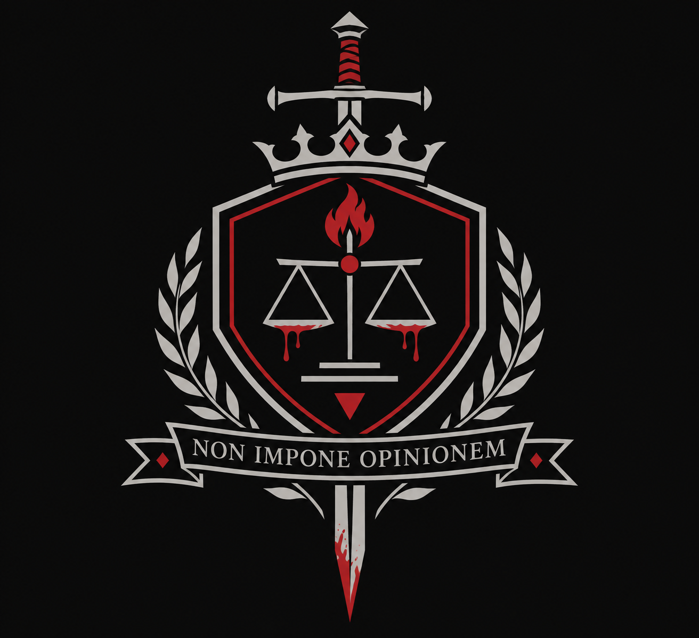
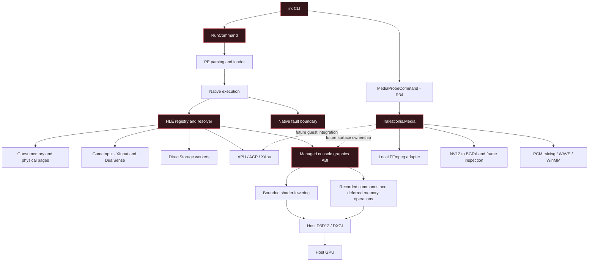
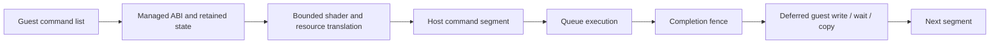
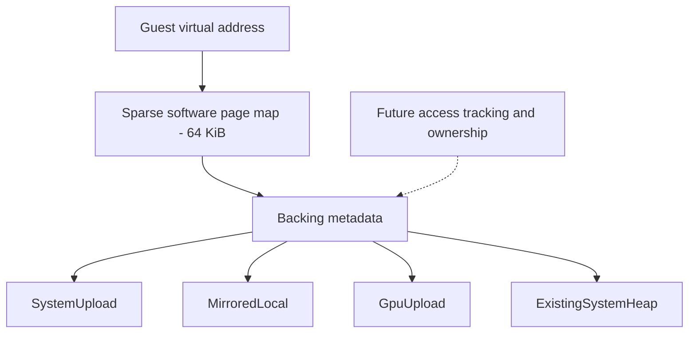
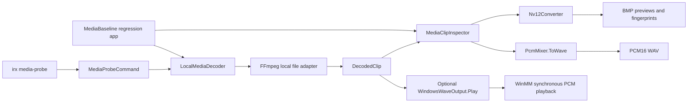

# Ira Rationis | Vindex

<p align="center"></p>
<h2 align="center">PROJECT VINDEX · v0.1.0</h2>
<p align="center"><i>The Wrath of Reason · Nullius in verba · Non impone opinionem</i></p>
<p align="center"><b>Defiance through competence.</b></p>

<p align="center">
  
  
  
  
</p>

Independent engineering research into native x86-64 console compatibility on Windows. Ira Rationis (IRX) investigates managed-first ABI translation, native execution, GPU command and resource translation, virtual memory, input, storage, and media processing. It is a compatibility runtime, not a complete console emulator, a security sandbox, or an official platform SDK.

## Project identity

| Identity | Designation |
| --- | --- |
| Project | Ira Rationis (IRX) |
| Release family | Vindex v0.1.0 |
| Development milestone | First Light R34 — Media CLI integration |
| Updated | 2026-11-25 |
| Implementation | C# 15 / .NET 11 / selected native C++ |
| Target | Windows x64 / Native AOT |
| Graphics | Direct3D 12 / TerraFX |
| Executable | `irx.exe` |
| License | GPL-3.0-or-later; see [LICENSE](LICENSE) |
| Status | Experimental; partial compatibility |

| Version | Codename | State |
| --- | --- | --- |
| 0.1 | Vindex | Current development |
| 0.2 | Abaddon | Reserved |
| 0.3 | Apollyon | Reserved |
| 0.4 | Prometheus | Reserved |
| 1.0 | Invictus | Reserved |

The identity card above is the release-level source of truth. Update the release designation, milestone and verified capabilities at each major release. Reserved names are not delivery commitments.

## First Light: current progress

> **Native execution, recognizable UI rendering and guest-consumed controller input have been observed.** Startup logo, intro video, guest audio output, account workflow completion and the main menu remain unresolved. R34 integrates independent media processing with the CLI, not with the guest's playback or account services.

The evidence below is maintainer-reported from local R30–R32 execution logs unless indicated otherwise. These observations are not proof of compatibility across other titles, hardware or builds. No game-derived binaries or captures are included in this repository update.

| Milestone | State | Evidence / boundary |
| --- | --- | --- |
| Native executable entry | Observed | Loaded image and dependencies enter native code. |
| Static imports | Observed | 924 resolved slots, zero missing in the R31 audit of five images. This does not establish ABI or behavioral parity. |
| Original UI pixels | Observed | Recognizable interface text and geometry rendered through translated draw paths. |
| Host presentation | Observed | Native D3D12/DXGI presentation; sampled final composition fingerprints match their intermediate inputs. |
| Controller input | Observed | Wired DualSense press/release events retrieved through the guest GameInput ABI. |
| Storage | Observed | R32 strict length checks, successful sampled reads and decompression/status markers; no reported request failures in the submitted run. |
| Independent media decoding | Component evidence | R33 synthetic H.264/AAC fixture: 60 decoded video frames, 192,000 interleaved PCM16 samples. FFmpeg commands validated independently; managed implementation awaits Windows validation. |
| Media CLI integration | Implemented, unverified | R34 CLI command, project reference and solution membership. |
| Startup logo / video | Outstanding | Black startup surfaces observed; decoded guest frame delivery not established. |
| Guest audio | Outstanding | APU/SHAPE/ACP initialization observed; XMA, full DSP and actual output missing or unverified. |
| Frontend / main menu | Outstanding | Input reaches the guest but account workflow does not progress in the supplied run. |
| Gameplay | Not demonstrated | No claim of playable game compatibility. |

Progress is reported by evidence rather than a speculative percentage. There is no claimed overall title completion score or external tracker rating.

### Performance evidence

| Revision | Observed behavior |
| --- | --- |
| R24–R27 | Sub-1 presentation/s during early UI experiments; CPU exception overhead and serialized submission identified. |
| R28 | Mean about 16.4 presentations/s after experimental CLZERO batching. |
| R29 | Mean about 19.7 presentations/s; sampled peak 21.44/s. One sparse upload case copied 37,354 bytes into an allocation of 1,161,472 bytes (about 96.8% fewer copied bytes). |
| R30 | Approximately 17–20 presentations/s in the supplied controller run. |
| R31 | Bounded full-surface readbacks reduced throughput during capture; disable them for normal performance measurements. |

These are development-run presentation rates, not measured gameplay FPS, and not controlled cross-revision benchmarks. The target remains sustained correct 30 FPS and eventually 60+ FPS on suitable hardware. Correctness takes precedence over presentation rate.

## Architecture



Solid edges indicate implemented architectural paths, not complete interface coverage. Dotted edges indicate planned integration. The CLI media probe is deliberately independent of native guest execution; normal `irx run` does not call it. See [architecture notes](docs/architecture.md) for the original research diagrams and historical design rationale.

### Solution organization

| Project | Responsibility |
| --- | --- |
| `IraRationis.Cli` | Command routing, executable selection, launch and diagnostic probes |
| `IraRationis.Core` | Shared configuration and runtime models |
| `IraRationis.PE` / `IraRationis.Loader` | PE inspection, preparation, import binding, TLS and execution |
| `IraRationis.HLE` | Managed ABI exports for platform, memory, storage, audio and input |
| `IraRationis.Graphics` / `IraRationis.Shaders` | Graphics ABI, shader inspection and bounded lowering, host graphics execution |
| `IraRationis.Memory` | Memory strategy and virtual unified memory research |
| `IraRationis.Game` / `IraRationis.Pipeline` | Game-format and pipeline research utilities |
| `IraRationis.Media` | Independent local media decoding, conversion, inspection and PCM output |
| `IraRationis.Generators` | Compile-time ABI code generation |
| `IraRationis.Native` | Native exception boundary and independent C++ probes |
| `IraRationis.Runtime.Tests` | Runtime ABI regression tests |
| `tests/storage-contract` | Synthetic storage payload contract checks |
| `tests/media-baseline` | Synthetic media fixture and primitive regression tests |

### Managed-first graphics boundary

The production `D3D12XboxCreateDevice` export resolves directly to the C# console graphics implementation. Host calls cross typed unmanaged COM boundaries. The original C++ graphics bridge is historical, not the production device implementation. The native DLL is retained for CPU fault context handling and independent diagnostic workloads; adding native code is justified by platform or correctness requirements rather than preference.



R10–R23 established executable host shader families, indexed input, texture sampling, bounded compute and native presentation. R24–R29 reduced overhead through fence reuse, timing instrumentation, narrowed vertex reads and sparse uploads, while retaining the conservative command-memory ordering. This is not a general RDNA2 compiler or a complete asynchronous GPU scheduler. Resource allocation, host visibility and correct content are separate milestones; successful PSO creation or fence completion does not establish semantic parity.

### Virtual unified memory (VUM)



VUM investigates explicit software address translation and comparative CPU/GPU backing strategies. The memory probe uses buffer writes and GPU checksums to compare mapped system upload, staged GPU-local, CPU-visible VRAM and eligible existing system heaps. VUM is an isolated research architecture, not a complete production residency manager or an interception mechanism for arbitrary native CPU writes. No zero-copy gameplay claim is made.

### Input and storage

The controller backend preserves XInput and keyboard fallback and adds wired DualSense HID report processing, normalization, dead zones and reconnect attempts. R30 demonstrated guest readings of actual button presses and releases. Bluetooth, haptics and full reading callback semantics remain incomplete.

DirectStorage uses per-queue ordered workers with raw reads and Zlib decompression. R32 added opt-in strict payload length checks and sampled request/status accounting. BCPack and weighted shared scheduling are not yet implemented. Success reports do not independently verify every byte's semantic interpretation by the guest.

### Media: actual R34 call path



Both CLI and regression app use the same managed library. The probe decodes a bounded local clip with a user-supplied FFmpeg executable, produces video preview images, hashes decoded frames, measures PCM peak and writes a WAVE file. Optional audio playback uses `PlaySoundW` with a pinned in-memory WAVE buffer. The video path exports previews, not a live video window; FFmpeg is an external process, not an embedded codec. No synchronized A/V playback, XMA processing, real-time WASAPI mixer, guest Bink interception, or authentication implementation is claimed. Use only trusted FFmpeg builds and local authorized media; this adapter is not a sandbox.

## Build and validate

Requirements: Windows x64, the .NET SDK specified in `global.json`, Visual Studio C++ build tools required by the existing native bridge build, and a compatible Direct3D 12 driver for graphics probes. FFmpeg is optional for ordinary runtime commands and required only for the standalone media command/tests.

```powershell
dotnet restore IraRationis.slnx
dotnet build IraRationis.slnx -c Release
dotnet publish IraRationis.Cli -c Release -r win-x64 -o artifacts/native-r34
.\artifacts\native-r34\irx.exe --help
```

The R34 source and project wiring have been checked offline. Windows compilation, Native AOT publication of the new integration and native speaker playback have not been validated in the authoring environment.

### Standalone media validation (no guest executable required)

```powershell
$ffmpeg = (Get-Command ffmpeg.exe -ErrorAction Stop).Source
$clip = (Resolve-Path .\tests\media-baseline\fixture.mp4).Path

# Actual main CLI entry point
& .\artifacts\native-r34\irx.exe media-probe $ffmpeg $clip --play

# Independent primitive and fixture regression checks
dotnet run --project tests/media-baseline/MediaBaseline.csproj -c Release -- $ffmpeg $clip

# Storage contract regression checks
dotnet run --project tests/storage-contract/StorageContract.csproj -c Release
```

Expected fixture observations: 60 decoded video frames, 60 distinct frame hashes, 192,000 interleaved PCM samples (96,000 stereo sample frames), 48 kHz and a nonzero audio peak. The CLI prints `IRX-R34` and the output directory under `artifacts/media-probe/`; the test application uses `artifacts/media-baseline/`. Each run creates a unique directory containing up to three BMP previews and `media-output.wav`. Omit `--play` to decode and export without speaker output. Static or silent clips are valid for the general CLI; the synthetic fixture test explicitly requires motion and sound.

Other independent commands:

```powershell
.\artifacts\native-r34\irx.exe graphics-probe
.\artifacts\native-r34\irx.exe veh-probe
.\artifacts\native-r34\irx.exe present-probe --seconds 5 --fps 60
.\artifacts\native-r34\irx.exe memory-probe --self-test
```

For supported runtime options, use `irx --help`. Native title execution is experimental and unsandboxed. Use only trusted executables and dependencies for which you have authorization; do not bypass licensing, authentication or entitlement requirements.

## Development history

| Revision | Scope |
| --- | --- |
| R3–R5 | Typed command-list close, presentation ingress and addressable fence synchronization |
| R6–R8 | APU heap and SHAPE context memory, ACP control interface, managed XApu Opus decoding |
| R9–R13 | First-draw evidence, bounded shader lowering, host pipeline and vertex-fetch execution |
| R14–R17 | Rectangle and textured draw execution, physical aliases, compute/LUT and descriptor handling |
| R18–R19 | Diagnostic preview, native swap chain and window sizing |
| R20–R23 | Indexed draws, PSO cache, color and array transform families |
| R24–R27 | Fence pooling, stage timings, pooled snapshots, narrowed vertex reads, CPU thread/resource telemetry |
| R28–R29 | Experimental CLZERO batching and sparse indexed host uploads |
| R30 | Native wired DualSense support and guest input telemetry |
| R31 | Input-correlated intermediate and presented pixel fingerprinting |
| R32 | Strict storage payload validation and request/status telemetry |
| R33 | Independent media library and synthetic fixture |
| R34 | Solution registration, CLI integration, shared inspection implementation and documentation |

## Remaining engineering milestones

1. Validate the R34 Windows build and independent media command on the target system.
2. Establish documented video surface ownership, layout and synchronization using authorized synthetic GPU workloads.
3. Extend shader and pipeline translation with explicit capability and error semantics rather than dummy-success returns.
4. Establish a streaming audio backend, correct decoder/PCM ownership, scheduling and observable native output.
5. Validate legitimate platform-service and async lifecycle contracts with independent test applications.
6. Demonstrate correct integrated startup, then measure stable throughput and memory behavior.

The previously observed pipeline rejections (`E_NOTIMPL` for slots `0x1C8` and `0x218`), transparent startup draws, guest resource alias coherence, incomplete audio processing and unverified account lifecycle are outstanding questions, not proven root causes of a single failure. Independent media success does not demonstrate guest video or audio integration.

## Provenance and licensing

IRX is a GPL-3.0-or-later source-level derivative of [Zettrox/ztrx](https://github.com/Zettrox/ztrx), based on VIctory and victory-fork. Original reference tree: `90b529f878a470fec9bf07b7be316bc769a12232`. [DexNom/VIctory](https://github.com/DexNom/VIctory/tree/main) and [victory-fork](https://github.com/fxceless/victory-fork) are additional architectural references, not proof of IRX parity. Maintain applicable upstream notices and license obligations. Review the license of external codec binaries separately; FFmpeg is not bundled by this update. No commercial game assets, executable images, account credentials, shader dumps, runtime caches or title-derived captures belong in version control.

IRX-specific work denotes implementation and research choices relative to its upstream references, not a claim of global novelty or proprietary rights over GPL-covered derivative code. See [LICENSE](LICENSE) and source notices. Preserve historical technical notes in Git history when revising this README.
