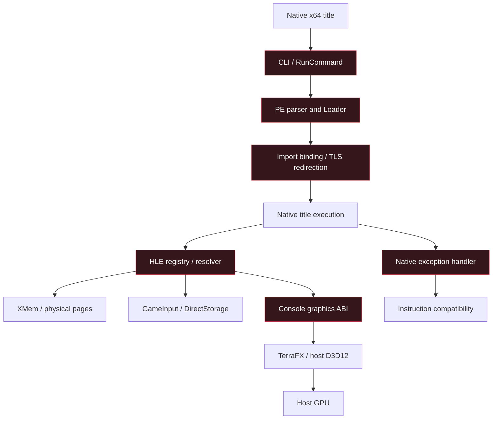

# Ira Rationis | Vindex

<h2 align="center">PROJECT VINDEX · v0.1.0</h2>

<i>The Wrath of Reason · Nullius in verba · Non impone opinionem</i>

<b>Defiance through competence.</b>

| Identity | Designation |
| --- | --- |
| Project | Ira Rationis (IRX) |
| Release | Vindex v0.1.0 |
| Development milestone | First Light |
| Implementation | C# 15 / .NET 11 / selected native C++ |
| Target | Windows x64 / Native AOT |
| Graphics | Direct3D 12 / TerraFX |
| Executable | `irx.exe` |
| License | GPL-3.0-or-later; see [LICENSE](LICENSE) |
| Status | Experimental compatibility runtime |

Independent engineering research into native x86-64 console compatibility on Windows, with explicit ABI boundaries, measurable memory behavior and systematic compatibility diagnostics. IRX is a source-level derivative of [Zettrox/ztrx](https://github.com/Zettrox/ztrx), based on VIctory and victory-fork. Reference tree: `90b529f878a470fec9bf07b7be316bc769a12232`.

> Native title entry and partial graphics initialization are maintainer-reported. First original frame, intro, menu and gameplay remain unverified. Native AOT is a target, not a verified title execution mode. No game assets are included. IRX is not a sandbox.

## Release designations

| Version | Codename | State |
| --- | --- | --- |
| 0.1 | Vindex | Current development |
| 0.2 | Abaddon | Reserved |
| 0.3 | Apollyon | Reserved |
| 0.4 | Prometheus | Reserved |
| 1.0 | Invictus | Reserved |

Update the release designation and milestone in the identity table on each major development release; keep the crest unchanged. Reserved names do not imply delivery dates or feature commitments.

## Architecture

The diagram is conceptual: it describes responsibilities, not a complete call graph or a claim of full compatibility. See [architecture and research diagrams](docs/architecture.md) for the memory model, graphics boundary, compile-time ABI generation and compatibility diagnostics.

<!-- MERGE POINT: retain the existing README from “## Engineering identity and differentiators” onward, including provenance, progress evidence, build instructions and development history. -->
