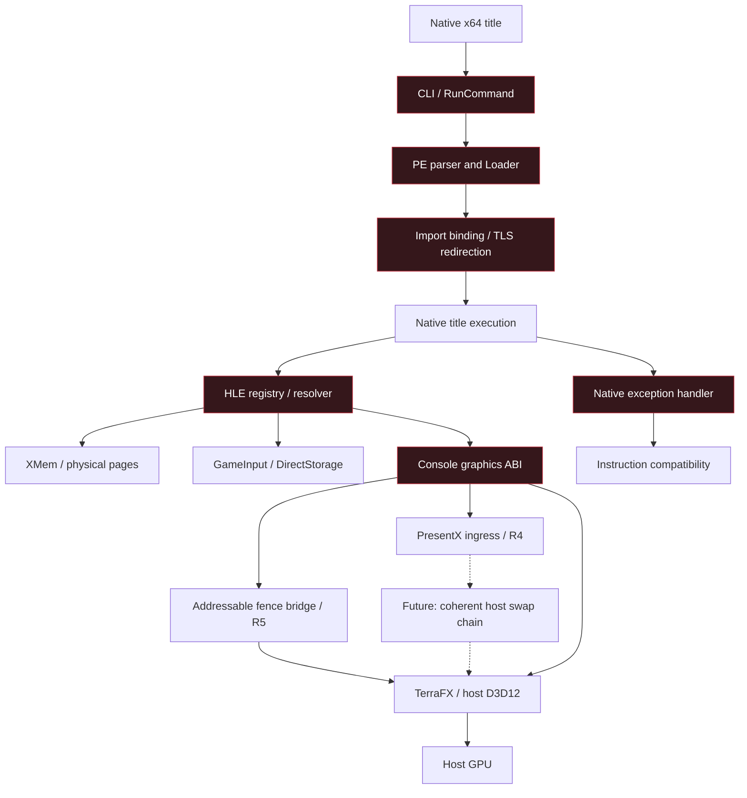
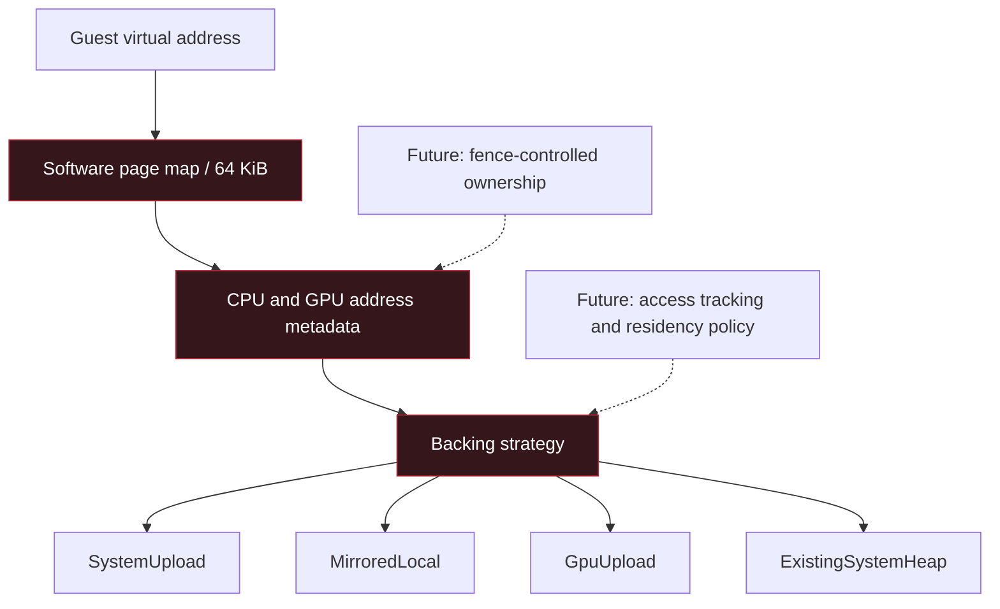
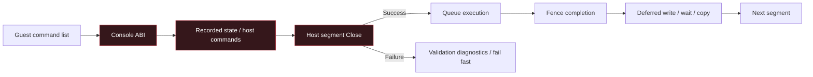
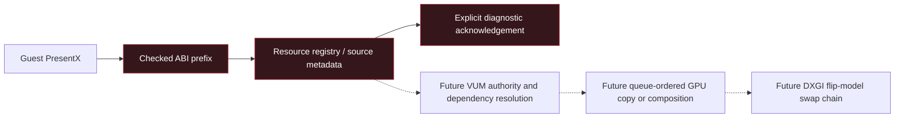
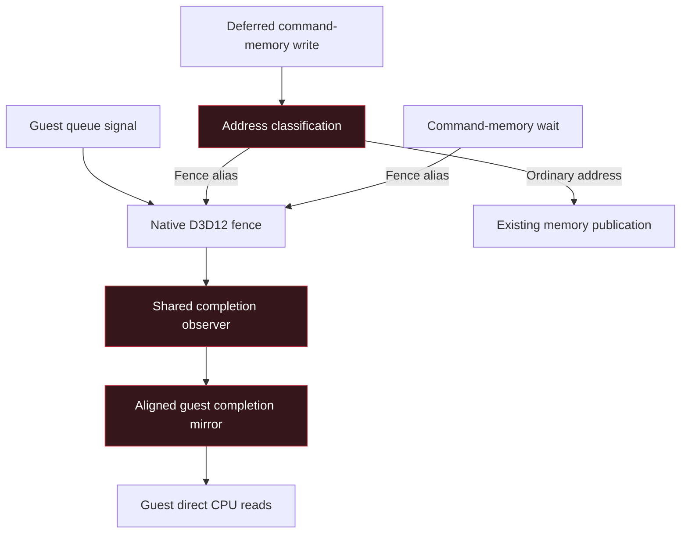

# Ira Rationis | Vindex

<p align="center"></p>

<h2 align="center">PROJECT VINDEX · v0.1.0</h2>
<p align="center"><i>The Wrath of Reason · Nullius in verba · Non impone opinionem</i></p>
<p align="center"><b>Defiance through competence.</b></p>

| Identity | Designation |
| --- | --- |
| Project | Ira Rationis (IRX) |
| Release | Vindex v0.1.0 |
| Development milestone | First Light |
| Implementation | C# 15 / .NET 11 / selected native C++ |
| Target | Windows x64 / Native AOT |
| Graphics | Direct3D 12 / TerraFX |
| Executable | `irx.exe` |
| License | GPL-3.0-or-later; see [LICENSE](LICENSE) |
| Status | Experimental compatibility runtime |

Independent engineering research into native x86-64 console compatibility on Windows, with explicit ABI boundaries, measurable memory behavior and systematic compatibility diagnostics. IRX is a source-level derivative of [Zettrox/ztrx](https://github.com/Zettrox/ztrx), based on VIctory and victory-fork. Reference tree: `90b529f878a470fec9bf07b7be316bc769a12232`.

> Native title entry and partial graphics initialization are maintainer-reported. First original frame, intro, menu and gameplay remain unverified. Native AOT is a target, not a verified title execution mode. No game assets are included. IRX is not a sandbox.

## Release designations

| Version | Codename | State |
| --- | --- | --- |
| 0.1 | Vindex | Current development |
| 0.2 | Abaddon | Reserved |
| 0.3 | Apollyon | Reserved |
| 0.4 | Prometheus | Reserved |
| 1.0 | Invictus | Reserved |

Update the release designation and milestone in the identity table on each major development release; keep the crest unchanged. Reserved names do not imply delivery dates or feature commitments.

## Architecture



The diagram is conceptual: it describes responsibilities, not a complete call graph or a claim of full compatibility. See [architecture and research diagrams](docs/architecture.md) for the memory model, graphics boundary, compile-time ABI generation and compatibility diagnostics.

## Engineering identity and differentiators

IRX is a GPL-3.0-or-later derivative of ztrx/VIctory, not a clean-room implementation or a claim of upstream feature parity. Its goal is a predominantly C# native compatibility runtime with explicit ABI boundaries, measurable memory behavior and systematic compatibility diagnostics. IRX-specific work denotes design or implementation relative to the upstream reference, not global novelty or a separate proprietary license.

| Area | Research direction | Status |
| --- | --- | --- |
| Virtual unified memory (VUM) | Sparse 64 KiB software page table; guest-to-CPU/GPU address translation and adaptive residency | Isolated proof of concept; not integrated into production title execution |
| Memory strategy evaluation | Common workload comparing four CPU/GPU backing strategies | Benchmark implemented; Windows results pending |
| Managed graphics ABI | C# unmanaged object layouts; typed host COM boundary | Partial title startup observed in Debug/JIT; Native AOT title execution unverified |
| Generated ABI fallbacks | Compile-time Roslyn generation of fallback callbacks | Implemented; known registrations explicit |
| Compatibility preflight | Build hash, import inventory, named ABI coverage, blocker history | Partial runtime coverage, not a complete static call graph |
| Synchronization | Conservative global barriers and segmented memory operations | Exact guest resource/layout semantics and cross-queue coherence unverified |
| Performance research | Dependency-aware scheduling, resource ownership, caching, allocation-free hot paths | Design goals; no comparative title benchmarks yet |

### Managed-first implementation boundary

Production `D3D12XboxCreateDevice` resolves through `IraRationis.HLE/GraphicsDeviceModule.cs` directly to `ConsoleGraphicsDevice.ExportAddress` in C#. The host graphics calls use unmanaged COM dispatch/TerraFX without requiring a C++ graphics shim. Native AOT is the primary deployment target; it does not by itself prove lower latency, allocation-free execution, or title compatibility.

The native build script compiles `ExceptionHandler.cpp`, `MemoryProbe.cpp` and `PresentationProbe.cpp` into `irx-native.dll`, and builds/runs `DecoderTests.cpp` separately. `GraphicsDevice.cpp` is historical and excluded from that build. The R5 solution lists it for inspection, along with all other native sources and native test fixtures; no additional native source or build dependency is introduced.

| Native component | Migration policy |
| --- | --- |
| `GraphicsDevice.cpp` | Retired reference; production device is already managed. Do not re-enable it or port it a second time. |
| `GraphicsBridge.h` | Shared adapter/device helper for native probes only; retire after both probe backends migrate. |
| `PresentationProbe.cpp` | First migration candidate: managed Win32 window/message loop, TerraFX DXGI swap chain, persistent command lists/allocators, per-buffer fence completion. Preserve the native probe as an independent oracle until pixel readback and pacing parity are demonstrated. |
| `MemoryProbe.cpp` | Second migration candidate: retain all four backing strategies, GPU checksum, timings and adapter enumeration; compare managed/native output before retirement. |
| `ExceptionHandler.cpp`, `InstructionDecoder.h` | Keep native for fault-context handling and instruction decoding until a proven safe alternative exists. Do not enter managed code from a fault handler merely to reduce the C++ line count. |
| `DecoderTests.cpp` | Keep alongside the decoder until the exception boundary changes. |

Future graphics and memory functionality belongs in C# unless a reproducible correctness or platform limitation requires native code. Windows calls through typed unmanaged function pointers are not a reason to add a C++ wrapper. New native files must be represented in the solution and, if applicable, the native build manifest. The R5 change is deliberately non-destructive: the two native probes still provide reference workloads; no probe backend has been ported or deleted in this revision.

### Virtual unified memory: research architecture



The software page map supports map, translate and unmap. It does not program hardware page tables, intercept arbitrary native CPU loads/stores or make CPU pointers GPU-visible by itself. Current XMem aliases and CPU-backed resource views are separate production paths, not proof of VUM integration.

- `SystemUpload`: CPU writes to a mapped upload resource consumed by the GPU.
- `MirroredLocal`: cached system memory staged through an upload resource into GPU-local memory.
- `GpuUpload`: CPU-visible VRAM, when supported, avoiding a separate staging copy for benchmark input.
- `ExistingSystemHeap`: opens eligible system memory as a D3D12 heap subject to driver restrictions.

All strategies use a shared full-buffer write and GPU checksum workload with CPU, copy, compute, submission/fence and end-to-end timings. Adaptive placement, dirty-range ownership, fence-controlled synchronization and migration are research targets. No zero-copy gameplay or reduced PCIe traffic is claimed.

Upstream already has memory research: [inplace.rs](https://github.com/Zettrox/ztrx/blob/main/crates/victory-gpu/src/inplace.rs), [shadow.rs](https://github.com/Zettrox/ztrx/blob/main/crates/victory-gpu/src/shadow.rs), and [watch.rs](https://github.com/Zettrox/ztrx/blob/main/crates/victory-gpu/src/watch.rs). IRX investigates an explicit translation/residency model and comparative benchmark harness, not the invention of shared memory, page tracking or mirroring.

### Graphics command execution



The current implementation records real host segments while retaining CPU-side guest state. A successful close is mandatory before submission. Deferred memory operations execute in order, not at recording time. This is a conservative correctness baseline rather than a finished asynchronous scheduler. Future work includes dependency-aware scheduling, resource-scoped barriers, reusable synchronization objects, descriptor and pipeline deduplication, and VUM-aware resource visibility.

## GTA VI compatibility progress

**Last updated: 2026-11-25**  
**Release:** Vindex v0.1.0 / First Light  
**Current milestone:** Exe runs (maintainer-reported)  
**Self-assessed progress:** 10% provisional; not a tracker-assigned score  
**Next milestone:** First original frame (20%).

  

| Milestone | Score | Evidence |
| --- | ---: | --- |
| Groundwork | 0–10% | Partial loader, HLE, graphics ABI and shader-container support |
| Exe runs | 10% | Title entry point and partial graphics startup observed |
| First frame | 20% | Not demonstrated; synthetic presentation does not count |
| Main menu | 30% | Not reached |
| In the world | 40% | Not reached |
| Playable | 50% | Not reached |
| Playing well | 50–100% | Not eligible; fidelity, FPS and stability unverified |

The ladder is cumulative, not a percentage of code complete. No points are claimed for upstream achievements. Core testing is done with GTA VI; no other retail title has been demonstrated by IRX.

### Latest execution evidence

Maintainer logs report native entry, GameInput and DirectStorage initialization, CPU physical-page reservations, host D3D12 initialization, descriptor heaps and command-list creation. The latest trace reaches CPU-only root signatures, compute pipeline containers, resource views and enhanced barrier recording. Optional pipeline slots `0x218` and `0x1C8` return `E_NOTIMPL`; no host pipeline is created by those paths. Earlier startup stopped in `SealMemoryBoundary` on host command-list `Close`, HRESULT `0x80070057` (`E_INVALIDARG`); the standalone `graphics-probe` reproduced that failure after creating a 4 × 4 test texture. The latest maintainer trace explicitly contains the R3 runtime marker, proceeds through enhanced barrier recording and 33,333 microsecond frame-interval configuration, then stops at the newer queue slot `0x100` (`PresentX`). This is evidence of a guest presentation request, not of a displayed frame or a passing full graphics probe. R4 registers and decodes the request. The next maintainer-reported failure is fence slot `0x60` (`GetGPUVirtualAddress`), indicating that execution reached another synchronization boundary; actual displayed frames and a complete passing probe remain unreported. R5 implements the addressable fence bridge, pending Windows validation.

### Current blockers and next steps

| Blocker | Next engineering step |
| --- | --- |
| Addressable fences | R5 bridges guest fence memory to native fence completion; verify delayed completion, packet writes and release |
| Presentation ingress | R4 registers old/new PresentX and checks the first plane prefix; validate source metadata and implement a coherent host presentation backend |
| Host command-list validation | R3 title trace progressed beyond prior close failure; run complete GPU clear/readback and segmented execution probes |
| CPU-only root signatures and pipeline containers | Translate and validate host pipeline inputs; deduplicate only proven-equivalent descriptions |
| Conservative global barriers | Establish resource-specific layout, ownership and synchronization semantics |
| CPU-backed resource views | Integrate tested resource visibility and residency policies |
| Shader translation | Verify translated title shaders and host pipeline compatibility |
| Native AOT | Publish, execute probes, verify actual title runtime mode |

### Performance and stability

Correctness gates precede performance comparisons. Record command-list creation, segmentation and submission costs, fence stalls, transfer bytes, allocations and cache hit rates. Compare equivalent workloads, drivers, settings and output correctness. No measured title FPS, benchmarked speedup, or competitive performance superiority is claimed.

## Build and test

Windows x64, the repository's .NET SDK and C++ toolchain, and a supported D3D12 GPU are required. Consult the solution and native build configuration for exact dependencies. Use a Visual Studio x64 developer PowerShell for the native toolchain.

```powershell
dotnet restore IraRationis.slnx
dotnet build IraRationis.slnx -c Release
dotnet run --project IraRationis.Runtime.Tests -c Release --no-build
dotnet publish IraRationis.Cli -c Release -r win-x64 -o artifacts/native
python tests/smoke.py artifacts/native/irx.exe
.\artifacts\native\irx.exe veh-probe
.\artifacts\native\irx.exe graphics-probe
.\artifacts\native\irx.exe memory-probe --self-test
.\artifacts\native\irx.exe memory-probe --mib 64 --iterations 10
.\artifacts\native\irx.exe present-probe --seconds 15 --fps 60
```

## Run

Use only trusted, lawfully obtained executables. IRX runs native instructions in its process and does not provide isolation. No title binaries or assets are distributed.

```powershell
.\artifacts\native\irx.exe run "D:\Games\title.exe"
.\artifacts\native\irx.exe run "D:\Games\title.exe" --bind-only
.\artifacts\native\irx.exe inspect
.\artifacts\native\irx.exe shader "D:\Shaders\example.dxbc"
.\artifacts\native\irx.exe archive "D:\Shaders\example.sgd5"
```

## Provenance, development history and license

The native PE loader, TLS redirection, AMD instruction emulation, console ABI signatures, GameInput, DirectStorage, XMem page model, descriptor behavior and RDNA2 texture sizing are adapted from or guided by upstream. Texture sizing retains upstream and AMD addrlib attribution. IRX is not equivalent to upstream's renderer, shader translation, optimized memory synchronization or demonstrated gameplay. No percentage of original code is asserted, and no complete independent competitor audit has been performed.

The [previous full README and historical execution records](https://github.com/DBWilliamEngineering/IraRationis/blob/b2eb7004fff7eca0600e87b049b56e0be64745f1/README.md) remain available at the pinned source revision. This replacement consolidates the earlier chronological revision notes; refer to Git history for detailed historical evidence and diagnostics.

GPL-3.0-or-later; see [LICENSE](LICENSE). Preserve upstream notices and applicable license terms. No separate proprietary license is asserted for derivative code.

## Graphics close stabilization R3

The standalone `graphics-probe` reproduces the title's `E_INVALIDARG` at the first GPU-backed `Write64` boundary. The baseline guest clear slots 51/52 were incorrectly forwarded to Windows host slots 51/52 (DiscardResource/BeginQuery); the Windows DSV/RTV slots are 47/48. R3 keeps the guest registrations but uses typed TerraFX Windows clear and descriptor methods. It also uses typed host `Close()` for the segment boundary. The existing GPU readback probe checks sixteen RGBA8 magenta pixels, not merely a success HRESULT.

R3 is supplied as complete source replacements. Set `IRX_D3D12_DEBUG=1` before process launch to enable the optional Windows D3D12 debug layer and failure-time information queue. The first GPU-backed memory boundary prints `IRX-GFX-CLOSE-R3 active`; a failed close prints a distinct R3 HRESULT and segment information. Selected host operations are traced only in diagnostic mode; the latest breadcrumb is not necessarily the cause. Install Windows Graphics Tools if the debug interface is unavailable. Disable debugging for performance measurements.

```powershell
$env:IRX_D3D12_DEBUG = "1"
dotnet publish IraRationis.Cli -c Release -r win-x64 -o artifacts/native-r3
.\artifacts\native-r3\irx.exe graphics-probe
```

The event-driven private completion fence is reused across segments within one submission. Guest waits and deferred memory publication retain the conservative execution order; no rejected command list is submitted and no guest write is published early. This is an allocation/polling optimization, not an asynchronous dependency scheduler or a measured speedup. Resource-specific barriers, pipeline translation, VUM integration and original title rendering remain outstanding. The maintainer reports the R3 title run reaching PresentX. Full graphics-probe success and Windows GPU readback remain unreported.

## First Light R4: presentation ingress

R4 implements the guest PresentX queue boundary (old slot 30 / `0xF0`; new slot 32 / `0x100`) using the prefix documented by [VIctory](https://github.com/LooperSalty/VIctory/blob/main/crates/victory-gpu/src/queue.rs) and [victory-fork](https://github.com/fxceless/victory-fork/blob/main/crates/victory-gpu/src/queue.rs). The x64 prefix contains a frame token at byte 0, resource count at byte 8, and resource-array pointer at byte 16. The full plane stride and optional parameters are not established here. Only the first plane and its first resource are inspected; multi-plane composition, placement, scaling and color handling remain unimplemented. Checked process-memory reads and registry validation are used rather than forwarding console pointers into host DXGI.



The default returns `E_NOTIMPL` rather than claiming successful presentation. `IRX_PRESENT_HEADLESS=1` permits explicit diagnostic-only acknowledgement of valid requests so that later startup blockers can be investigated. This does not display frames, copy texture data, synchronize queues, modify frame tokens, or create a window. The sampled request log includes token, plane count, first resource count, resource dimensions, format, layout, flags, sample count and host-allocation status. An allocated host resource does not prove authoritative pixels. Invalid pointers or unrecognized resources are rejected even in headless mode.

```powershell
dotnet publish IraRationis.Cli -c Release -r win-x64 -o artifacts/native-r4
.\artifacts\native-r4\irx.exe graphics-probe
$env:IRX_PRESENT_HEADLESS = "1"
.\artifacts\native-r4\irx.exe run "D:\Games\title.exe"
Remove-Item Env:IRX_PRESENT_HEADLESS
```

Expected registration probe: `PresentX old/new registration and checked plane prefix passed (CPU only; no displayed frame)`. Expected title marker: `IRX-GFX-PRESENT-R4`. R4 retains R3 command and fence changes; it includes complete replacement display and project files and a new presentation partial. Build and execution of R4 have not been verified on Windows. The first actual displayed title frame remains the next milestone. Performance measurements must distinguish presentation requests, diagnostic acknowledgements, and real displayed frames. Future presentation should use explicit content ownership, per-backbuffer fences, persistent command allocators and a queue-ordered GPU path rather than unconditional CPU readback or global waits.


## First Light R5: addressable fence synchronization

The guest fence slot 12 (`0x60`) returns the aligned guest CPU alias of the existing 64-bit completion field at offset `0x10`. The ABI was cross-checked against [VIctory](https://github.com/LooperSalty/VIctory/blob/main/crates/victory-gpu/src/fence.rs) and [victory-fork](https://github.com/fxceless/victory-fork/blob/main/crates/victory-gpu/src/fence.rs). The alias is not a hardware GPU virtual address and is valid only for the lifetime of the guest fence. The native D3D12 fence remains authoritative; queued values are never published just because submission succeeded.



One process-wide observer is started on first address export. It sleeps indefinitely when no fences are exported and samples only exported fences at a nominal 2 ms interval otherwise. It does not wait for GPU queue completion, allocate per signal or overwrite an unchanged mirror value. Export, native CPU signaling, API reads, observer access and final guest release are serialized. Raw guest reads are eventually consistent, subject to Windows scheduling and timer granularity; a native event can be delivered before the next mirror sample. This is a conservative bring-up implementation, not a measured performance win or a replacement for dependency-aware completion scheduling. Direct command-memory waits read the native fence on demand. Deferred 64-bit writes and aligned 32-bit half writes signal the native fence after the existing segment completion boundary, so host queue waits and events can observe them. Arbitrary native CPU stores, copy packets into fence aliases, multi-queue visibility races, and full console synchronization semantics remain unverified or unsupported. CPU and GPU fence rewinds are not converted into a monotonic maximum. Future work: queue-scoped completion tickets, event-driven mirror publication with ordering guarantees, and VUM-backed address classification.

The registration hook uses the existing R4 late ABI initialization site, after fence and queue table creation and before ABI tables are published. This avoids replacing the core device file with an older remote revision. The new partial is explicitly included in the SDK project; existing R3/R4 source membership is retained.

```powershell
dotnet build IraRationis.slnx -c Release
dotnet publish IraRationis.Cli -c Release -r win-x64 -o artifacts/native-r5
.\artifacts\native-r5\irx.exe graphics-probe
$env:IRX_PRESENT_HEADLESS = "1"
.\artifacts\native-r5\irx.exe run "D:\Games\title.exe"
Remove-Item Env:IRX_PRESENT_HEADLESS
```

Expected marker: `IRX-GFX-FENCE-R5 active`. The extended graphics probe checks null/registered ABI slots, stable and aligned alias, a native queue blocked behind an unsignaled gate (no premature mirror publication), direct-memory completion without a guest API query, native fence publication from 64-bit and partial writes, rewinds, actual segmented packet write/wait, and removal from the observer registry after final release. Both old/new queue layouts run through the probe. The Windows compile and execution results are not yet verified. No original title frame, intro, menu, gameplay or comparative performance result is claimed by this revision.
