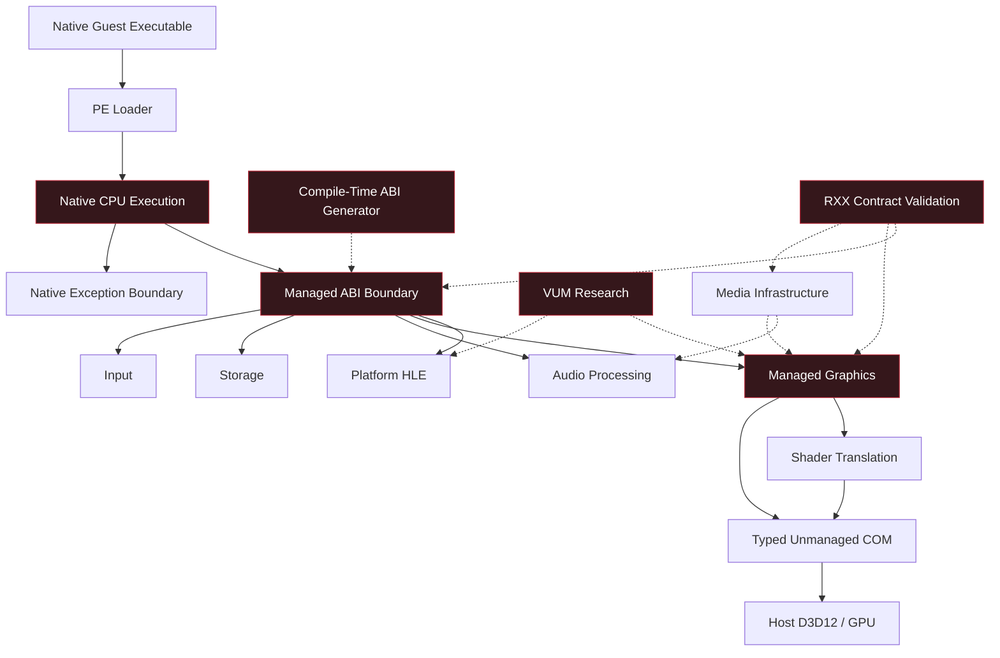
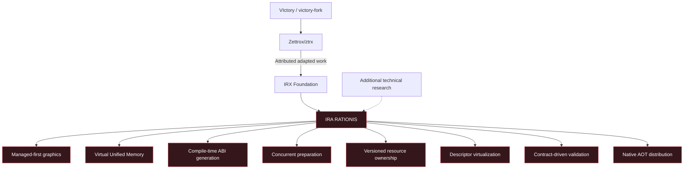
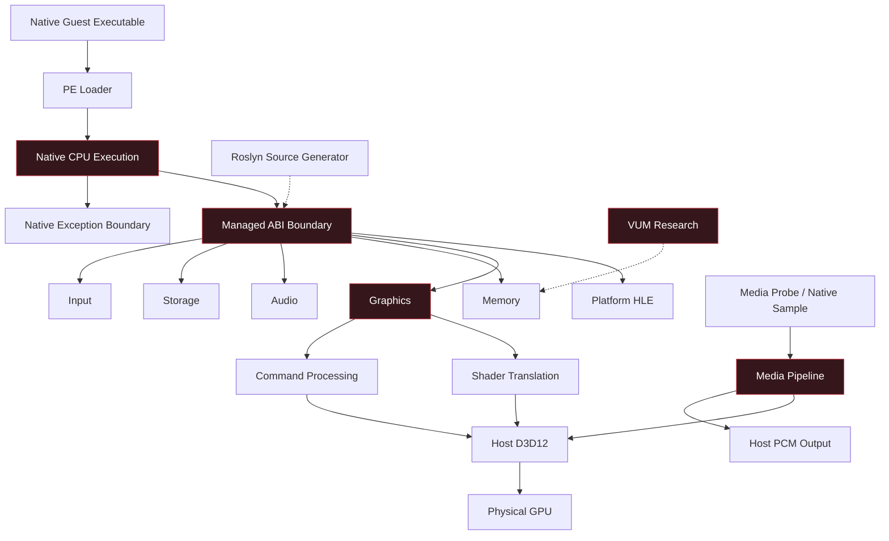
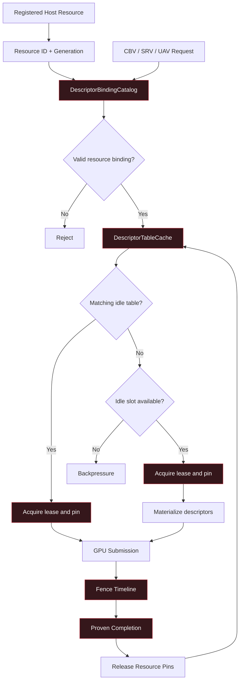
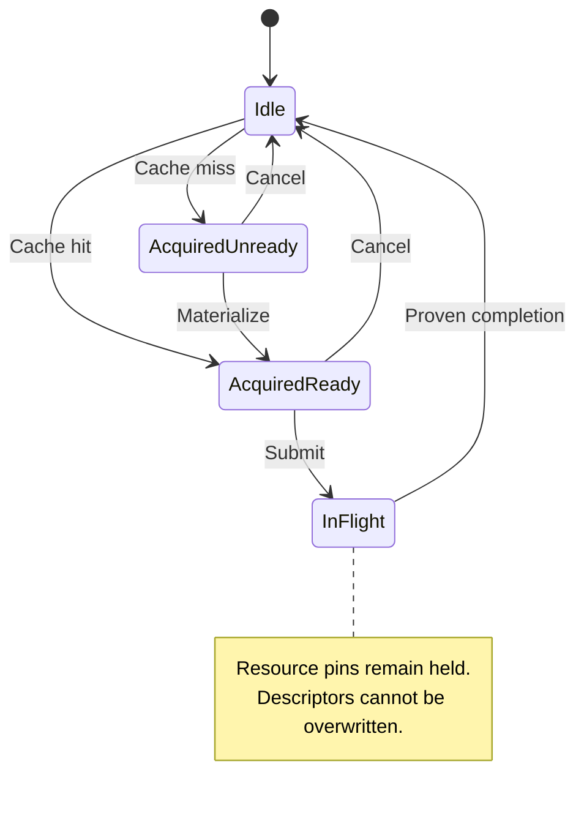
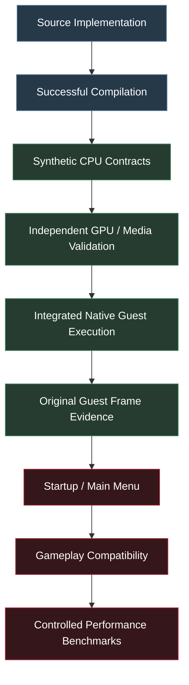

# Ira Rationis | Architectural Divergence

> Nullius in verba · Non impone opinionem

## 1. Purpose

This document establishes the architectural identity, technical direction, and implementation strategy of Ira Rationis (IRX), distinguishing its ongoing engineering development from its upstream foundations.

IRX acknowledges its upstream ancestry and preserves applicable attribution, copyright notices, and licensing obligations.

The project does not claim that every component was independently authored from inception. It does, however, maintain its own architectural direction, engineering priorities, subsystem boundaries, and development lifecycle.

## 2. Architectural Objectives

IRX approaches console compatibility as a systems engineering problem rather than a title-specific execution problem.

Its primary objectives are:

- Native x86-64 execution.
- Managed-first platform compatibility.
- Deterministic unmanaged resource ownership.
- Explicit guest-to-host ABI translation.
- Memory-efficient graphics and resource processing.
- Extensible shader translation.
- Contract-driven behavioral correctness.
- Measurable performance and scalability.
- Native AOT distribution.
- Long-term maintainability.

## 3. Managed-First Runtime

The use of C# and .NET is an architectural decision rather than a direct language substitution.

IRX leverages:

- Native AOT compilation.
- Typed unmanaged function pointers.
- Explicit ABI and memory layouts.
- Compile-time source generation.
- Span-based memory operations.
- Pooled memory allocation.
- Hardware intrinsics where appropriate.
- Selective native interoperability.

Native C++ remains appropriate for platform-specific operations that require native execution context, exception handling, or other capabilities not adequately exposed through managed APIs.

## 4. Architectural Development Areas

| Subsystem | IRX Architectural Direction |
|---|---|
| CPU execution | Native execution with explicit exception and instruction compatibility boundaries |
| ABI translation | Managed exports, typed unmanaged callbacks, and compile-time generation |
| Graphics | Managed console graphics objects, explicit guest layouts, and native host COM dispatch |
| Memory | Virtual Unified Memory research, software address translation, and comparative backing strategies |
| Shaders | Instruction inspection, bounded lowering, and explicit unsupported-instruction diagnostics |
| Audio | Managed processing, PCM contracts, routing, and synchronization |
| Media | Independent decoding and playback infrastructure, including Windows Media Foundation |
| Storage | Ordered request processing, decompression, and strict payload validation |
| Input | Native controller integration and guest-compatible input contracts |
| Diagnostics | Instrumented execution, process-scoped network observation, and component contract validation |
| Deployment | Self-contained Windows x64 Native AOT distribution |

These areas represent the project's current architectural direction and varying levels of implementation maturity. Their inclusion does not imply that every capability is complete or integrated into guest execution.

## 5. Architectural Research

### Virtual Unified Memory

IRX investigates software-managed address translation and explicit CPU/GPU backing strategies.

This research evaluates allocation, accessibility, resource coherence, synchronization, and performance characteristics across different host memory configurations.

VUM remains an experimental research architecture and is not represented as a complete production memory manager.

### Managed Graphics ABI

IRX maintains separate guest and host graphics layouts, with explicit unmanaged dispatch boundaries.

The objective is to provide a maintainable translation architecture while preserving native graphics execution and avoiding unnecessary interoperability layers.

### Compile-Time ABI Generation

IRX uses Roslyn-based source generation to generate selected ABI callbacks and diagnostic fallbacks during compilation.

This reduces repetitive implementation requirements and avoids introducing a runtime dependency on compiler infrastructure.

### Contract-Driven Development

Component contract tests establish behavioral expectations for individual runtime subsystems. Their project and implementation names describe the behavior under test; historical log markers remain stable where tooling depends on them.

Contracts are intended to identify regressions independently of commercial title execution and distinguish implementation correctness from apparent compatibility.

### Component ownership and maintainability

Authored types have one top-level declaration per file and live with the component that owns their contract. Input models, descriptor identities, and audio ABI structures therefore have local `Models` namespaces rather than a general shared-type library. Independent behavior classes make their owner dependencies explicit; extraction alone does not remove coupling. The partial graphics facade keeps one public type identity while its files are organized by graphics responsibility.

Maintainability is evaluated through understandable ownership and control flow, with cyclomatic and Halstead complexity used as review signals. Moving files does not itself simplify branches or prove a better maintainability score. Names should explain intent, comments should preserve non-obvious contracts and performance costs, and `//TODO: Damon William -> ...` notes should identify actionable decisions. SOLID, DRY, and YAGNI guide abstractions; a design pattern is useful when it solves an actual responsibility or lifetime problem.

### Performance and memory contracts

The production physical-page owner now uses a C# range index to find mapped-view overlaps and resolve aliases by contiguous portions. This changes lookup cost without moving mapping policy into C++ or removing synchronization. The separate VUM research model is still not a complete production coherence manager.

Existing bounded preparation and fence-retirement abstractions are foundations for using additional CPU cores while preserving guest-visible order. VRAM residency likewise requires guest-write observation, alias coherence, and completion-safe lifetime before transfer skipping or budget expansion is valid. The current implementation and remaining boundaries are documented in [architecture notes](architecture.md), [runtime integration](RUNTIME-INTEGRATION.md), and [diagnostics](DIAGNOSTICS.md).

## 6. Upstream Relationship

IRX incorporates attributed work from Zettrox/ztrx and its upstream ancestry. Additional repositories may be consulted as technical references.

Adapted implementation, reference material, and independently authored extensions must remain distinguishable through source attribution, repository history, and applicable licensing documentation.

Upstream ancestry does not solely define the current architectural identity of IRX.

## 7. Validation and Compatibility Claims

IRX distinguishes the following levels of evidence:

1. Source implementation.
2. Successful compilation.
3. Synthetic contract validation.
4. Independent subsystem execution.
5. Integrated guest execution.
6. Original guest frame presentation.
7. Menu and gameplay compatibility.
8. Sustained performance and stability.

Success at one level does not automatically establish success at subsequent levels.

On November 26, 2026, the maintainer supplied a successful local build and passing runtime component, startup-evidence, versioned-upload, descriptor-binding CPU, and strict/legacy raw/Zlib storage-contract results. This establishes reported local compilation and component-test evidence. The [validation record](RELEASING.md#local-build-and-component-checks) preserves the success markers; no game, GPU, performance, or CI outcome is implied by these checks.

The project does not represent synthetic media playback, diagnostic presentation, successful API invocation, or partial initialization as completed gameplay compatibility.

## 8. Supporting Evidence

- [Architecture and Research](architecture.md)
- [Virtual Unified Memory](../IraRationis.Memory)
- [Graphics Architecture](../IraRationis.Graphics)
- [Shader Architecture](../IraRationis.Shaders)
- [ABI Source Generation](../IraRationis.Generators)
- [Media Infrastructure](../IraRationis.Media)
- [Native Interoperability](../IraRationis.Native)
- [Contract Tests](../tests)
- [Development History](https://github.com/DBWilliamEngineering/IraRationis/commits/main/)
- [License](../LICENSE)

## 9. Project Classification

**Ira Rationis is an independently evolving, managed-first native compatibility runtime incorporating attributed upstream work and pursuing its own architectural and implementation strategy.**

Its technical merits should be evaluated against its current source, architecture, validation evidence, and development history.

## Architectural Diagrams

## Architectural identity and divergence

# Runtime architecture

## Descriptor binding architecture

### Descriptor lifecycle

## Evidence and engineering maturity

