# IRA RATIONIS | Architecture, Evidence & Performance Atlas

> **Vindex / First Light · Component architecture**<br>
> *Nullius in verba · Non impone opinionem*  
> Managed-first native compatibility research for Windows x64.

**Updated:** November 26, 2026, US Central time. Source links and ownership notes follow the current component layout. The original evidence baseline is [`d18868543526c75005b12bad3fd1666037814340`](https://github.com/DBWilliamEngineering/IraRationis/commit/d18868543526c75005b12bad3fd1666037814340) (R52); historical observations and fixture targets retain their revision labels. Damon William supplied a successful local build and passing runtime component, startup-evidence, versioned-upload, descriptor-binding CPU, and storage-contract results on November 26. These results do not establish new game, GPU, performance, or CI acceptance. This atlas is not a compatibility rating, controlled benchmark, full upstream diff, or proof of independent authorship for every component.

## Contents

- [01 · Identity and architectural divergence](#01--identity-and-architectural-divergence)
- [02 · Runtime architecture](#02--runtime-architecture)
- [03 · CPU, loading and ABI](#03--cpu-loading-and-abi)
- [04 · Graphics and shader translation](#04--graphics-and-shader-translation)
- [05 · Memory and resource ownership](#05--memory-and-resource-ownership)
- [06 · Concurrency and GPU synchronization](#06--concurrency-and-gpu-synchronization)
- [07 · Media and audio](#07--media-and-audio)
- [08 · Storage and input](#08--storage-and-input)
- [09 · Evidence and validation](#09--evidence-and-validation)
- [10 · Performance evidence](#10--performance-evidence)
- [11 · Development history and remaining gates](#11--development-history-and-remaining-gates)

### Reading the diagrams

Solid arrows depict documented source-level relationships or the flow of a specified fixture. Dotted arrows depict research, validation, optional integration, or future work as labeled. A source-level relationship does not prove that every guest call is supported. Status is conveyed by labels rather than color alone.

- **Source:** inspected implementation; source links use the current layout, while historical snapshots are labeled explicitly. Execution may be unverified.
- **Reported:** maintainer-reported local observation, not independently reproduced in preparing this atlas.
- **Target:** a test expectation or derived workload quantity, not an observed result.
- **Research:** isolated implementation or planned integration; no production compatibility claim.

## 01 · Identity and architectural divergence

### Diagram 01 | Ancestry, attribution and technical direction

IRX incorporates attributed GPL-covered upstream work and continues along its own architectural direction. The diagram describes documented relationships, not percentages of originality or an assertion that upstream lacks any particular capability.

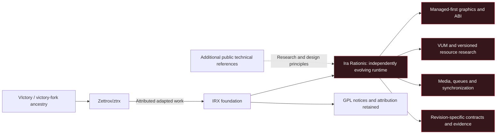

### Diagram 02 | Architectural decision map

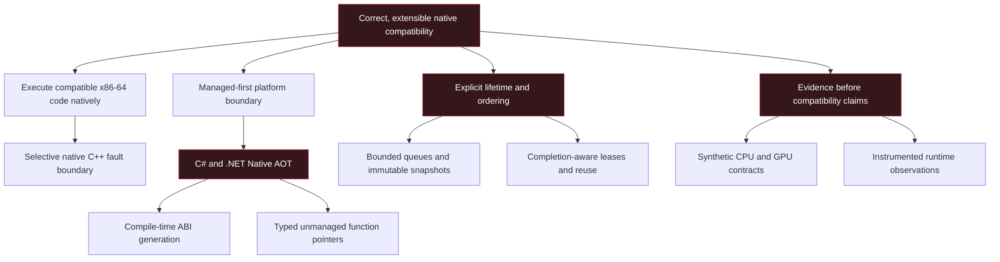

### Divergence inventory (evidence, not comparative superiority)

| IRX development area | Source anchors | Provenance / maturity boundary |
|---|---|---|
| Managed graphics ABI | [Graphics ABI](../IraRationis.Graphics/ConsoleGraphicsDevice/Abi.cs), [GraphicsDeviceModule.cs](../IraRationis.HLE/Graphics/GraphicsDeviceModule.cs) | Documented managed-first direction; mixed ancestry, exact source lineage not audited |
| Compile-time ABI fallbacks | [MissingGraphicsSlotGenerator.cs](../IraRationis.Generators/MissingGraphicsSlotGenerator.cs) | IRX-documented architectural extension; generated fallback is not semantic coverage |
| Virtual Unified Memory | [VirtualPageTable.cs](../IraRationis.Memory/VirtualMemory/VirtualPageTable.cs), [MemoryProbe.cs](../IraRationis.Memory/Diagnostics/MemoryProbe.cs) | IRX-documented isolated research; not global native memory interception |
| Media pipeline | [IraRationis.Media](../IraRationis.Media), [GPU media](../IraRationis.Graphics/Media/Nv12Presenter.cs), [Shared-device context](../IraRationis.Graphics/Media/MediaGpuContext.cs) | Host media architecture and explicit native fixture; not commercial guest movie ABI |
| Deferred preparation | [DeferredPreparationQueue.cs](../IraRationis.Core/Scheduling/DeferredPreparationQueue.cs) | Historical R48 notes describe independent C# implementation inspired by public design notes; not wired into guest dispatcher |
| Fence retirement | [FenceRetirementQueue.cs](../IraRationis.Core/Scheduling/FenceRetirementQueue.cs) | Bounded lifetime foundation; not general guest resource management |
| Host copy queue | [Nv12Presenter](../IraRationis.Graphics/Media/Nv12Presenter.cs) | Historical R49 notes describe independent implementation inspired by public design notes; opt-in |
| Resource versioning | [VersionedUploadBuffer.cs](../IraRationis.Graphics/Resources/VersionedUploadBuffer.cs) | Explicit-write host buffer contract; independent GPU probe and authored runtime integration |
| Descriptor identity and cache | [DescriptorBindingCatalog.cs](../IraRationis.Graphics/Descriptors/DescriptorBindingCatalog.cs), [DescriptorTableCache.cs](../IraRationis.Graphics/Descriptors/DescriptorTableCache.cs) | Bounded host descriptor virtualization; authored runtime integration, not general guest descriptor translation |
| Native CPU, HLE and shader paths | [Loader](../IraRationis.Loader), [Native](../IraRationis.Native), [HLE](../IraRationis.HLE), [Shaders](../IraRationis.Shaders) | Mixed provenance; requires file-level upstream comparison |

Upstream references: [Zettrox/ztrx](https://github.com/Zettrox/ztrx), [DexNom/VIctory](https://github.com/DexNom/VIctory), [victory-fork](https://github.com/fxceless/victory-fork), [VIctory-7900XTX](https://github.com/avatarmanz/VIctory-7900XTX). See [runtime license](../LICENSE) and repository attribution. An independently developed extension does not remove applicable upstream license obligations.

## 02 · Runtime architecture

### Component ownership and source layout

Types are organized by responsibility, with data models beneath the component that owns their contract. For example, physical mappings belong to `IraRationis.HLE.Memory`, input state to `IraRationis.HLE.Input.Models`, and descriptor identities to `IraRationis.Graphics.Descriptors.Models`. Shared audio ABI layouts live in `IraRationis.Media.Audio.Models`; a generic shared library is not required merely because a type is a struct.

Authored types are top-level and have individual files. Extracted behavior classes retain explicit assembly-internal dependencies where required; moving a nested type does not itself decouple its ownership. `ConsoleGraphicsDevice` remains one partial facade in `IraRationis.Graphics`, because its generated ABI callbacks and partial declarations must share a type identity. Its files are grouped under [ConsoleGraphicsDevice](../IraRationis.Graphics/ConsoleGraphicsDevice), with names such as `Drawing/VertexFetchSourceProbe.cs`.

The [architecture notes](architecture.md) describe the implementation boundaries. [Runtime integration](RUNTIME-INTEGRATION.md) covers utility contexts and the authored scalar/media path; [diagnostics](DIAGNOSTICS.md) covers trace capture and startup evidence. Release-specific working notes live in Git history rather than serving as current documentation.

### Diagram 03 | System context

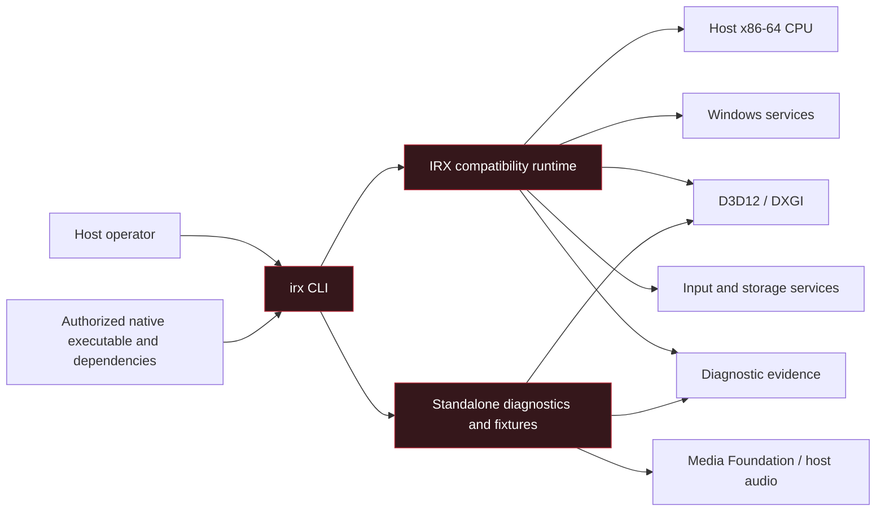

### Diagram 04 | Runtime subsystem topology

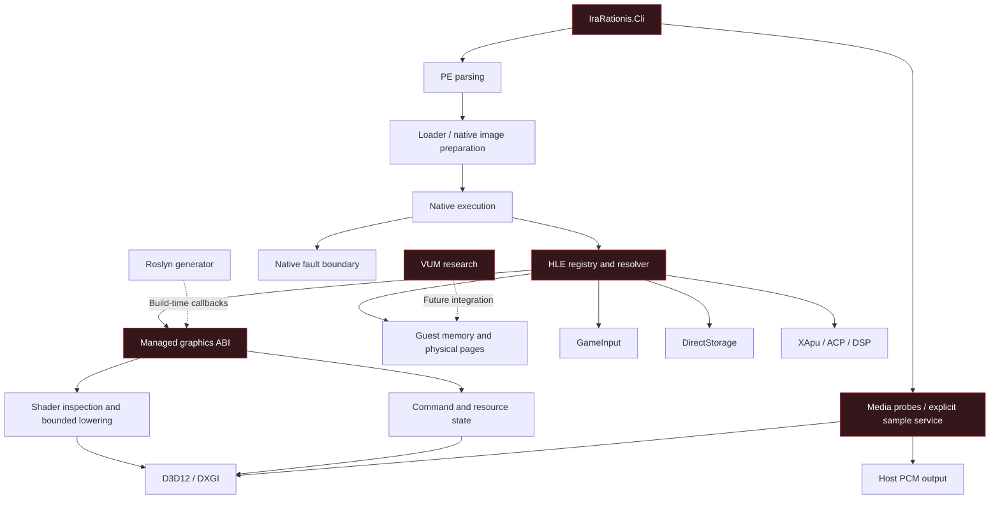

Sources: [solution](../IraRationis.slnx), [RunCommand](../IraRationis.Cli/Commands/RunCommand.cs), [existing architecture notes](architecture.md).

## 03 · CPU, loading and ABI

### Diagram 05 | Image preparation and native execution

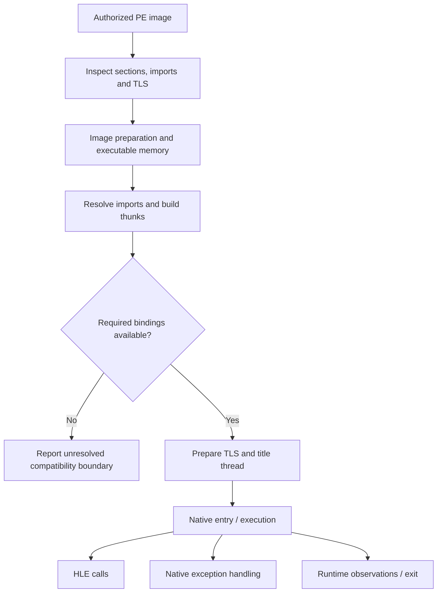

Sources: [PeImage](../IraRationis.PE/Parsing/PeImage.cs), [ImagePreparation](../IraRationis.Loader/Images/ImagePreparation.cs), [IImportResolver](../IraRationis.Loader/Imports/IImportResolver.cs), [ImportThunks](../IraRationis.Loader/Imports/ImportThunks.cs), [TlsRedirector](../IraRationis.Loader/Threads/TlsRedirector.cs), [TitleThreads](../IraRationis.Loader/Threads/TitleThreads.cs). Conceptual flow; not a complete loader call graph or sandbox.

### Diagram 06 | Native instruction compatibility boundary

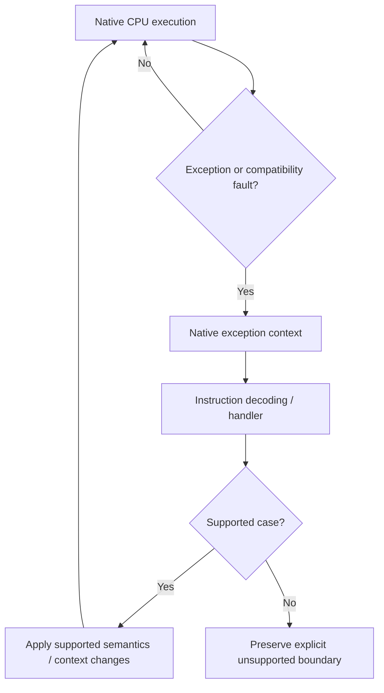

Sources: [ExceptionHandler.cpp](../IraRationis.Native/ExceptionHandler.cpp), [ConsoleInstructionDecoder.cs](../IraRationis.Loader/Instructions/ConsoleInstructionDecoder.cs), [ConsoleInstructionHandler.cs](../IraRationis.Loader/Instructions/ConsoleInstructionHandler.cs). This depicts the architectural boundary; it does not imply every fault takes this route or every instruction is emulated.

### Diagram 07 | Compile-time ABI generation and dispatch

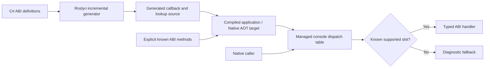

Sources: [MissingGraphicsSlotGenerator](../IraRationis.Generators/MissingGraphicsSlotGenerator.cs), [HleRegistry](../IraRationis.HLE/Runtime/HleRegistry.cs). Fallback callbacks are generated at build time; the former empty placeholder source file was removed. An ABI callback existing is not evidence of behavioral parity.

## 04 · Graphics and shader translation

### Diagram 08 | Managed graphics translation boundary

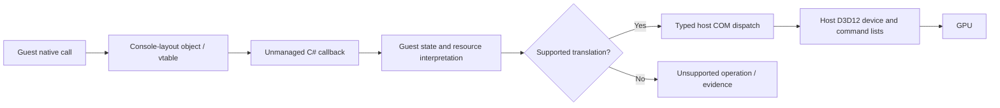

Sources: [GraphicsDeviceModule](../IraRationis.HLE/Graphics/GraphicsDeviceModule.cs), [Graphics ABI](../IraRationis.Graphics/ConsoleGraphicsDevice/Abi.cs), [ConsoleGraphicsDevice](../IraRationis.Graphics/ConsoleGraphicsDevice/ConsoleGraphicsDevice.cs).

### Diagram 09 | Shader evidence and bounded lowering

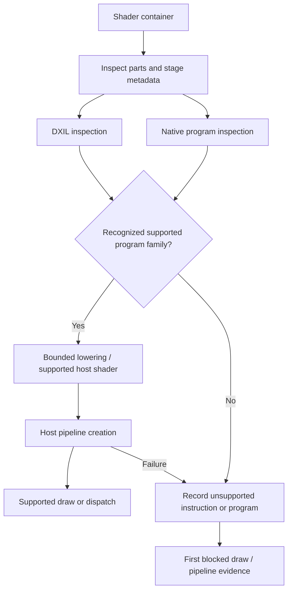

Sources: [ShaderContainer](../IraRationis.Shaders/Containers/ShaderContainer.cs), [NativeShaderProbe](../IraRationis.Shaders/Native/NativeShaderProbe.cs), [Rdna2ScalarCompiler](../IraRationis.Shaders/Scalar/Rdna2ScalarCompiler.cs), [DrawEvidence](../IraRationis.Graphics/ConsoleGraphicsDevice/Diagnostics/DrawEvidence.cs). The compiler families are deliberately limited; diagnostic native programs are not necessarily executable.

### Diagram 10 | Conservative command ordering

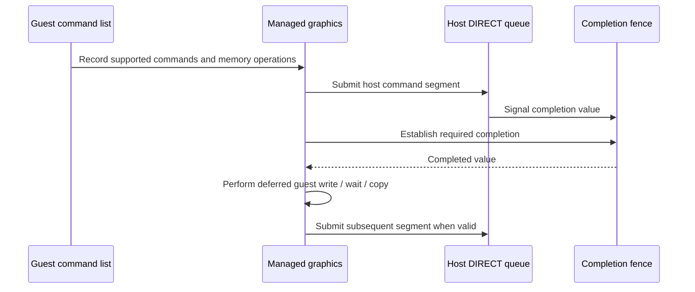

Sources: [CommandMemory](../IraRationis.Graphics/ConsoleGraphicsDevice/Commands/CommandMemory.cs), [CommandOperations](../IraRationis.Graphics/ConsoleGraphicsDevice/Commands/CommandOperations.cs), [HostCompletionFence](../IraRationis.Graphics/Synchronization/HostCompletionFence.cs). Conservative segmentation is not a fully asynchronous guest GPU scheduler.

### Diagram 11 | Descriptor identity and table materialization

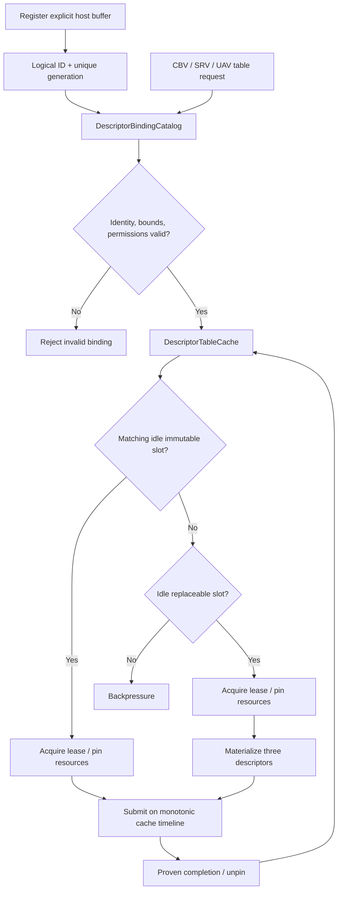

Source: [DescriptorTableCache](../IraRationis.Graphics/Descriptors/DescriptorTableCache.cs). Pins are acquired with the lease, before materialization and submission. Only explicit host buffer identities are tracked. Physical aliases between different IDs are not detected.

### Diagram 12 | Descriptor lease lifecycle

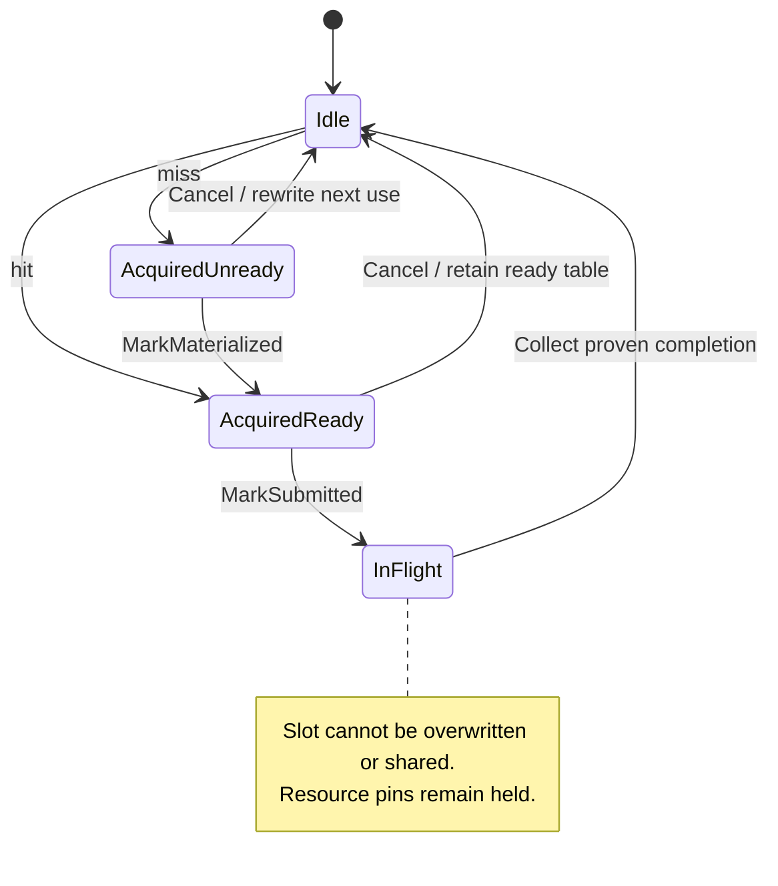

Sources: [DescriptorTableCache](../IraRationis.Graphics/Descriptors/DescriptorTableCache.cs), [descriptor CPU contracts](../tests/descriptor-bindings/Program.cs). Native COM lifetime remains the caller's responsibility; the catalog does not own the resources.

### Diagram 13 | Authored GPU descriptor fixture

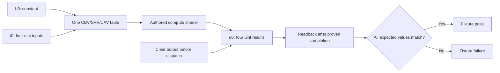

| Dispatch | Binding | Expected output (target) |
|---|---|---|
| 1 | A | 9, 11, 13, 15 |
| 2 | A | 9, 11, 13, 15 |
| 3 | B | 29, 39, 49, 59 |
| 4 | A | 9, 11, 13, 15 |

Expected counters: 4 dispatches, 2 hits, 2 misses, 2 materializations, 6 native descriptors, 1 heap. These are **targets**, not observed results. R51 DEFAULT-buffer uploads and R52 bindings are exercised separately. Source: [DescriptorBindingProbe](../IraRationis.Graphics/ConsoleGraphicsDevice/Descriptors/DescriptorBindingProbe.cs), [Descriptor tables](../IraRationis.Graphics/Descriptors/DescriptorTableCache.cs).

## 05 · Memory and resource ownership

### Diagram 14 | Virtual Unified Memory research

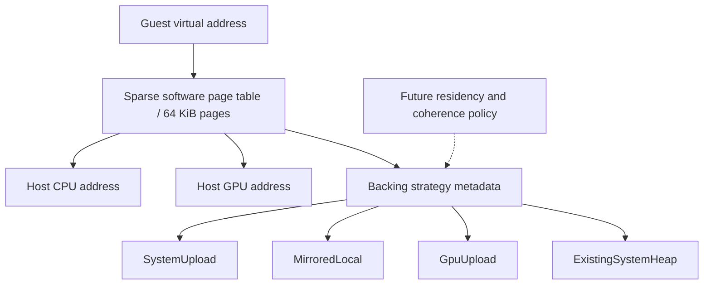

Sources: [VirtualPageTable](../IraRationis.Memory/VirtualMemory/VirtualPageTable.cs), [MemoryProbe](../IraRationis.Memory/Diagnostics/MemoryProbe.cs). Isolated research; no hardware page-table interception or arbitrary pointer-write tracking.

### Production physical-view indexing

The production [PhysicalPageModule](../IraRationis.HLE/Memory/PhysicalPageModule.cs) is distinct from that research page table. Its [MappedViewIndex](../IraRationis.HLE/Memory/MappedViewIndex.cs) indexes disjoint half-open ranges and snapshots overlapping views before they are unmapped or split. Lookup is O(log n + k) for n views and k overlaps; index updates during unmapping add O(k log n). Alias resolution works by contiguous view portions rather than repeating a complete search for each page. The existing owner lock and Windows mapping calls remain serialized, and values retain their section-handle ownership. These costs describe the algorithm, not a measured FPS improvement.

Host resource materialization currently has a 512 MiB total budget and 256 MiB per-resource limit in [HostResources](../IraRationis.Graphics/ConsoleGraphicsDevice/Resources/HostResources.cs). More available VRAM does not remove the need for coherent aliases, guest-write observation, and fence-safe eviction before expanding residency policy.

### Diagram 15 | VUM comparative workload design

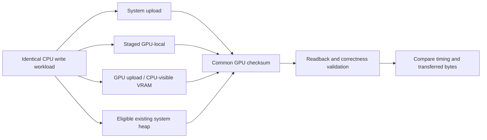

No comparative speed results are asserted here. Backing availability is hardware and driver dependent.

### Diagram 16 | Immutable versioned uploads

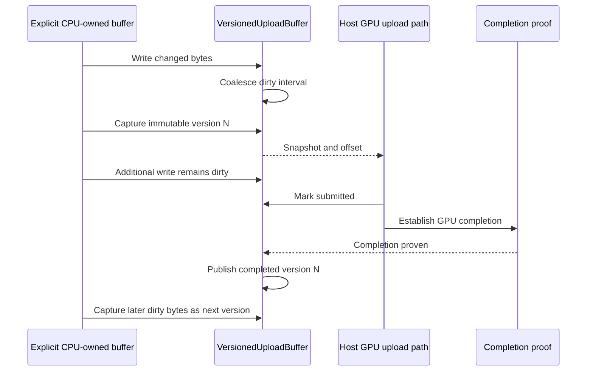

Sources: [VersionedUploadBuffer](../IraRationis.Graphics/Resources/VersionedUploadBuffer.cs), [VersionedUploadProbe](../IraRationis.Graphics/ConsoleGraphicsDevice/Resources/VersionedUploadProbe.cs). One outstanding snapshot; no general alias coherence.

Current integration also uses this buffer in [UtilityContext](../IraRationis.Graphics/Commands/UtilityContext.cs) for explicitly captured data. The pool reuses completed utility work in texture-upload and compute paths; the authored scalar fixture uses versioned upload and descriptor tables together. This still does not track arbitrary guest-pointer writes or general guest descriptor lifetimes. See [runtime integration](RUNTIME-INTEGRATION.md) for those contracts and validation limits.

### Diagram 17 | Upload state machine

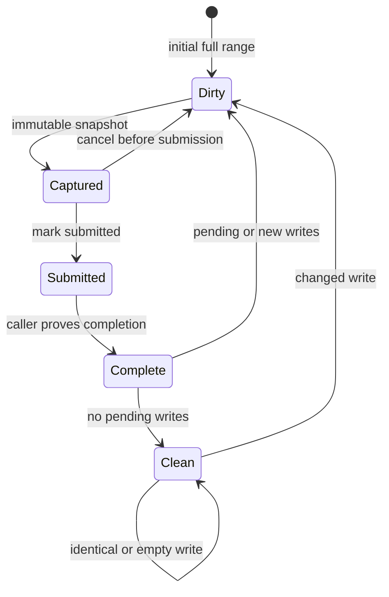

Writes after capture remain dirty for the next snapshot; they do not mutate the in-flight snapshot. A cancelled snapshot's range is merged back with later changes.

## 06 · Concurrency and GPU synchronization

### Diagram 18 | Bounded concurrent preparation

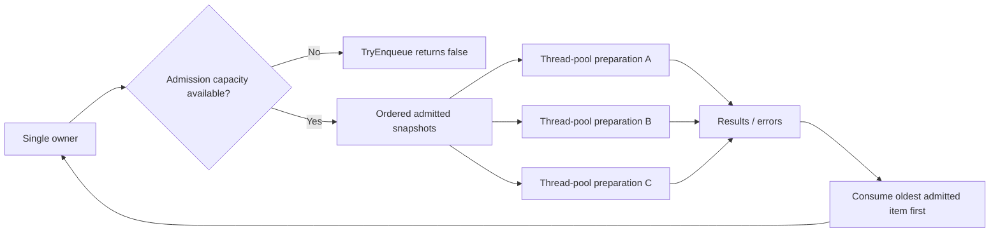

Source: [DeferredPreparationQueue](../IraRationis.Core/Scheduling/DeferredPreparationQueue.cs). Worker semaphore bounds parallelism; managed snapshots only. This foundation is not wired into the guest dispatcher.

### Diagram 19 | Completion-aware retirement

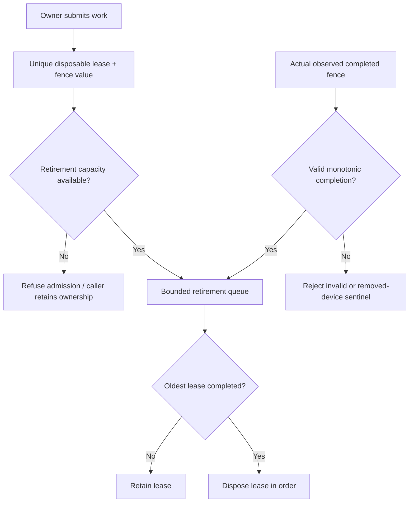

Source: [FenceRetirementQueue](../IraRationis.Core/Scheduling/FenceRetirementQueue.cs). Queue does not signal fences or own native COM resources directly.

### Diagram 20 | Two-level host shader caching

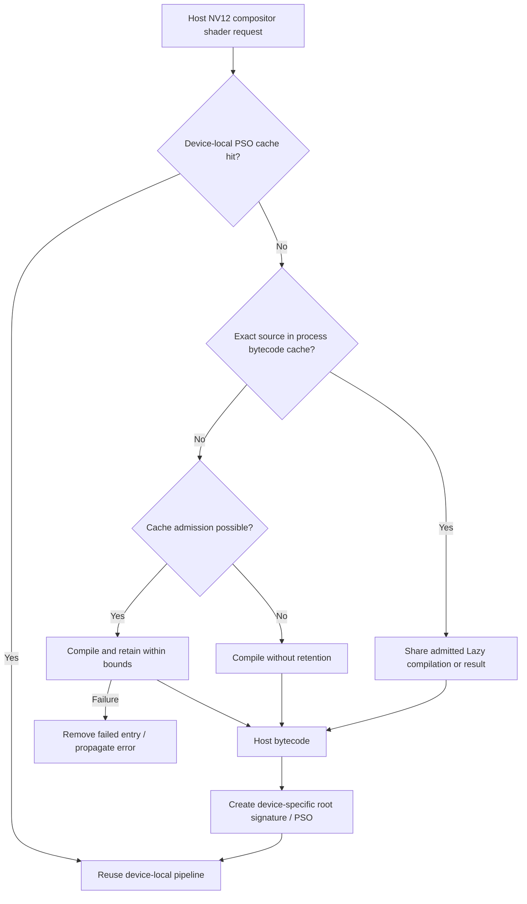

Source: [HostMediaShaderCache](../IraRationis.Graphics/ConsoleGraphicsDevice/Media/HostMediaShaderCache.cs). Retention limits: 32 entries and 8 MiB completed bytecode; source strings over 64 Ki characters bypass retention. Pending entries are not evicted; not a global bound on concurrent compilation.

### Diagram 21 | Opt-in COPY and DIRECT queue synchronization

```mermaid
sequenceDiagram
    participant CPU as Owner thread / slot
    participant CQ as COPY queue
    participant CF as Copy fence
    participant DQ as DIRECT queue
    participant DF as Direct fence
    CPU->>DF: Wait for prior slot completion if needed
    CPU->>CPU: Fill mapped upload and record both lists
    CPU->>CQ: Submit Y and UV plane copies
    CQ->>CF: Signal frame sequence N
    CPU->>DQ: Enqueue GPU-side wait for copy fence N
    CF-->>DQ: Copy dependency completed
    CPU->>DQ: Submit conversion and back-buffer copy
    CPU->>DQ: Present and signal N
    DQ->>DF: Signal after submitted work
    DF-->>CPU: Slot safe to reuse after completion
```

Source: [Host copy queue](../IraRationis.Graphics/Media/Nv12Presenter.cs). No dedicated CPU copy-fence wait in the designed path; DIRECT reuse may still wait. Separate GPU engines are not proof of measured overlap or speedup.

## 07 · Media and audio

### Diagram 22 | Host media paths and the guest boundary

```mermaid
flowchart TD
    A["Authorized local clip"] --> B["Standalone media-probe"]
    A --> S["Explicit host-selected sample clip"]
    S --> N["Authored native sample HLE service"]
    B --> MF["Media Foundation / supported local decoder"]
    N --> MF
    MF --> V["NV12 frames"]
    MF --> PCM["48 kHz stereo PCM16"]
    V --> GDI["Existing CPU/GDI path"]
    V --> GPU["Persistent D3D12 compositor"]
    PCM --> CLK["Host audio clock / output"]
    CLK --> GDI
    CLK --> GPU
    GUEST["Commercial guest movie service"] -.->|Not established| MF
    GPU -.->|Guest texture publication not established| GT["Guest graphics resources"]
```

Sources: [MediaFoundationDecoder](../IraRationis.Media/Decoding/MediaFoundationDecoder.cs), [GpuMediaPlaybackSession](../IraRationis.Media/Playback/GpuMediaPlaybackSession.cs), [RuntimeMediaSample](../IraRationis.Cli/Media/RuntimeMediaSample.cs).

### Diagram 23 | Device ownership and triple buffering

```mermaid
flowchart TD
    A["Host media context"] --> B{"Runtime-backed context selected?"}
    B -->|Yes| C["Process-owned runtime D3D12 device"]
    B -->|No| D["Isolated host device"]
    C --> Q["Media DIRECT queue"]
    D --> Q
    Q --> P["Persistent presenter / PSO / root signature"]
    P --> S0["Slot 0: upload / NV12 / output / list"]
    P --> S1["Slot 1: upload / NV12 / output / list"]
    P --> S2["Slot 2: upload / NV12 / output / list"]
    S0 --> F["Fence-safe reuse"]
    S1 --> F
    S2 --> F
    F --> P
```

Sources: [Nv12Presenter](../IraRationis.Graphics/Media/Nv12Presenter.cs), [MediaGpuContext](../IraRationis.Graphics/Media/MediaGpuContext.cs). Sharing a device is not equivalent to sharing resource ownership or queue ordering.

### Diagram 24 | NV12 plane upload and conversion

```mermaid
flowchart LR
    A["Decoded NV12"] --> Y["Y plane: full height"]
    A --> UV["Interleaved UV: half height"]
    Y --> P["Validate pitched plane extents"]
    UV --> P
    P --> U["Mapped upload buffer"]
    U --> T["GPU NV12 texture"]
    T --> C["Host compute conversion"]
    C --> B["Pitched BGRA output buffer"]
    B --> S["SwapChain back buffer"]
    S --> D["Present"]
```

Sources: [PitchedPlaneCopy](../IraRationis.Graphics/Textures/PitchedPlaneCopy.cs), [Nv12Presenter](../IraRationis.Graphics/Media/Nv12Presenter.cs), [VersionedUploadBuffer](../IraRationis.Graphics/Resources/VersionedUploadBuffer.cs). The GPU presentation path avoids CPU video readback; it still performs CPU upload and GPU copies.

### Diagram 25 | First-frame and audio-clock synchronization

```mermaid
sequenceDiagram
    participant S as Playback session
    participant P as GPU presenter
    participant A as Audio clock
    participant T as HostFrameTimeline
    S->>P: Submit opening frame 0
    alt Frame accepted
        P-->>S: Accepted
        S->>A: Start audio clock
        loop While playback active
            A-->>S: Monotonic audio position
            S->>T: Select due frame
            T-->>S: Frame index / skip accounting
            S->>P: Submit selected frame
        end
        S->>S: Account for completion or cancellation
    else Frame refused
        P-->>S: Failure
        S->>S: Fail without starting audio
    end
```

Sources: [HostFrameTimeline](../IraRationis.Media/Playback/HostFrameTimeline.cs), [GpuMediaPlaybackSession](../IraRationis.Media/Playback/GpuMediaPlaybackSession.cs). Accepted presentation is not proof of monitor scanout.

### Diagram 26 | Reported R39.1 audio timeline alignment

```mermaid
flowchart LR
    A["Decoded: 97,280 stereo frames"] --> B["Trim 3,200 leading frames"]
    B --> C["94,080 copied frames"]
    C --> D["Pad 1,920 trailing frames"]
    D --> E["96,000 stereo frames"]
    E --> F["192,000 interleaved PCM samples"]
```

Maintainer-reported log: 60 video frames, display 320×180, negotiated 320×192, 48 kHz audio, 96,000 target stereo frames. A stereo frame contains two samples. This proves the reported decode/alignment accounting, not guest movie output or audible playback.

### Diagram 27 | Guest audio vs independent output evidence

```mermaid
flowchart TD
    G["Guest audio ABI calls"] --> H["XApu / ACP / DSP implementation"]
    H --> P["Implemented PCM handling / observations"]
    P --> S["Session-scoped sink / packet contract"]
    S --> O["Host output or monitoring path as configured"]
    M["Independent local media PCM"] --> A["Host audio clock / wave output"]
    G -.->|Full decoder and DSP coverage outstanding| X["Integrated title audio"]
    O -.->|Requires measured evidence| X
```

Sources: [Guest PCM observation](../IraRationis.HLE/Audio/Apu/XApuModule/Pcm.cs), [IPcmPacketSink](../IraRationis.Media/Audio/IPcmPacketSink.cs), [RuntimePcmObservation](../IraRationis.Cli/Diagnostics/RuntimePcmObservation.cs), [WindowsPcmMonitor](../IraRationis.Media/Audio/WindowsPcmMonitor.cs). Do not infer guest audio support from standalone wave output.

## 08 · Storage and input

### Diagram 28 | Ordered storage processing

```mermaid
flowchart LR
    A["Guest storage request"] --> B["Per-queue ordered worker"]
    B --> C["Read requested payload"]
    C --> D{"Supported compression?"}
    D -->|Raw| E["Raw bytes"]
    D -->|Zlib| F["Decompress"]
    D -->|Other / invalid| X["Explicit error boundary"]
    E --> V["Validate payload length as configured"]
    F --> V
    V --> S["Status / completion accounting"]
```

Sources: [DirectStorageModule](../IraRationis.HLE/Storage/DirectStorageModule.cs), [DirectStoragePayload](../IraRationis.HLE/Storage/DirectStoragePayload.cs), [storage contracts](../tests/storage-contract). BCPack and generalized weighted scheduling are not established by these contracts.

### Diagram 29 | Native controller handling

```mermaid
flowchart LR
    D["Wired DualSense HID reports"] --> N["Normalize controls and dead zones"]
    X["XInput"] --> N
    K["Keyboard fallback"] --> N
    N --> I["GameInput implementation"]
    I --> G["Guest readings"]
    G --> E["Observed press / release evidence"]
```

Sources: [GameInputModule](../IraRationis.HLE/Input/GameInputModule/GameInputModule.cs), [DualSense backend](../IraRationis.HLE/Input/GameInputModule/DualSense.cs). R30 maintainer-reported wired input readings; does not establish complete controller features, haptics, Bluetooth, or frontend completion.

## 09 · Evidence and validation

### Diagram 30 | Evidence ladder (not a completion percentage)

```mermaid
flowchart TD
    S["1. Source implemented"] --> B["2. Build succeeds"]
    B --> C["3. Synthetic CPU contracts pass"]
    C --> G["4. Independent GPU / media fixtures pass"]
    G --> N["5. Integrated native guest execution"]
    N --> F["6. Original guest frame evidence"]
    F --> M["7. Startup / main menu verified"]
    M --> P["8. Gameplay verified"]
    P --> T["9. Controlled performance and stability"]
```

This is a reporting model, not a mandatory chronological dependency between every subsystem. Evidence at one level never automatically establishes the next level.

### Diagram 31 | Component contract coverage

```mermaid
flowchart LR
    R50["Startup CPU contracts: reported pass November 26"] --> A["Frame timeline and skip accounting"]
    R50 --> B["Log sampling / error preservation"]
    R51["Upload CPU contracts: reported pass November 26"] --> C["Full and partial uploads"]
    R51 --> D["Immutable snapshots and cancellation"]
    R51 --> E["Pitched-plane copy / padding"]
    R52["Descriptor CPU contracts: reported pass November 26"] --> F["Generation-checked resource catalog"]
    R52 --> G["Cache capacity / immutable reuse"]
    R52 --> H["Cancellation and invalid transitions"]
    R52 -.-> I["Independent GPU fixture: validation target"]
```

Current sources: [startup-evidence contracts](../tests/startup-evidence/Program.cs), [versioned-upload contracts](../tests/versioned-upload/Program.cs), [descriptor-binding contracts](../tests/descriptor-bindings/Program.cs). The original atlas had reported R50/R51 success markers and source-only R52 evidence. On November 26, 2026, the maintainer supplied passing results for all three CPU suites, including `IRX-R52 CPU contracts passed.` Current project names describe behavior, while the historical success markers remain stable. See [local build and component checks](RELEASING.md#local-build-and-component-checks) for the command inventory and current validation record.

### Diagram 32 | Startup evidence decision tree

```mermaid
flowchart TD
    A["Capture authorized run with revision and settings"] --> B{"Native entry and imports observed?"}
    B -->|No| C["Investigate loader / ABI boundary"]
    B -->|Yes| D{"Supported draw or dispatch submitted?"}
    D -->|No| E["Record first blocked draw / shader / pipeline"]
    D -->|Yes| F{"Resource content and composition verified?"}
    F -->|No| G["Inspect resource data and ordering"]
    F -->|Yes| H{"Original guest-visible frame demonstrated?"}
    H -->|No| I["Keep presentation status unverified"]
    H -->|Yes| J["Record exact frame evidence and limits"]
    J --> K{"Menu / gameplay independently demonstrated?"}
    K -->|No| L["No menu or gameplay claim"]
    K -->|Yes| M["Record reproducible scenario and compatibility"]
```

### Evidence register

| Capability | Evidence status | Evidence / limit |
|---|---|---|
| Native executable entry | Reported | Historical README; authorized native execution |
| Static imports | Reported | R31: 924 resolved slots, zero missing in five-image audit; not semantic coverage |
| Recognizable original UI pixels | Reported | Historical README R30–R31; not independently reviewed captures here |
| Wired controller guest readings | Reported | R30 press/release observations |
| Storage reads | Reported | R32 sampled successful reads and status accounting |
| Independent media decode | Reported | R34 and R39.1: 60 frames, 192,000 interleaved PCM samples |
| Independent live A/V | Reported | R35/R36 60 presented, 0 skipped; physical sound not independently verified |
| Local build and runtime component suite | Reported pass, November 26, 2026 | Maintainer supplied a successful build and `Runtime component tests passed.`; includes mapped-view and physical-page contracts |
| Startup/upload CPU contracts | Reported pass, November 26, 2026 | Maintainer supplied `IRX-R50 CPU contracts passed.` and `IRX-R51 CPU contracts passed.` |
| Descriptor CPU contracts | Reported pass, November 26, 2026 | Maintainer supplied `IRX-R52 CPU contracts passed.`; supersedes the original atlas's source-only status |
| Raw/Zlib storage contracts | Reported pass, November 26, 2026 | All supplied strict/legacy checks passed, including exact output, short-output policy, overflow rejection, and invalid Zlib rejection |
| R51 versioned GPU upload | Target | 4096-byte initial and 64-byte partial upload, readback verification |
| R52 descriptor GPU fixture | Target | Four dispatches, two hits, two misses, verified readback |
| Guest startup logo/video | Outstanding | Independent host playback is not guest playback |
| Guest audio and frontend/menu | Outstanding | Full guest audio and legitimate platform lifecycle not established |
| Gameplay | Not demonstrated | No gameplay claim |

Historical source: [README at the R52 snapshot](https://github.com/DBWilliamEngineering/IraRationis/blob/d18868543526c75005b12bad3fd1666037814340/README.md), plus maintainer-supplied local logs. The November 26 component results are a later maintainer-supplied update, not a rerun of the historical GPU or title scenarios. Where documentation and runtime reports differ in revision or scope, retain both labels and attach exact evidence before changing status.

### Diagram 33 | Evidence publication and CI gates

```mermaid
flowchart TD
    P["Push / pull request / manual run"] --> B["Restore and build"]
    B --> C["Configured component and storage tests"]
    C --> A["Native AOT publish"]
    A --> S["Configured native / synthetic smoke tests"]
    S --> Z["Build artifacts and metadata"]
    Z --> T{"Version tag push?"}
    T -->|No| E["CI artifact"]
    T -->|Yes| R["Draft prerelease and source archive"]
    R --> H["Maintainer review"]
    X["Executable contract projects"] -.->|Require explicit execution in CI| C
    G["GPU and real A/V acceptance"] -.->|Separate local evidence| H
```

Source: [build workflow](../.github/workflows/build.yml). The diagram summarizes configured gates, not a successful CI run. Executable contract projects need explicit execution: adding a console project to a solution does not execute its `Main` during `dotnet build` or guarantee execution by `dotnet test`.

## 10 · Performance evidence

### Diagram 34 | Historical presentation rates (reported, not gameplay FPS)

```mermaid
xychart-beta
    title "Reported mean presentations per second (historical runs)"
    x-axis [R28, R29]
    y-axis "Presentations/s" 0 --> 25
    bar [16.4, 19.7]
```

| Revision | Reported observation |
|---|---|
| R24–R27 | Sub-1 presentation/s during early UI experiments |
| R28 | Mean approximately 16.4 presentations/s |
| R29 | Mean approximately 19.7 presentations/s; sampled peak 21.44/s |
| R30 | Approximately 17–20 presentations/s |
| R31 | Capture readbacks reduced throughput |

R28 and R29 are historical development runs, not controlled A/B benchmarks. The chart does not imply a measured R52 speedup. Historical README is the source. If a GitHub Mermaid renderer does not support `xychart-beta`, use this table as the authoritative data.

### Diagram 35 | Sparse upload volume (reported R29 example)

```mermaid
xychart-beta
    title "R29 sampled upload bytes"
    x-axis [Allocation, Copied]
    y-axis "Bytes" 0 --> 1200000
    bar [1161472, 37354]
```

| Quantity | Bytes |
|---|---:|
| Allocation size | 1,161,472 |
| Copied bytes | 37,354 |
| Difference | 1,124,118 |
| Copied volume relative to allocation | Approximately 3.2% |
| Reduced volume relative to full allocation | Approximately 96.8% |

This is one reported sparse upload case; it is not a GPU bandwidth measurement or generalized speedup.

### Diagram 36 | Log-volume model (prediction)

```mermaid
xychart-beta
    title "R50 diagnostic sampling model"
    x-axis [Views, Lists]
    y-axis "Log lines" 0 --> 5000
    bar [4601, 625]
    bar [14, 11]
```

| Category | Original reported log lines | Predicted retained lines |
|---|---:|---:|
| Resource views | 4,601 | 14 |
| Command list creations | 625 | 11 |
| Total of these two categories | 5,226 | 25 |

The first series shows observed line counts and the second shows projected counts with sampling. The rule retains the first four and subsequent powers of two for each category. Sampling now runs before formatting or writing either success message. Error and evidence logging use their existing paths. The original log contained 6,022 lines, and the projected reduction of about 99.5% applies to the two sampled categories. Wall time still needs measurement. [GraphicsLogSampling](../IraRationis.Graphics/Diagnostics/GraphicsLogSampling.cs).

### Diagram 37 | Upload and descriptor fixture efficiency targets

```mermaid
flowchart TD
    A["R51: 4096-byte host buffer"] --> B["Initial transfer: 4096 bytes"]
    A --> C["Changed interval: 64 bytes"]
    A --> D["Unchanged write: no upload"]
    B --> V["Expected full readback verification"]
    C --> V
    E["R52: four serial dispatches"] --> F["A, A, B, A bindings"]
    F --> G["Expected two materializations"]
    G --> H["Expected six native descriptors"]
    F --> I["Expected two cache hits"]
```

| Fixture | Baseline / operation | Target | Interpretation |
|---|---|---|---|
| R51 | 4096-byte full transfer | 64-byte partial update | 1/64 of full transfer volume for that update only |
| R51 | Identical write | 0 uploads | No unnecessary transfer for this explicit-write fixture |
| R52 | 4 serial table acquisitions | 2 hits, 2 misses | 50% expected cache hit rate for A/A/B/A only |
| R52 | 3 descriptors per materialized table | 6 native descriptors | Two materializations; no general heap reduction claim |
| R49 | 60 frames at 320×180 NV12 | 5,184,000 active pixel bytes | Derived workload quantity; excludes padding and other copies |

All rows are target or derived fixture quantities, not hardware measurements. Sources: [Host copy queue](../IraRationis.Graphics/Media/Nv12Presenter.cs), [Versioned uploads](../IraRationis.Graphics/Resources/VersionedUploadBuffer.cs), [Descriptor tables](../IraRationis.Graphics/Descriptors/DescriptorTableCache.cs).

### Diagram 38 | Performance instrumentation map

```mermaid
flowchart LR
    A["Native workload"] --> CPU["CPU fault and dispatch overhead"]
    A --> PR["CPU preparation"]
    PR --> UP["Resource upload / copied bytes"]
    UP --> SUB["Host submission wall time"]
    SUB --> GPU["GPU execution"]
    GPU --> F["Fence waits / resource retirement"]
    F --> P["Presentation / frame accounting"]
    CPU --> M["Metrics and trace evidence"]
    PR --> M
    UP --> M
    SUB --> M
    F --> M
    P --> M
    GPU -.->|Timestamp queries needed for actual GPU duration| M
```

Sources: [RuntimeMetrics](../IraRationis.Graphics/ConsoleGraphicsDevice/Diagnostics/RuntimeMetrics.cs), [TimingMetrics](../IraRationis.Graphics/ConsoleGraphicsDevice/Diagnostics/TimingMetrics.cs), [GPU media](../IraRationis.Graphics/Media/Nv12Presenter.cs). Instrumentation map identifies useful measurements; not all are implemented for every path. CPU submit wall time is not GPU execution duration.

### CPU samples and network observation

[CpuAttribution](../IraRationis.Graphics/ConsoleGraphicsDevice/Diagnostics/CpuAttribution.cs) provides sampled host-thread CPU evidence alongside the wall-time counters. The native build emits a matching bridge PDB for future traces. Preserve the exact executable, DLL, and PDB from each measured run; symbol files from a newer build are not interchangeable.

[NetworkTraceCommand](../IraRationis.Cli/Diagnostics/Network/NetworkTraceCommand.cs) and [NetworkTraceSession](../IraRationis.Cli/Diagnostics/Network/NetworkTraceSession.cs) capture selected user-mode DNS/Winsock events for one process into a bounded circular ETL. [Export-NetworkTrace.ps1](../scripts/Export-NetworkTrace.ps1) exports those events as JSON Lines. This observes network-operation metadata, not application authentication success; pre-capture and off-process work may be absent. Capture procedure and interpretation belong in [diagnostics](DIAGNOSTICS.md).

### Diagram 39 | Reproducible benchmark protocol

```mermaid
flowchart TD
    A["Pin revision, hardware, driver, SDK and workload hash"] --> B["Define one experimental variable"]
    B --> C["Build same configuration"]
    C --> D["Run warmups"]
    D --> E["Repeated baseline runs"]
    D --> F["Repeated treatment runs"]
    E --> G["Verify output and completion parity"]
    F --> G
    G --> H{"Correctness retained?"}
    H -->|No| X["Reject performance comparison"]
    H -->|Yes| I["Compare medians, tails, bytes and waits"]
    I --> J["Publish raw logs and reproducible commands"]
```

Suggested measurement matrix (not completed):

| Experiment | Change one variable | Record |
|---|---|---|
| Host shader cache | `IRX_HOST_MEDIA_SHADER_CACHE` off/on | Compilation count, hit/miss, startup latency, memory |
| Host media transfer | `IRX_HOST_MEDIA_COPY_QUEUE` off/on | Presented/skipped frames, wall submit time, copy counters, waits, GPU timestamps if implemented |
| Runtime logging | `IRX_SAMPLE_GRAPHICS_LOGS` off/on | Log lines, CPU wall time, presentation rates, unchanged error evidence |
| Versioned uploads | Full vs changed range | Bytes, CPU preparation, GPU time if measured, verified readback |
| Descriptor reuse | Fixed vs alternating binding patterns | Hits, misses, materializations, backpressure, allocation and CPU overhead, correct output |
| VUM | Same workload across supported backing strategies | Correct checksum, transfer bytes, CPU/GPU durations and residency where available |

For comparisons, fix CPU/GPU clocks and power settings where practical, driver/SDK, build configuration, asset/fixture hash, display and vsync configuration, resolution, audio device, warmup and tracing settings. Report sample count, median, p95/p99 where supported by sample size, and raw logs. Do not compare unrelated guest and host fixture workloads as FPS equivalents.

## 11 · Development history and remaining gates

### Diagram 40 | Architectural evolution from R43 to R52

```mermaid
flowchart LR
    R43["R43: persistent GPU media"] --> R44["R44: authored native sample"]
    R44 --> R45["R45: shared runtime device"]
    R45 --> R46["R46: preparation work"]
    R46 --> R47["R47: host shader cache"]
    R47 --> R48["R48: deferred / retirement foundations"]
    R48 --> R49["R49: opt-in host COPY queue"]
    R49 --> R50["R50: startup evidence / preroll"]
    R50 --> R51["R51: versioned uploads / plane validation"]
    R51 --> R52["R52: descriptor identity / table cache"]
    classDef irx fill:#35171b,stroke:#b52837,color:#fff
    class R48,R49,R50,R51,R52 irx
```

| Revision / work | Source or history |
|---|---|
| R43 | [GPU compositor design](../IraRationis.Graphics/Media/Nv12Presenter.cs) |
| R44 | [Native sample](../IraRationis.Cli/Media/RuntimeMediaSample.cs) · [commit](https://github.com/DBWilliamEngineering/IraRationis/commit/371b67561b1345cb1bfe773b71a71f065dadbc14) |
| R45 | [Shared device](../IraRationis.Graphics/Media/MediaGpuContext.cs) · [commit](https://github.com/DBWilliamEngineering/IraRationis/commit/6eb59ffd6c9cd7db7fd5f07a32cc528a41d0244d) |
| R46 | [Preparation work commit](https://github.com/DBWilliamEngineering/IraRationis/commit/8725bddc4277097cfcb8b0886621c02f76f84704) |
| R47 | [Shader cache](../IraRationis.Graphics/ConsoleGraphicsDevice/Media/HostMediaShaderCache.cs) · [commit](https://github.com/DBWilliamEngineering/IraRationis/commit/f481a1207744a357e20d20b339e495553ed58722) |
| R48 | [Deferred foundation](../IraRationis.Core/Scheduling/DeferredPreparationQueue.cs) · [commit](https://github.com/DBWilliamEngineering/IraRationis/commit/52d2ceebd751f0b69b64e2053435fb5cd84cf76e) |
| R49 | [Copy queue](../IraRationis.Graphics/Media/Nv12Presenter.cs) · [commit](https://github.com/DBWilliamEngineering/IraRationis/commit/7f12083610f70b10a759b9698e204cdc29de34af) |
| R50 | [Startup evidence](../IraRationis.Media/Playback/HostFrameTimeline.cs) · [chroma fix commit](https://github.com/DBWilliamEngineering/IraRationis/commit/6a11bac6c31575b70c8ded8f0afbf69ef46ae03a) |
| R51 | [Versioned uploads](../IraRationis.Graphics/Resources/VersionedUploadBuffer.cs) |
| Quality pass | [Formatting commit](https://github.com/DBWilliamEngineering/IraRationis/commit/f40e48e2a6bae9466b4c26b8ad83664acfc9f214) · [follow-up](https://github.com/DBWilliamEngineering/IraRationis/commit/15e3184637eba902671f54421f12445d5bb2b81d) |
| R52 | [Descriptor tables](../IraRationis.Graphics/Descriptors/DescriptorTableCache.cs) · [commit](https://github.com/DBWilliamEngineering/IraRationis/commit/d18868543526c75005b12bad3fd1666037814340) |

The timeline describes development sequence, not the independent validation date of each feature. Combined commits can include multiple revision-level changes.

### Diagram 41 | Proposed integration gates (not a release promise)

```mermaid
flowchart TD
    A["GPU upload and descriptor acceptance"] --> B["Explicit resource producer and ownership contract"]
    B --> C["Versioned resource publication"]
    B --> D["Descriptor binding and lifetime integration"]
    C --> E["Ordered submission / actual fence retirement"]
    D --> E
    S["Expand verified shader lowering"] --> G["Correct guest draw and resource content"]
    E --> G
    M["Documented guest media / audio contracts"] --> V["Integrated guest startup evidence"]
    G --> V
    V --> L["Legitimate platform lifecycle / menu verification"]
    L --> P["Gameplay and controlled benchmarks"]
```

These are proposed engineering gates, not claims that integration has been completed. Preserve explicit unsupported boundaries and avoid title-specific shortcuts that obscure correctness.

---

### Reproduction checklist

```powershell
# Windows x64, from the repository root. Use the repository-pinned SDK.
dotnet build IraRationis.slnx -c Release -p:Platform="Any CPU"
dotnet run --project tests/startup-evidence/StartupEvidence.Contracts.csproj -c Release
dotnet run --project tests/versioned-upload/VersionedUpload.Contracts.csproj -c Release
dotnet run --project tests/descriptor-bindings/DescriptorBindings.Contracts.csproj -c Release
dotnet publish IraRationis.Cli -c Release -r win-x64 -o artifacts/native
.\artifacts\native\irx.exe graphics-probe
$env:IRX_HOST_MEDIA_DIAGNOSTICS = '1'
$env:IRX_HOST_MEDIA_COPY_QUEUE = '1'
$clip = (Resolve-Path tests/media-baseline/vindex-intro.mp4).Path
try {
    & .\artifacts\native\irx.exe media-probe --mf $clip --gpu
} finally {
    Remove-Item Env:IRX_HOST_MEDIA_COPY_QUEUE -ErrorAction SilentlyContinue
    Remove-Item Env:IRX_HOST_MEDIA_DIAGNOSTICS -ErrorAction SilentlyContinue
}
```

Archive the exact commit, command, environment, stdout/stderr, exit status and test fixture hash. Only publish authorized original fixtures, sanitized diagnostics, or other material you have permission to distribute. No proprietary game data or credentials should enter source control.

**Review boundary:** This atlas combines current source inspection with historical revision documentation and maintainer-supplied observations. The November 26 local build and component-contract passes are recorded above; they do not establish new GPU, game, performance, or CI results. No build or runtime test was rerun as part of this documentation update, the Mermaid blocks have not been rendered in GitHub, and no full upstream diff or authorship audit was performed. The performance charts deliberately separate historical observations, predictions, and test targets.
