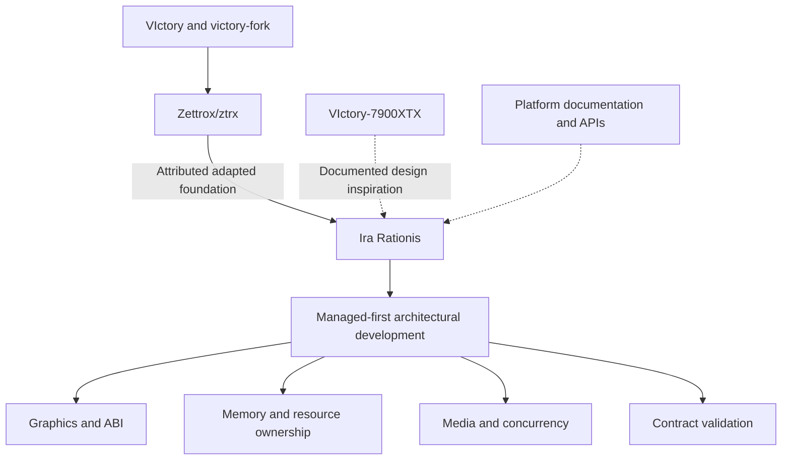
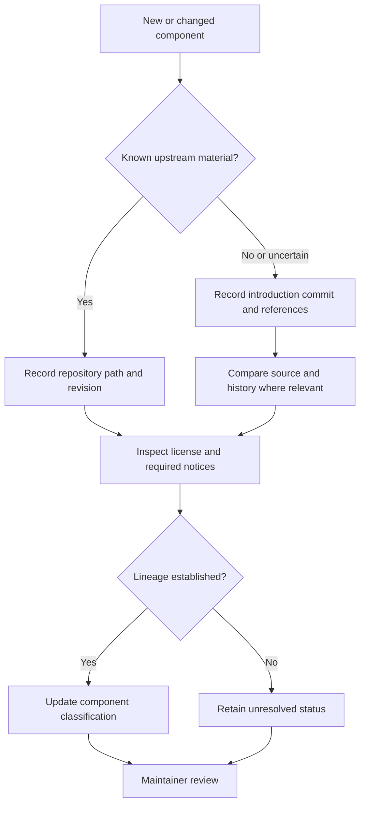

# Ira Rationis | Implementation Provenance

> Nullius in verba · Non impone opinionem

**Project:** Ira Rationis (IRX)  
**Historical review baseline:** [R52 / d188685](https://github.com/DBWilliamEngineering/IraRationis/commit/d18868543526c75005b12bad3fd1666037814340)<br>
**Source paths updated:** November 26, 2026, following component extraction and namespace organization.<br>
**Status:** Maintainer review required; preliminary source-lineage inventory, not a complete copyright audit.

## 1. Purpose

This document records the relationship between Ira Rationis, its upstream foundations, and its subsequent architectural development. It distinguishes code ancestry from architectural direction, and technical references from incorporated implementations.

IRX is an independently evolving, managed-first native compatibility runtime targeting Windows x64. It incorporates attributed upstream work and pursues its own subsystem design, engineering methodology, and implementation strategy. It does not claim to be a clean-room implementation or to have independently authored every component from inception.

## 2. Upstream ancestry and references

| Project | Relationship | Evidence / notes |
| --- | --- | --- |
| [Zettrox/ztrx](https://github.com/Zettrox/ztrx) | Adapted upstream foundation | IRX's README identifies upstream reference tree `90b529f878a470fec9bf07b7be316bc769a12232`. Exact file-level lineage remains to be audited. |
| [DexNom/VIctory](https://github.com/DexNom/VIctory) | Upstream ancestry and technical reference | Preserve inherited notices and applicable licensing obligations. |
| [fxceless/victory-fork](https://github.com/fxceless/victory-fork) | Upstream ancestry and technical reference | Direct versus inherited incorporation must be determined at file level. |
| [avatarmanz/VIctory-7900XTX](https://github.com/avatarmanz/VIctory-7900XTX) | Architectural reference | R43, R48 and R49 notes document inspiration from resource publication, deferred preparation and transfer queues. R48/R49 notes report independent implementations rather than copied reference code; this has not been independently audited. |
| [Belobug/VIctory-Belobug-AMD](https://github.com/Belobug/VIctory-Belobug-AMD) | Technical reference | Supplied by the maintainer for investigating critical compatibility and performance issues. No implementation from this repository was incorporated in the component-restructure change. This entry is not an audit of either repository. |
| [trustno1-coder/VIctory-NVIDIA](https://github.com/trustno1-coder/VIctory-NVIDIA) | Technical reference | Published DLSS, frame generation and performance reporting inform benchmark design. |
| [BCPack format specification](https://github.com/Tim0219800/bcpack-decoder/blob/main/docs/SPEC.md), [Microsoft Silicon-rANS](https://github.com/microsoft/silicon-rans) | Format and validation references | Documented byte layout, frequency generation, lane scheduling and block semantics inform the C# BC1 implementation. Independently calculated integer frequencies were compared with the published RTL. |



Arrows describe documented relationships, not a verified file-by-file dependency or copyright graph.

## 3. Classification vocabulary

| Classification | Meaning |
| --- | --- |
| Inherited / adapted | Code derived from an upstream implementation, including translation or modification. |
| Mixed / unresolved | Component with possible upstream and IRX contributions; exact boundaries are not established. |
| Documented IRX extension | Functionality or architectural development evidenced in IRX history; does not by itself establish exclusive authorship or absence of upstream code. |
| Reference-inspired | Design informed by another project's documented approach; copying is not inferred from conceptual similarity. |
| External dependency | Third-party package, library, API or tool governed by its own applicable terms. |

## 4. Component-level provenance inventory

Paths follow the current component layout. Historical revision labels and commits identify the evidence available when a feature was introduced; source links do not turn historical execution claims into current test results. Classifications remain provisional unless supported by a completed source comparison.

| Component | Source | Current classification | Evidence / remaining audit |
| --- | --- | --- | --- |
| PE parsing and executable loading | [IraRationis.PE](../IraRationis.PE), [IraRationis.Loader](../IraRationis.Loader) | Mixed / unresolved | Compare against upstream loader, import binding and TLS implementations. |
| Native CPU and exception handling | [IraRationis.Native](../IraRationis.Native), [instruction handler](../IraRationis.Loader/Instructions/ConsoleInstructionHandler.cs) | Mixed / unresolved | Trace native bridge and subsequent instruction compatibility changes. |
| Platform HLE | [IraRationis.HLE](../IraRationis.HLE) | Mixed / unresolved | Audit module-level ancestry and ABI implementations. |
| Host import resolution | [HostPolicy.cs](../IraRationis.HLE/Runtime/HostPolicy.cs) | IRX implementation with inherited compatibility data | The new resolver separates exact names and module families, caches successful module loads, and uses documented Win32 name and ordinal lookup. The default module names retain their ztrx attribution. [Windows library loading](https://learn.microsoft.com/en-us/windows/win32/api/libloaderapi/nf-libloaderapi-loadlibraryexw) · [Export lookup](https://learn.microsoft.com/en-us/windows/win32/api/libloaderapi/nf-libloaderapi-getprocaddress) |
| Managed graphics and COM dispatch | [IraRationis.Graphics](../IraRationis.Graphics) | Adapted foundation / documented IRX development | Audit individual methods; managed architecture is documented in [architecture notes](architecture.md). |
| Compile-time ABI generation | [MissingGraphicsSlotGenerator.cs](../IraRationis.Generators/MissingGraphicsSlotGenerator.cs) | Documented IRX extension | Verify introduction commit and source lineage. |
| Virtual Unified Memory research | [VirtualPageTable.cs](../IraRationis.Memory/VirtualMemory/VirtualPageTable.cs), [MemoryProbe.cs](../IraRationis.Cli/Diagnostics/Memory/MemoryProbe.cs) | Documented IRX research extension | The managed D3D12 session carries forward the synthetic C++ benchmark. Verify the introduction commit for original ownership. |
| Shader inspection and lowering | [IraRationis.Shaders](../IraRationis.Shaders) | Mixed / unresolved | Audit parsers, instruction semantics and lowering implementations separately. |
| DirectStorage | [DirectStorageModule.cs](../IraRationis.HLE/Storage/DirectStorageModule.cs), [DirectStoragePayload.cs](../IraRationis.HLE/Storage/DirectStoragePayload.cs) | Mixed / documented IRX development | Trace queue and payload validation changes. |
| BC1 BCPack | [Storage/BcPack](../IraRationis.HLE/Storage/BcPack), [authored byte fixtures](../IraRationis.Runtime.Tests/Contracts/DirectStorageBcPackTests.cs) | Documented IRX development | Original managed implementation of the published format behavior. The verified built-in selector prefix is calculated directly. Other dictionary entries are optional local data that require independent validation. |
| Controller input | [DualSense provider](../IraRationis.HLE/Input/DualSenseProvider.cs), [input decoding](../IraRationis.HLE/Input/GameInputModule/DualSense.cs) | Documented IRX development | R30 documentation describes native wired DualSense integration; extraction preserves inherited notices. Verify source ancestry. |
| Audio and PCM | [IraRationis.Media](../IraRationis.Media), [PCM observation](../IraRationis.HLE/Audio/Apu/XApuModule/Pcm.cs) | Mixed / documented IRX development | Distinguish adapted APU/DSP behavior from host PCM contracts. The shared audio-local WaveFormat/WaveHeader types consolidate existing identical ABI layouts. |
| Media decoding | [MediaFoundationDecoder.cs](../IraRationis.Media/Decoding/MediaFoundationDecoder.cs) | Documented IRX extension | R37 commit and README record in-process Windows Media Foundation integration. |
| Persistent GPU media | [GpuMediaPlaybackSession.cs](../IraRationis.Media/Playback/GpuMediaPlaybackSession.cs), [Nv12Presenter.cs](../IraRationis.Graphics/Media/Nv12Presenter.cs) | Documented IRX development / reference-inspired | [Authored media service](../IraRationis.Cli/Media/RuntimeMediaSample.cs), [shared-device context](../IraRationis.Graphics/Media/MediaGpuContext.cs). |
| Host shader cache | [HostMediaShaderCache.cs](../IraRationis.Graphics/ConsoleGraphicsDevice/Media/HostMediaShaderCache.cs) | Documented IRX extension | [Host shader cache](../IraRationis.Graphics/ConsoleGraphicsDevice/Media/HostMediaShaderCache.cs). Host media bytecode, not general guest shader caching. |
| Deferred preparation | [DeferredPreparationQueue.cs](../IraRationis.Core/Scheduling/DeferredPreparationQueue.cs), [OrderedPreparation.cs](../IraRationis.Core/Scheduling/OrderedPreparation.cs) | Documented IRX extension / reference-inspired | [Deferred preparation](../IraRationis.Core/Scheduling/DeferredPreparationQueue.cs). General guest dispatcher integration not established. |
| Fence retirement | [FenceRetirementQueue.cs](../IraRationis.Core/Scheduling/FenceRetirementQueue.cs) | Documented IRX extension / reference-inspired | R48 notes identify a bounded owner-thread foundation. |
| Host media transfer queue | [Nv12Presenter.cs](../IraRationis.Graphics/Media/Nv12Presenter.cs) | Documented IRX extension / reference-inspired | Historical R49 notes describe the opt-in host media path. |
| Startup evidence and timing | [HostFrameTimeline.cs](../IraRationis.Media/Playback/HostFrameTimeline.cs), [GraphicsLogSampling.cs](../IraRationis.Graphics/Diagnostics/GraphicsLogSampling.cs) | Documented IRX extension | [Frame timeline](../IraRationis.Media/Playback/HostFrameTimeline.cs). Does not prove commercial title startup. |
| Versioned uploads | [VersionedUploadBuffer.cs](../IraRationis.Graphics/Resources/VersionedUploadBuffer.cs), [PitchedPlaneCopy.cs](../IraRationis.Graphics/Textures/PitchedPlaneCopy.cs) | Documented IRX extension | [Versioned uploads](../IraRationis.Graphics/Resources/VersionedUploadBuffer.cs). Explicitly written host buffers and independent probe. |
| Descriptor virtualization | [DescriptorBindingCatalog.cs](../IraRationis.Graphics/Descriptors/DescriptorBindingCatalog.cs), [DescriptorTableCache.cs](../IraRationis.Graphics/Descriptors/DescriptorTableCache.cs) | Documented IRX extension | [Descriptor tables](../IraRationis.Graphics/Descriptors/DescriptorTableCache.cs). Independent authored host compute fixture; guest descriptor integration not established. |
| Component contract testing | [Startup evidence](../tests/startup-evidence), [Versioned uploads](../tests/versioned-upload), [Descriptor bindings](../tests/descriptor-bindings) | Documented IRX development | Project names now identify behavior rather than release number. Existing fixture provenance and historical diagnostic markers remain. |
| Physical-view index | [MappedViewIndex](../IraRationis.HLE/Memory/MappedViewIndex.cs), [mapping owner](../IraRationis.HLE/Memory/PhysicalPageModule.cs) | Documented IRX extension / adapted owner | The C# range index replaces full-view scans while preserving the existing mapping owner's provenance. An independently added data structure does not change the lineage of surrounding adapted code. |
| Network diagnostics | [NetworkTraceSession](../IraRationis.Cli/Diagnostics/Network/NetworkTraceSession.cs), [export script](../scripts/Export-NetworkTrace.ps1) | Documented IRX extension | Managed control of Windows ETW providers; provider contracts come from platform documentation. No reference-project network implementation was incorporated in this change. |
| Build and release engineering | [GitHub Actions workflow](../.github/workflows/build.yml), [release procedure](RELEASING.md) | Documented IRX development | Audit inherited build files and third-party actions separately. |

## 5. Traceable architectural development

These commits evidence architectural evolution within IRX. Their existence does not establish that every changed line is independently authored, nor that a feature was successfully executed.

| Development | IRX commit |
| --- | --- |
| In-process media decoding and distribution | [149c56b](https://github.com/DBWilliamEngineering/IraRationis/commit/149c56be1bc588c92f58839b82544166f00040f8) |
| GPU NV12 upload and conversion | [5fe0b5c](https://github.com/DBWilliamEngineering/IraRationis/commit/5fe0b5c7db911712958c3d9896c3c264899fc370) |
| Native sample-driven media integration | [371b675](https://github.com/DBWilliamEngineering/IraRationis/commit/371b67561b1345cb1bfe773b71a71f065dadbc14) |
| Shared runtime/media device ownership | [6eb59ff](https://github.com/DBWilliamEngineering/IraRationis/commit/6eb59ffd6c9cd7db7fd5f07a32cc528a41d0244d) |
| Bounded parallel preparation | [8725bdd](https://github.com/DBWilliamEngineering/IraRationis/commit/8725bddc4277097cfcb8b0886621c02f76f84704) |
| Host shader compilation cache | [f481a12](https://github.com/DBWilliamEngineering/IraRationis/commit/f481a1207744a357e20d20b339e495553ed58722) |
| Deferred preparation and retirement | [52d2cee](https://github.com/DBWilliamEngineering/IraRationis/commit/52d2ceebd751f0b69b64e2053435fb5cd84cf76e) |
| Asynchronous host texture transfers | [7f12083](https://github.com/DBWilliamEngineering/IraRationis/commit/7f12083610f70b10a759b9698e204cdc29de34af) |
| Descriptor binding virtualization and fence-aware lifetime management | [d188685](https://github.com/DBWilliamEngineering/IraRationis/commit/d18868543526c75005b12bad3fd1666037814340) |

## 6. Licensing and attribution policy

- Preserve upstream copyright notices, license texts, and attribution for incorporated or adapted code.
- The repository README identifies the runtime as GPL-3.0-or-later; see [LICENSE](../LICENSE). Honor the obligations applicable to each incorporated component and distributed combined work.
- Separately designated independent proprietary material is governed by [LICENSE-PROPRIETARY.md](../LICENSE-PROPRIETARY.md) only where that designation is valid and does not conflict with GPL or third-party obligations.
- Third-party dependencies retain their respective licenses. Maintain a separate dependency/license inventory from the actual project references and package lock files.
- Do not treat a language translation, renamed symbol, formatting change, or architectural rewrite as automatic removal of upstream copyright obligations.
- Do not infer permission to redistribute commercial executable images, assets, credentials, or other proprietary title material from IRX's own source license.

## 7. Provenance review workflow



For each new component, record the introduction commit, upstream repository and revision if applicable, original file or symbol, nature of adaptation, applicable license, and supporting evidence. Record reference-only inspiration separately from incorporated code. Maintain the distinction between source provenance and behavioral validation.

Useful local inspection commands:

```powershell
git log --follow -- IraRationis.Graphics/Descriptors/DescriptorTableCache.cs
git log --follow -- IraRationis.Memory/VirtualMemory/VirtualPageTable.cs
git blame -- IraRationis.Generators/MissingGraphicsSlotGenerator.cs
git show d18868543526c75005b12bad3fd1666037814340 --stat
```

A first appearance in IRX history is not proof of independent authorship. Compare against pinned upstream source trees before marking a component independently authored.

## 8. Review boundaries

### Retiring inherited implementations

The November 27 baseline scan found 100 source files with matching Victory or ztrx port and adaptation notices. The count is an index for file-by-file review. Start with related clusters so an ABI change can be validated end to end. For each replacement, capture the existing behavior in fixtures, implement against the ABI and platform contracts, and record the lineage of any data it still uses. `HostPolicy.cs` is the first slice. Its new implementation preserves the existing module policy and uses a concurrent cache for successful loads, with serialization on cache misses. The default allowlist retains the original data attribution.

```powershell
rg -l '^(//|#) (Port of|Adapted from|Layout and addressing adapted from).*([Zz]ettrox|[Vv]ictory|[Zz]trx)' `
    -g '*.cs' -g '*.cpp' -g '*.h' -g '*.ps1'
git log --follow -- IraRationis.HLE/Runtime/HostPolicy.cs
```

Start new IRX file headers with plain `/*` and end with `*/`. Include `@file`, `@description`, `@author Damon William`, and the original `@date` in ISO format. Add `@details` for a meaningful ownership, ordering, or numerical contract. Use the [BC1 decoder header](../IraRationis.HLE/Storage/BcPack/BcPackBc1Decoder.cs) as an example. File-level license terms follow the applicable repository notices. A separate library with independent ownership and distribution can have separately documented terms. Review how it would be used and distributed with the existing runtime before making a restrictive designation. [Repository license](../LICENSE) · [Proprietary material scope](../LICENSE-PROPRIETARY.md) · [SPDX identifiers](https://spdx.dev/learn/handling-license-info/)

This inventory is based on the R52 repository tree, selected source files, revision notes, commit summaries, and existing attribution statements. No complete upstream diff, dependency license audit, or independent authorship verification has been performed. Unresolved classifications must remain visible until the maintainer completes that review.

The current layout update preserves those provisional classifications and adds the physical-view index and network diagnostics. File moves, semantic renames, and extraction into top-level classes do not establish new authorship. Replacing earlier ported implementations should retain contract tests, record the replacement design and references, and keep notices applicable to any derived implementation that remains. The maintainer's successful local build is behavioral evidence about compilation, not a provenance audit.

See also [Architecture and Research](architecture.md), [Architecture Atlas](ARCHITECTURE-ATLAS.md), and [Architectural Divergence](ARCHITECTURAL-DIVERGENCE.md). Retired release-specific notes remain in Git history; current subsystem behavior belongs in topic documents and source contracts.
