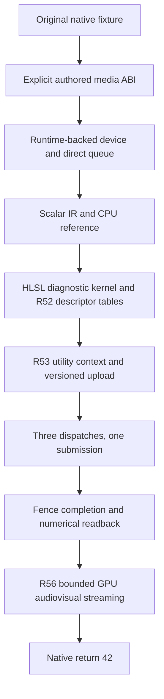

# R58-R62 combined integration slice

Baseline: `2a073bb8597573da491413c0edcdef1f3e440d79` (R57).

## Implementation and scope

This single patch joins several existing subsystems in the original native media fixture's opt-in runtime service. It does not complete the five proposed general compatibility releases. It does not modify user/account state, entitlements, title assets, guest shader bindings, or guest media APIs.

| Roadmap | Delivered in this slice | Outstanding |
|---|---|---|
| R58 | Stage timings for scalar decode/lowering, compilation, recording, and completion; optional matched authored media wall-clock comparison | CPU hot-path profiling, root cause of prior FPS regression and measured recovery |
| R59 | CPU reference executor for existing scalar IR; existing HLSL diagnostic lowering now dispatched on D3D12 and compared with reference | New opcodes, control flow, wave semantics, vertex/pixel stages, general guest shader/pipeline translation |
| R60 | R52 resource catalog and descriptor cache used by the authored runtime service; A/B/A table binding and numerical readback | General guest root signatures and descriptors, texture descriptors and alias coherence |
| R61 | R53 versioned upload and completion-owned utility context; three GPU dispatches in one command list, one submission, one completion wait | Nonblocking guest scheduling, cross-queue synchronization, resource-state tracking, general GPU coherence |
| R62 | Scalar batch precedes R56 streaming playback in the same runtime-backed device/queue context; same native fixture exit contract | Guest media interfaces, complete audio mixing/routing, interactive application and account lifecycle |

## Data flow



## Ownership and synchronization

- The authored kernel operates on 102 uint scalar registers plus SCC. Only the existing supported scalar instruction subset is accepted; invalid/unsupported code is rejected. No new instruction encoding is claimed.
- Input A and B have distinct untouched register values. The CPU reference and known constants provide independent checks of the generated HLSL. Each dispatch clears its output first and copies it to a separate readback region, so a skipped dispatch cannot inherit the preceding result. Three dispatches verify 309 words (1,236 bytes).
- The diagnostic HLSL uses typed R32_UINT buffers for this backend. Its original structured-buffer form is preserved for existing callers. Only the two known generated declarations are adapted.
- A single host upload resource contains a 256-byte constant range, two 412-byte input ranges and a 412-byte zero range. The two distinct descriptor tables are materialized once. A is bound twice while its lease is active in the same recording. Private logical ordinals 1 and 2 are collected only after the actual completion fence wait succeeds; they are not native fence values.
- The native output buffer transitions COMMON -> COPY_DEST -> UAV -> COPY_SOURCE -> COMMON for each dispatch. Readback stays COPY_DEST and upload stays GENERIC_READ. The utility context is retired only after confirmed completion. The existing fail-fast rule for unknown submitted work remains in effect.
- No new dependency or test project. The opt-in `IRX_SAMPLE_SCALAR_BATCH=1` applies only to the existing explicitly registered authored streaming sample service. The default path is unchanged. Both workloads share the context's runtime device and queue; the context's existing `presenterAcquisitions` counter also includes the additional compute queue/device acquisition during this opt-in run.

## Validation

Run `Apply-R58-R62.ps1 -Validate` from the repository root. FFmpeg is resolved from PATH. Requires Windows, .NET SDK 11, MSVC x64 build tools, an available audio endpoint and D3D12. Keep the playback window visible. The validation script uses only a locally generated test pattern and synthetic sine wave, and never launches an arbitrary executable as a guest.

Expected: existing graphics-probe succeeds, normal authored streaming exits 42, combined authored streaming exits 42, and combined output includes:

```text
[runtime] IRX-R58-62: scalarDispatches=3; tableMaterializations=2; submissions=1; completionWaits=1; ... readback=verified.
[media] IRX-R56: decoded=60; presented=60; skipped=0; cancelled=False; audioSeconds=2.000; queueCapacity=4.
Title entry returned 42 (0x0000002A).
```

The optional `-BaselineExe` argument accepts a trusted local previous IraRationis CLI build. It measures elapsed process time on the same original media fixture with scalar batching disabled. Three paired runs produce a median, not a gameplay FPS measurement. The fixed 30 Hz playback workload is not suitable for estimating maximum rendering throughput. Do not compare the compute-enabled run to the media-only run as a performance regression test.

Windows compilation and GPU execution are pending. The patch has been checked against complete hash-matched source files; it is not a fully built or GPU-validated release. No FPS recovery, commercial title boot, intro playback, account selection, or game menu milestone is claimed.
