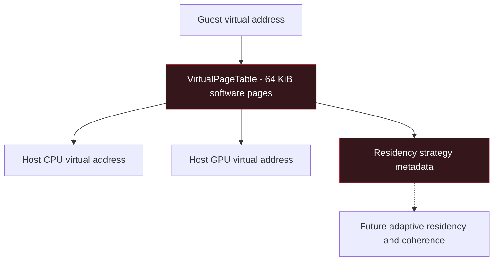
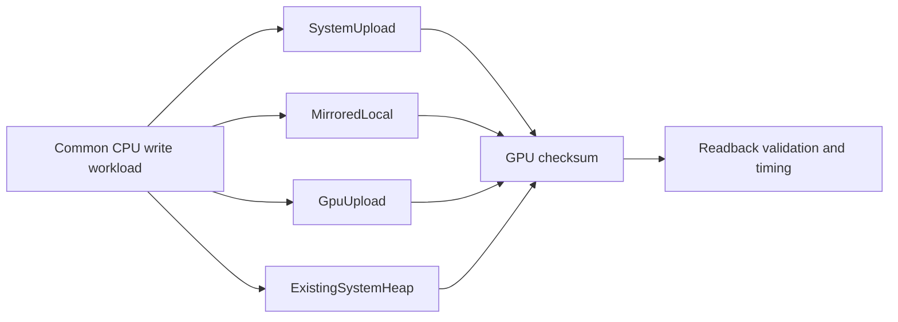
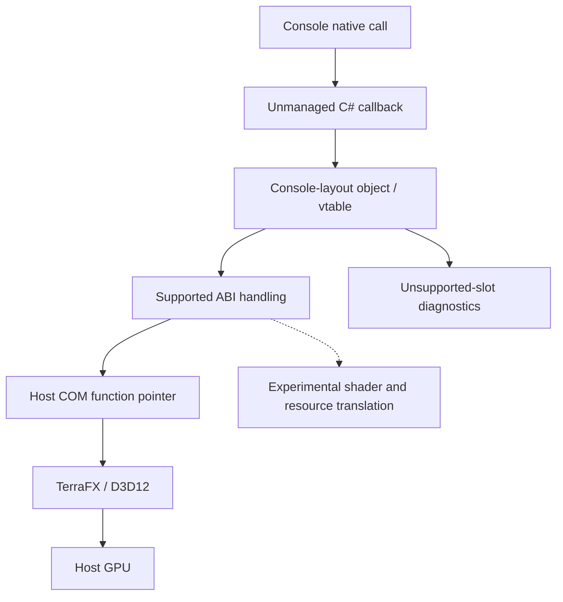
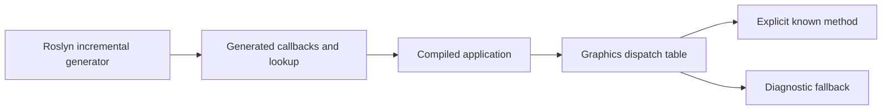
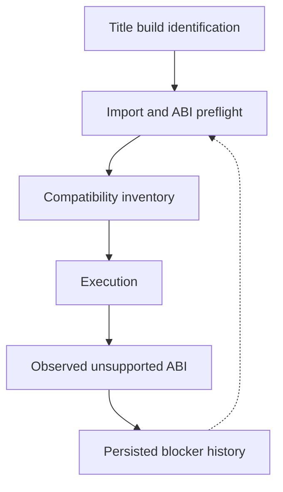

# IRX architecture and research

Vindex / First Light. Source inventory reviewed 2026-11-25. These are conceptual diagrams; implemented source is not equivalent to tested behavior. Research extensions are IRX-specific relative to the referenced upstream, not claims of worldwide novelty.

## Virtual unified memory (isolated research)

[VirtualPageTable](../IraRationis.Memory/VirtualPageTable.cs) supports map, translate and unmap. It does not modify hardware page tables or transparently intercept native accesses. It remains separate from title allocation and GPU submission.

Four backing strategies use a common checksum workload. Existing-system-memory heaps and GPU upload depend on hardware and driver support. No title performance advantage has been established.

## Managed graphics ABI

Source: [Graphics](../IraRationis.Graphics). Separate console and host layouts, explicit unmanaged calls and direct COM dispatch. Newer source includes host resource materialization, pipeline metadata, texture computer interfaces, query heaps and host DXR capability detection. Guest ray tracing, complete shader translation, coherence and original frame presentation are not established.

## Build-time ABI fallbacks

[Generator](../IraRationis.Generators/MissingGraphicsSlotGenerator.cs). Build-time generation avoids shipping Roslyn as a runtime dependency. Known ABI registrations remain explicit.

## Build-aware compatibility diagnostics

This describes the diagnostic workflow reported in the existing README, not a complete static call graph. Compare logs against the exact code revision before attributing any runtime result.

## Validation boundary

Maintainer-reported Debug/JIT execution reached partial graphics initialization. Synthetic probes are not title rendering. Keep original frame, intro, menu, gameplay and Native AOT claims separate until reproduced. The latest repository source was not compiled or executed during this documentation review.
