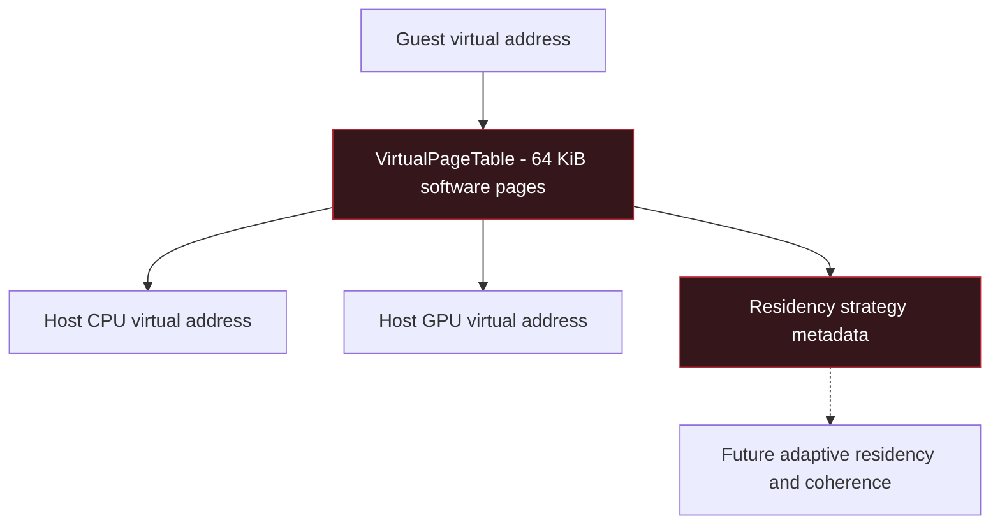
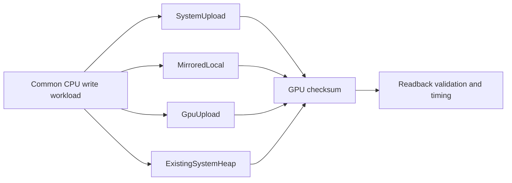
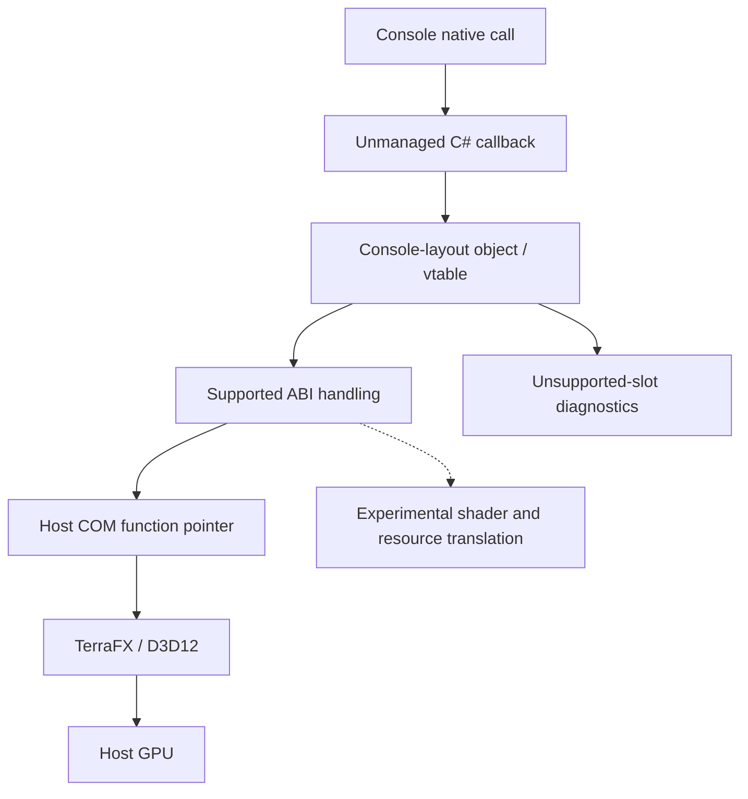
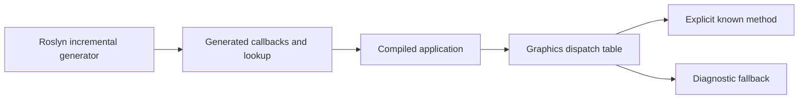
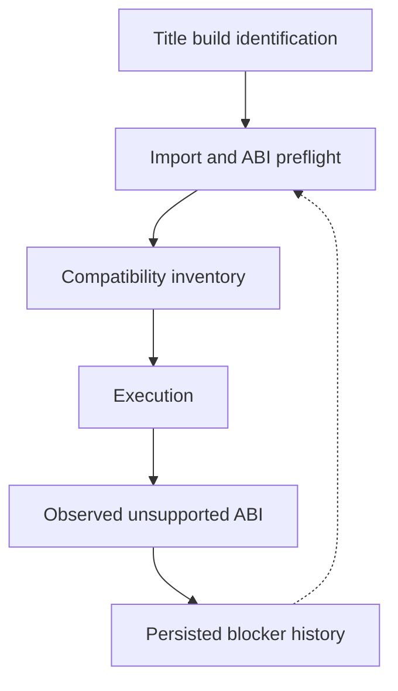

# IRX architecture and research

Vindex / First Light. Source organization reviewed November 26, 2026. These are conceptual diagrams; implemented source is not equivalent to tested behavior. Research extensions describe IRX's development direction, not claims of worldwide novelty.

## Component ownership

Production code is grouped by responsibility and namespace. Data types live beneath the component that owns their contract, such as `HLE/Input/Models`, `Graphics/Descriptors/Models`, and `Media/Audio/Models`. Shared abstractions require a concrete cross-component responsibility; there is no catch-all model library. Authored types are top-level and have individual files. The partial `ConsoleGraphicsDevice` facade retains its public type identity while its source files are grouped by graphics responsibility.

Extraction makes dependencies visible but does not automatically remove them. Internal members shared with extracted behavior classes remain explicit review boundaries. Preserve native field layout and resource lifetime when simplifying those relationships. Prefer descriptive names, bounded ownership, and clear control flow; code metrics support design review but do not replace it.

The [architecture atlas](ARCHITECTURE-ATLAS.md) provides subsystem diagrams. [Runtime integration](RUNTIME-INTEGRATION.md) describes utility-context and authored-sample integration, while [diagnostics](DIAGNOSTICS.md) covers startup and performance evidence.

## Virtual unified memory (isolated research)

[VirtualPageTable](../IraRationis.Memory/VirtualMemory/VirtualPageTable.cs) supports map, translate and unmap. It does not modify hardware page tables or transparently intercept native accesses. It remains separate from title allocation and GPU submission.

Four backing strategies use a common checksum workload. Existing-system-memory heaps and GPU upload depend on hardware and driver support. No title performance advantage has been established.

Production physical mappings use [MappedViewIndex](../IraRationis.HLE/Memory/MappedViewIndex.cs) to find overlapping views and resolve aliases by contiguous portions. Its owner, [PhysicalPageModule](../IraRationis.HLE/Memory/PhysicalPageModule.cs), retains synchronization and section-handle ownership. Range lookup is O(log n + k) for n views and k overlaps; Windows mapping work and index updates add their own costs.

This index is not a CPU/GPU coherence manager. [VersionedUploadBuffer](../IraRationis.Graphics/Resources/VersionedUploadBuffer.cs) tracks explicit writes to an owned host buffer, not arbitrary guest-pointer writes or physical aliases. Broader VRAM residency requires those observations and fence-safe eviction. The current host materialization budget is 512 MiB with a 256 MiB resource limit.

## Managed graphics ABI

Source: [Graphics](../IraRationis.Graphics). Separate console and host layouts, explicit unmanaged calls and direct COM dispatch. Source includes host resource materialization, pipeline metadata, texture computer interfaces, query heaps and host DXR capability detection. The maintainer has reported recognizable guest UI rendering; that does not establish complete shader translation, guest ray tracing, coherent resources, or playable gameplay.

## Build-time ABI fallbacks

[Generator](../IraRationis.Generators/MissingGraphicsSlotGenerator.cs). Build-time generation avoids shipping Roslyn as a runtime dependency. Known ABI registrations remain explicit.

## Build-aware compatibility diagnostics

This describes the diagnostic workflow reported in the existing README, not a complete static call graph. Compare logs against the exact code revision before attributing any runtime result.

## Validation boundary

Host adaptation begins with C# [capability snapshots](../IraRationis.Core/Hardware/HardwareCapabilityProbe.cs): runtime-usable SIMD, effective processors, physical-memory availability, and GC memory budget are distinct facts. GPU capability/budget capture uses the adapter already selected by host graphics initialization. These snapshots do not themselves create parallel preparation work or change residency limits.

Instruction-emulation policy also lives in C#. The native VEH boundary accepts an explicit options structure and can opt into a fresh page query for each single-line CLZERO destination, falling back to the existing region validator. It does not retain permission caches or broaden private-only loop batching. The [diagnostic contract](DIAGNOSTICS.md#fresh-resident-page-validation) separates query counters, execution checks, and performance evidence.

On November 26, 2026, the maintainer supplied a successful local build and passing runtime component, startup-evidence, versioned-upload, descriptor-binding CPU, and strict/legacy raw/Zlib storage-contract results. The [validation record](RELEASING.md#local-build-and-component-checks) identifies the reported success markers. These local results were not independently rerun during this documentation update and do not establish GPU, game, performance, or CI acceptance. Original startup video/audio, account completion, main menu, and gameplay need their own evidence.
